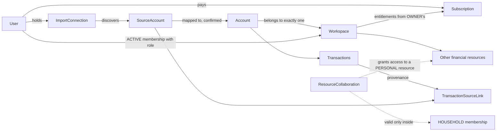
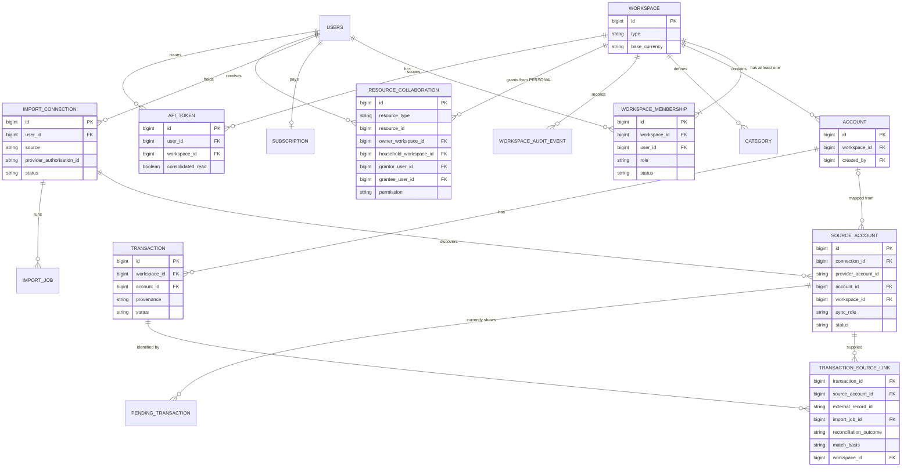
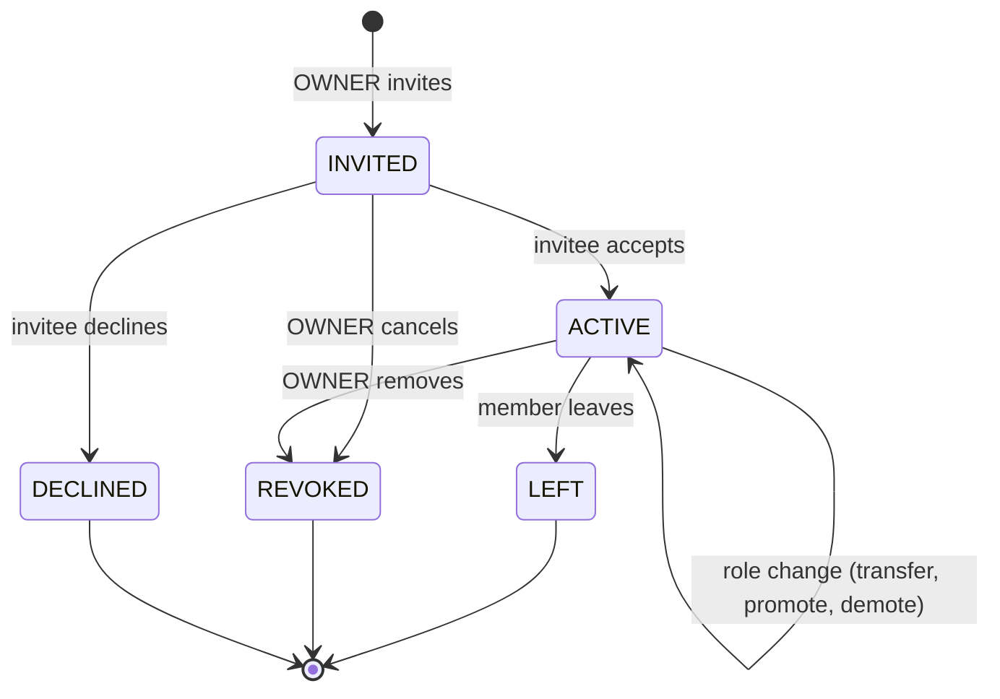
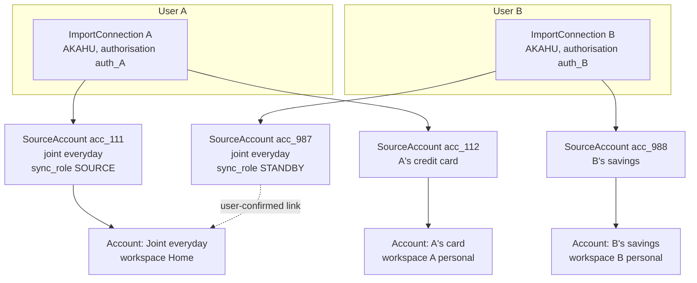
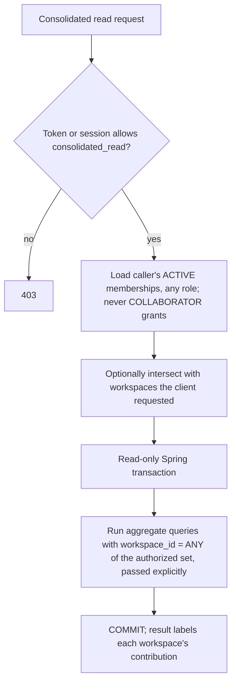
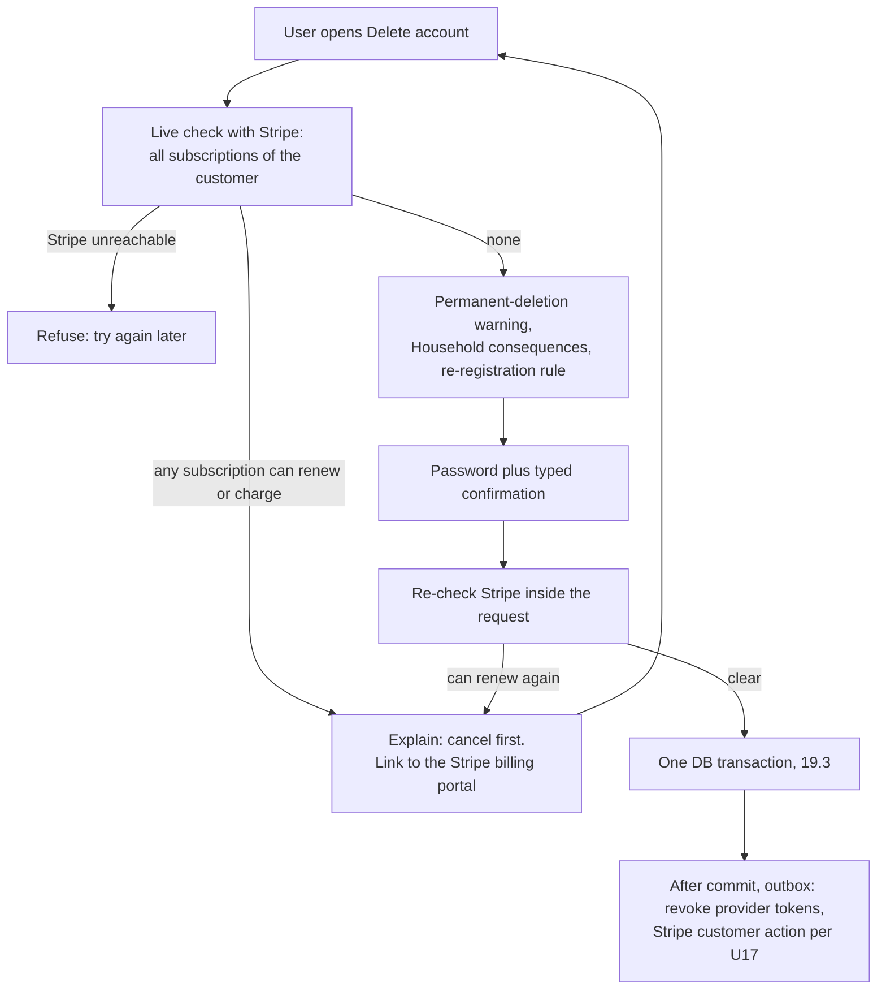
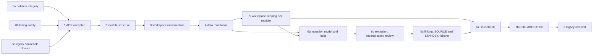
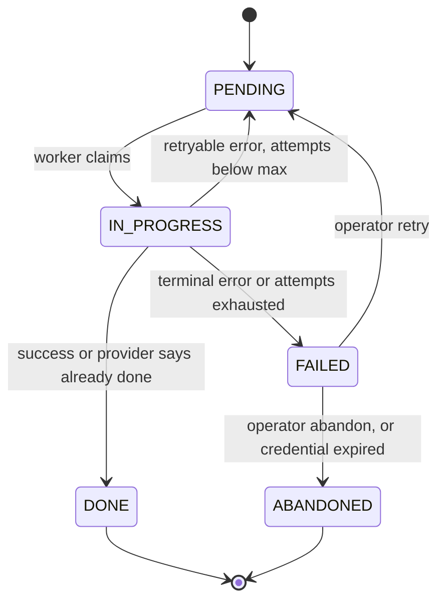

# ADR-001: Workspace tenancy, ownership and bank data ingestion

| Field | Value |
|---|---|
| Status | **Proposed** |
| Date | 2026-11-04; revised 2026-11-05 to incorporate the product decisions of three review rounds; revised 2026-11-15 for the code changes of PR #716 and the Spring Modulith epic #775 (section 4.8); independent review recorded in 28.3 and assessed in 28.4 (2026-11-15) |
| Deciders | Repository owner (product), backend maintainers |
| Supersedes | Nothing. Builds on the FOFI Architecture Assessment and the FOFI Tenancy and Ownership Decision (both 2026-11-04) |
| Reviews incorporated | [Section 24 review](ADR-001-section-24-review.md) (round 1), [E3 and E4 review](ADR-001-review-e3-e4.md) (round 2), [Deletion and billing review](ADR-001-review-deletion-billing.md) (round 3) |
| Scope | Modular monolith boundaries, tenancy and ownership of financial data, household collaboration, collaborator access to personal resources, consolidated reads, provider-agnostic ingestion, bank-feed identity and deduplication, entitlements, API/MCP authorization, application-layer isolation, migration, account deletion and billing |
| Out of scope | Business or adviser workspaces, workspace or household billing, collaboration outside a Household, microservices, message brokers |

---

## Executive summary

FOFI moves from **user-as-tenant** (`owner_id` on 50+ entities, plus a read-only household overlay) to **workspace-as-tenant**. Every user gets a PERSONAL workspace; a HOUSEHOLD is a second, shared workspace. Every financial row carries exactly one `workspace_id`; access is an ACTIVE membership with a role (OWNER or MEMBER; a VIEWER role is optional and undecided, section 24.3 U10). The **membership row with role OWNER is the only ownership authority**; there is no `workspace.owner_user_id`. A Household owns its resources; `created_by` is audit only and never an authorization input.

A PERSONAL resource never moves into a Household and is never duplicated. It can instead be shared with another member of the same Household through a **COLLABORATOR** grant (READ_ONLY or READ_WRITE), which changes no ownership and ends automatically when the membership ends.

When a Household OWNER deletes their account, or dissolves the Household, the Household and all its data are **deleted immediately**. There is no automatic transfer and no recovery window. An OWNER may instead transfer ownership, while the Household continues, to a MEMBER who holds an active PRO subscription.

Writes target exactly one workspace. A small, explicit set of **consolidated read** endpoints aggregate PERSONAL plus 100% of HOUSEHOLD across the workspaces the caller is an ACTIVE member of. They are computed live from the primary tables, inside read-only transactions, over an authorized set of workspaces computed by the application. There is no projection and no CQRS.

Ingestion is **provider-agnostic**: accounts and transactions belong to FOFI, and providers only supply information. Akahu personal is the only provider implemented now. Credentials stay with the user. Akahu's documentation states that each connected account belongs to a single Akahu user, so two partners connecting one joint account produce **two unrelated provider account ids and two unrelated sets of transaction ids**. FOFI therefore separates `import_connection` (user) → `source_account` (provider or file record) → `account` (internal, one workspace). Several source accounts may map to one internal account, and the link is **confirmed by a user**, never inferred automatically. Exactly one mapped live-feed source account per internal account is the **transaction source of record**; others supply balances and act as standby. Database uniqueness on `(source_account_id, external_record_id)`, `INSERT ... ON CONFLICT` and a per-account advisory lock make concurrent syncs safe. Deleting an imported transaction excludes it durably, so no later sync or re-import brings it back.

Subscriptions stay on the user. PRO is required to create and administer a Household; invited members need no plan. A user with a subscription that can still renew or charge must cancel it before deleting their account; deletion is then immediate and permanent, the remaining PRO period is forfeited without refund, and a later registration with the same email is a brand-new account. Tokens and MCP grants are scoped to one workspace, and unscoped tokens fail closed. The persisted `User.activeContext` stops being an authorization input. All authorization and multi-tenant isolation are implemented exclusively in Spring Boot: `CurrentWorkspace`, membership validation, an explicit `workspace_id` and mandatory workspace filters in every repository and service. PostgreSQL does not take part in authorization; RLS, removed in `V44`, stays out. The database keeps only integrity constraints such as foreign keys and unique keys.

The backend is a **Modular Monolith**: one deployable Spring Boot application made of business modules with explicit APIs, one-way dependencies and module-owned data, verified by Spring Modulith and ArchUnit (section 16). No microservices, brokers or independent deployments are introduced. The admin console stays a separate frontend over an `admin` module of the same backend.

**Phase 0 is mandatory and independent:** account deletion fails for household users, leaves billing and user data behind, does not stop Stripe billing, and lets a Stripe webhook re-create a deleted user's subscription. These are confirmed defects and must be fixed first.

---

## 1. Title and status

ADR-001, "Workspace tenancy, ownership and bank data ingestion". **Status: Proposed.** It becomes Accepted when the items listed under Phase 1 in section 25 are decided; every later pending item must be decided before the phase it blocks (section 28). Section 24 is the decision register and the only authoritative source of decision status: confirmed product decisions in 24.1, technical decisions in 24.2, pending product decisions in 24.3, pending technical decisions in 24.4. Nothing marked `PENDING` is approved, whatever it recommends.

## 2. Date and scope

Written 2026-11-04 against `master` at `5e67cf46`; revised 2026-11-05 with the confirmed decisions of the three review rounds. Repository paths are relative to `src/main/java/co/nz/lcichero/bankparser/` unless they start with `src/`, `docs/` or `frontend/`.

## 3. Context and problem statement

FOFI is a Spring Boot 4.1 / PostgreSQL / Next.js personal-finance application with Akahu bank feeds and an MCP server, used today by one couple and intended to become a commercial multi-tenant SaaS. The FOFI Architecture Assessment chose an enforced modular monolith with nine business modules. The FOFI Tenancy and Ownership Decision chose workspace tenancy. Neither settled:

- who is authoritative about workspace ownership, and what happens over a household's lifetime;
- how a user sees a consolidated financial position across personal and household workspaces without weakening isolation;
- how two partners can connect the same joint bank account through their own Akahu authorizations without duplicated accounts, transactions, balances or net worth;
- how a member can share a personal resource with a partner without moving or duplicating it;
- how requests, tokens and jobs establish workspace context without trusting a browser toggle;
- how to migrate real data and delete accounts safely, including accounts that hold a paid subscription.

This ADR decides each of those.

## 4. Existing architecture and verified repository findings

Re-verified on 2026-11-04, and again on 2026-11-15 after PR #716 and the Spring Modulith epic (#775). What changed since the first verification is summarized in 4.8; rows below carry their current status. Paths in this section are the ones the findings were made against; section 4.8 maps them to the current packages. Findings added by the review rounds are in 4.3, 4.4 and 4.7. The legacy Household data has since been deleted from production (section 24.1, U11); the legacy household code path still exists.

### 4.1 Ownership and tenancy

| # | Finding | Evidence | Status |
|---|---|---|---|
| F1 | `owner_id` means "the authenticated user" and is the isolation key for financial data **and** for identity-scoped data (subscription, API tokens, OAuth grants, feedback, Stripe customer) | Every `@Entity` with `private Long ownerId`, e.g. `account/Account.java`, `transaction/TransactionEntity.java`, `subscription/Subscription.java`, `user/ApiToken.java`, `connectors/stripe/StripeCustomer.java` | Implemented |
| F2 | `owner_id` is stamped by a trigger from `app.owner_id` when null | `src/main/resources/db/migration/V34__stamp_owner_id_from_session.sql`, `V35` | Implemented, active |
| F3 | Session variables `app.owner_id` and `app.active_context` are published per connection borrow (session scope, overwritten every borrow) and per transaction (`SET LOCAL`) | `security/OwnerSessionDataSource.java`, `security/OwnerSessionTransactionManager.java` | Implemented; RLS that consumed them was dropped in `V44` |
| F4 | RLS removed; isolation is application-layer only | `V44__drop_row_level_security.sql`; `security/DefaultAuthorizationService.java` | Implemented |
| F5 | App runs as non-superuser `bankparser_app`; migrations as `bankparser_migrate` | `V44` comments, `security/RuntimeDatabaseRoleCheck.java` | Implemented |
| F6 | External identity unique per owner: `(owner_id, source, source_ref)` on account and loan | `V33__scope_external_identity_by_owner.sql` | Implemented |
| F7 | Transaction uniqueness is `(owner_id, account, fit_id)`; `account` is the provider account reference string, separate from the `account_id` foreign key | `V60__widen_transaction_fit_id_uniqueness_to_account.sql` | Implemented |

### 4.2 Household overlay

| # | Finding | Evidence | Status |
|---|---|---|---|
| H1 | Tables `household(owner_id)`, `household_membership(household_id, household_owner_id, user_id, status, code, ...)`, `household_resource_share(household_id, resource_type, resource_id, permission)` | `V37__create_household_tables.sql`, `V42` | Implemented |
| H2 | One household per user (partial unique index), one non-transferable owner, `READ` only, shareable types `ACCOUNT` and `LOAN` | `V37`; `household/HouseholdResourceType.java`; `household/HouseholdSharePermission.java` | Implemented |
| H3 | Only the household owner can share, and only their own resources | `household/HouseholdService.java` `share()` | Implemented |
| H4 | Visibility depends on the persisted `User.activeContext` (MINE/HOUSEHOLD), read from the principal for every request **including API tokens, MCP and scheduled jobs** | `security/SecurityContextActiveContext.java`; `connectors/akahu/AkahuScheduledJob.runAsOwner` builds the principal from the stored user | Implemented |
| H5 | **Fixed (PR #716, 2026-11-08).** `requireOwned` let an active member in household view read and mutate the owner's unshared resources by id. Since #716 a member reaches only what is shared | `websecurity/DefaultAuthorizationService.java` (was `security/`); `src/test/java/co/nz/lcichero/bankparser/ledger/household/HouseholdUnsharedResourceAccessTest.java` (event read, event delete, receipt delete, dashboard delete) now passes | Fixed; tests kept as regression tests for COLLABORATOR |
| H6 | Root cause of H5: before `V44`, RLS filtered the row at `findById`, so the broad check never decided anything | Javadoc of `requireOwnedOrSpecificallyShared` | Regression from RLS removal |
| H7 | Household feature gated on the **owner's** plan, with minimum **PLUS** and member cap 4. The target is PRO (section 13) | `subscription/FeatureAccessService.java` javadoc; `V96__seed_plan_price_and_feature_config.sql` | Implemented; conflicts with Q8 |
| H8 | Legacy sharing allows only the household owner to share, `READ` only, accounts and loans only. The COLLABORATOR model (section 9.5) replaces it | `household/HouseholdService.share`, `household/HouseholdSharePermission.java` | Implemented; code present though the legacy Household data is deleted |
| H9 | Household members are read-only by design today; Q6 makes MEMBER a writer | `docs/plans/FEAT-002-HOUSEHOLD-SHARING.md` section 5 | Legacy |

### 4.3 Deletion and billing

| # | Finding | Evidence | Status |
|---|---|---|---|
| D1 | **Fixed (PR #716, 2026-11-08).** Deleting a household owner failed on `household_owner_id_fkey`, and a member on `household_membership_user_id_fkey`. The household rows are now erased in the deletion (step `HOUSEHOLDS`, `ledger/household/HouseholdEraser`): an owner takes their household, shares and every membership in it; a member takes only their own membership. Dissolution as a separate use case still does not exist | `AccountDeletionServiceTest` (`deleteAccountAsAdmin_householdOwner_...`, `..._householdMember_...`) | Fixed |
| D2 | **Fixed.** The `subscription` row is erased in the deletion (step `SUBSCRIPTION`, `subscription/SubscriptionEraser`) | `AccountDeletionServiceTest`, `deleteAccountAsAdmin_removesTheSubscription` | Fixed |
| D3 | **Partly fixed.** Transaction-attachment blobs, receipt photos (including the extra photos of a long receipt) and the uploaded avatar are now deleted through `AttachmentStorage` (step `STORED_FILES`). **Still not deleted and no cascade path, re-verified 2026-11-15:** `stripe_customer`, `beta_access`, `dashboard` (with `dashboard_component` and `dashboard_widget` by cascade), `saved_query`, `feedback_submission` (with `feedback_message` and `feedback_message_image` by cascade, and their image blobs), `balance_assertion` and `holding_transaction` (no FK at all), and `recurring_series` rows without `merchant_id` or `sub_category_id` | `security/ErasureStep.java` (no step for these tables); `V62`, `V65`, `V67`, `V81`, `V82`, `V88`, `V99`, `V106`, `V109`; [E3 review](ADR-001-review-e3-e4.md) section 1.2 | Partly confirmed open |
| D3b | Probable deletion failure: `holding.account_id` has an FK without cascade (`V92`), and the erasure still deletes accounts (step `ACCOUNTS`) before holdings (step `HOLDINGS`). The deletion test seeds no holding linked to an account, so it cannot catch it | `V92__add_account_id_to_holding.sql`; `security/ErasureStep.java` order | Not yet tested |
| D3c | Extra receipt photos and feedback image blobs | `storage/impl/DbAttachmentStorage.java` | Unknown; needs a test |
| D4 | **Defect, confirmed by code reading:** no Stripe call exists anywhere except customer retrieve and create; an active paid Stripe subscription keeps billing after deletion. Cancellation happens only in the Stripe-hosted portal | `AccountDeletionService` has no Stripe dependency; `connectors/stripe/StripeBillingClient.java`; `StripeCheckoutService.createBillingPortalSession` | Confirmed |
| D5 | **Defect, confirmed by code reading:** `invoice.paid` re-creates a `subscription` row for a deleted owner id, because the owner is read from Stripe metadata `ownerId` and `upsertSubscription` never checks that the user exists | `connectors/stripe/StripeSubscriptionSyncService.handleInvoicePaid`, `upsertSubscription` | Confirmed |
| D6 | FOFI cannot tell whether a subscription will renew: `Subscription` stores plan, cycle, `expires_at`, source and `source_ref`, but not Stripe `status`, `cancel_at_period_end` or `cancel_at`; `active` and `trialing` are treated alike | `subscription/Subscription.java`; `StripeSubscriptionSyncService.syncEntitledSubscription`, `isEntitledStatus`, `isEndedStatus` | Confirmed |
| D7 | Deletion has no subscription check in the API, the UI or the admin route; the confirmation copy says nothing about subscriptions or re-registration | `user/MeController.deleteAccount`; `AccountDeletionService.deleteAccount`, `deleteAccountAsAdmin`; `frontend/src/app/settings/page.tsx` (`handleDeleteAccount`) | Confirmed |
| D8 | The Akahu token is never revoked remotely; deletion and disconnect remove local rows only | `userAkahuConnectionRepository.deleteByUserId`; `AkahuConnectionService.disconnect`; `AkahuApiClient` has no revoke call | Confirmed |
| D9 | Already compliant with P3: entitlements are keyed by user id, never by email (`subscription.owner_id` unique, `V93`); user ids come from a sequence and are never reused; checkout for a new account creates a new Stripe customer and never searches Stripe by email (`StripeBillingClient.ensureCustomer`) | Code reading | Confirmed |

### 4.4 Akahu integration

| # | Finding | Evidence | Status |
|---|---|---|---|
| A1 | One connection per user: `user_akahu_connection(user_id, app_token, encrypted_user_token, last_sync_*)`. Each user supplies their own app token, the shape of an Akahu **personal app** | `connectors/akahu/UserAkahuConnection.java`, `AkahuConnectionService.connect` | Implemented |
| A2 | `akahu_account(id, external_id, owner_id, ...)` keyed `findByOwnerIdAndExternalId`; the internal account is upserted by `(owner_id, "AKAHU", akahu _id)` | `AkahuService.syncAccounts`, `account/AccountService.upsertFromConnector` | Implemented. Same bank account via two users = two internal accounts |
| A3 | Settled transactions use Akahu `_id` as `fit_id`; amount parsed from `Double` | `connectors/akahu/mapper/AkahuTransactionMapper.java`, `model/AkahuTransaction.java` | Implemented |
| A4 | Pending transactions get **synthetic** ids from `date + amount + cleaned description` (+ index), and are later reconciled to settled ones by date, amount and fuzzy description | `service/TransactionImporterService.assignSyntheticIdsForPendings`, `reconcilePendingWithConfirmed` | Implemented; contrary to Akahu's guidance (section 10) |
| A5 | Dedupe is application-level check-then-insert, backed by the `(owner_id, account, fit_id)` unique index | `TransactionImporterService.findExistingFitIdAccountPairs` | Implemented |
| A6 | Settled transactions removed or re-issued by the provider are not handled; only stale pendings are deleted | `TransactionImporterService.syncPendingTransactions` is the only delete path | Gap |
| A7 | `_migrated` is parsed but never used | `model/AkahuTransaction.java`; no other reference | Gap |
| A8 | No Akahu webhooks; polling every 5 minutes (08:00 to 00:59 NZ) over a 1-month window; refresh hourly | `AkahuScheduledJob` | Implemented |
| A9 | No lock around a user's sync; jobs call `LocalDate.now()` directly, against the `Clock` rule in `docs/ai/architecture.md` section 7 | `AkahuScheduledJob.runImportJob` | Implemented |
| A10 | The connector writes loan tables directly | `AkahuService.syncLoanFromAkahu` imports `LoanRepository`, `LoanBalanceSnapshotRepository`, `LoanInterestPeriodRepository` | Implemented; breaks `docs/ai/architecture.md` section 4 |
| A11 | No run-level lock: a manual sync (`POST /api/akahu/accounts/sync`, `GET /api/akahu/import`) can overlap the scheduled job; a second replica would run the job twice. Two overlapping imports of the same connection make the second one hit the unique index and roll back entirely | `connectors/akahu/AkahuController.java`, `AkahuScheduledJob` | Inferred from code, not tested |
| A12 | `AkahuService.syncAccounts` is not `@Transactional`; a failure mid-loop leaves a partial account sync of individually idempotent upserts | `connectors/akahu/AkahuService.java` | Implemented |
| A13 | Deleting an imported transaction is a hard delete; its javadoc says a re-sync "will simply recreate" it. Single delete allows synced rows while bulk delete refuses them | `transaction/TransactionService.deleteById`, `bulkDelete` | Implemented; conflicts with Q6 |
| A14 | A CSV imported onto a bank-fed account gets content-hash `fit_id`s that never equal Akahu `trans_` ids, so overlapping rows import as duplicates; the duplicate preview compares `fit_id`s only | `fileimport/FileImportService.java`, `fileimport/ConfigurableCsvParser.java`, `UploadControllerDuplicatePreviewTest` | Inferred, not tested |
| A15 | Provider vocabulary inside the domain: `transaction.fit_id` holds Akahu `trans_` ids, `transaction.account` the provider account reference, `Account.source/sourceRef` and `Loan.source/sourceRef` carry `"AKAHU"` and `acc_` ids | `transaction/TransactionEntity.java`, `account/Account.java`, `loan/Loan.java` | Implemented; conflicts with Q7 |
| A16 | The `bank-feed` feature is PLUS-gated **per user** with a linked-account cap of 3; the scheduled job skips users without it, so an invited FREE member cannot connect a bank at all | `V97__seed_bank_feed_feature_config.sql`; `AkahuService.exceedsLinkedAccountCap`; `AkahuScheduledJob.forEachConnectedUser` | Implemented; see U7 and U8 |

### 4.5 Other surfaces

| # | Finding | Evidence |
|---|---|---|
| O1 | Attachments are stored in the database (`attachment_blob`, random UUID key), not object storage; no signed URLs | `storage/impl/DbAttachmentStorage.java` |
| O2 | No application caching (`@Cacheable` absent) | Repository search |
| O3 | FQL scopes each query table by owner in Java | `queryexplorer/query/*QueryTable.java`, `QueryExecutionEngine.java` |
| O4 | Few domain events: synchronous, same-transaction `@EventListener`s were introduced by #775 for two inversions only (`user.UserRegistered`, `ledger.merchant.MerchantDeleting`). No `@TransactionalEventListener`, no event publication registry | Repository search |
| O5 | Frontend never sends owner ids; 8 components read the context toggle | `frontend/src/lib/types.ts`, component search |

### 4.6 Discrepancies with earlier documents

- `AGENTS.md` says Flyway is at `V1` to `V32`; it is at `V150`.
- `docs/ai/security.md` describes household widening for "six v1 data tables plus categories and budget envelopes". In code, the broad `requireOwned` widening reaches every service that calls it (H5), which neither document describes.
- `docs/ai/architecture.md` section 5 says the ledger is "driven by events"; it is driven by direct calls (FOFI Architecture Assessment).
- `AGENTS.md` says the tests run on H2 in memory; `pom.xml` runs them on PostgreSQL through Testcontainers (AS-4).
- `docs/ai/architecture.md` section 3 says the service must not re-implement owner scoping "which the database owns"; since `V44` the database owns nothing about scoping (NO-RLS).
- **Resolved 2026-11-15:** `docs/ai/architecture.md` section 2 used to forbid moving existing features into feature packages (DEBT-013). The Spring Modulith epic (#775) did the move; DEBT-013 is closed and the document describes the module layout as the only one.
- **Resolved 2026-11-15:** the root package used to mix layer packages and features with no module APIs. Every top-level package is now a declared Spring Modulith module, verified on the whole application (section 4.8, 16.0). `AdminMetricsRepository` still reaches other modules' tables through string JPQL, which Spring Modulith cannot see (16.7).

These documents are updated in Phase 1, after acceptance; until then this ADR wins where they disagree with it.

### 4.7 Decision-to-code conflicts

Every confirmed decision in section 24.1 that the current code contradicts. All are addressed by the phases in section 25.

| # | Decision | Current code | Finding |
|---|---|---|---|
| X1 | Q1, Q2, U1 (dissolve and erase) | No dissolution use case. Deleting a household user works since #716, but it erases the legacy household tables, not a workspace | D1 |
| X2 | Q1, Q2, P2 (nothing survives deletion) | Several tables survive (D3); the subscription row and stored files no longer do | D3, D3b |
| X3 | P1, P2 (billing must stop; no entitlement after deletion) | No Stripe check before deletion; webhooks re-create the subscription row | D4, D5, D6, D7 |
| X4 | Q6 (deleted imports never reappear) | Hard delete; re-sync recreates | A13 |
| X5 | Q6 (one delete rule) | Single delete allowed for synced rows, bulk delete refused | A13 |
| X6 | Q6 (OWNER and MEMBER edit and delete Household data) | Writes authorized by `owner_id == currentUser` | F1, H9 |
| X7 | Q7 (provider-agnostic domain) | Akahu ids in domain columns; connector writes loan tables | A10, A15 |
| X8 | Q7 (no duplicates across sources) | CSV over a feed duplicates; two partners create two accounts | A2, A14 |
| X9 | Q7 (no descriptive-only identity) | Synthetic pending ids and fuzzy merges of money rows | A4 |
| X10 | Q8 (PRO for a Household) | `household` minimum PLUS | H7 |
| X11 | Q8 (invited members need no plan) | Bank feed gated per user on PLUS | A16 (see U7) |
| X12 | COLLABORATOR | Legacy owner-only, read-only sharing | H8 |
| X13 | Explicit workspace context for jobs (D-14) | Akahu job impersonates the user with their persisted `activeContext` | H4 |
| X14 | Concurrency safety (D-11) | No run lock | A11 |

### 4.8 Changes since 2026-11-05

The code moved on after the review rounds. None of these changes alters a product decision in section 24.1.

**PR #716 (2026-11-08):** fixed H5 (a household member reaches only what is shared) and D1 (deleting a household owner or member works).

**Spring Modulith epic #775 (PRs #776 to #789, 2026-11-15):** every top-level package is a declared Spring Modulith module, and `ModularityTest` runs `ApplicationModules.detectViolations()` on the whole application with no filter, searches cycles itself without Modulith's cap of 100, and fails if a top-level package has no `@ApplicationModule`. What that did to the structure this ADR plans:

| Area | Before | Now | Effect on this ADR |
|---|---|---|---|
| Core money concepts | `account/`, `transaction/`, `category/`, `loan/`, `merchant/`, `recurring/`, `household/` in one cycle | One `ledger` module: `ledger.account`, `ledger.transaction`, `ledger.category`, `ledger.loan`, `ledger.merchant`, `ledger.recurring`, `ledger.household`, each a named interface | Replaces the Records, Classification and Wealth (loans) split of 16.1 for these packages (D-40, section 16.0) |
| Transaction parts | `transactionattachment/`, `transactionassociation/`, `importhistory/` | `ledger.transaction.attachment`, `.association`, `.importhistory`, named interfaces | Part of the ledger |
| Layer packages | `controller/`, `service/`, `dto/`, `specification/`, `categorizer/` | Dissolved into their owners; new feature modules `cashflow`, `recap`, `networth`; `api` holds `GlobalExceptionHandler` | Phase 2 "no class left in the old flat packages" is done |
| Security | `security/` held interfaces and the authentication wiring | `security/` holds only interfaces and small types with no dependencies (`CurrentUser`, `AuthorizationService`, `ActiveContext`, token scopes, `RunAsOwner`, `OwnedDataEraser`, `ErasureStep`); `websecurity/` holds the filters, `SecurityConfig`, `AppUserPrincipal`, `DefaultAuthorizationService` and the `SecurityContext*` classes | Appendix C paths updated |
| Account deletion | `AccountDeletionService` held 36 repositories of 20 modules | Each module implements `security.OwnedDataEraser` for its own tables; `security.ErasureStep` lists the 33 steps in foreign-key order; the service runs them in one transaction and deletes the user row last | Implements the eraser SPI of D-30, user-scoped; workspace erasers come with Phase 3 |
| Scheduled jobs | Each job copied a security-context block to run as a user | `security.RunAsOwner`, implemented in `websecurity`; the holding price job moved to `investment` | First step towards `WorkspaceTask` (D-14) |
| Inversions | Lower modules reached up | Interfaces in the lower module (`currency.BaseCurrencyConversion`, `institution.InstitutionUsage`, `ledger.account.LinkedHoldingsValue`) and synchronous events (`user.UserRegistered`, `ledger.merchant.MerchantDeleting`) | Matches AP-3 and 16.3 (SPI); the events are synchronous same-transaction listeners, not the after-commit registry of 16.3 |
| Receipts boundary | ArchUnit rule `GroceryModuleTest` | `receipt.ProductCatalog` is the `receipt :: product-catalog` named interface; Modulith enforces it | |
| Classpath | `spring-modulith-api` and `spring-modulith-starter-test` 2.1.2 (Boot 4.1) | Unchanged; no event publication registry | TD-3, AS-9 resolved |

## 5. Business and technical requirements

| ID | Requirement |
|---|---|
| R1 | Each person's financial data is private unless deliberately placed in a shared workspace |
| R2 | Partners can each contribute accounts to a household and, by role, edit shared data |
| R3 | A user sees a consolidated position (net worth, debt, cash flow) across all workspaces they belong to |
| R4 | Two partners connecting the same joint account produce one internal account and one set of transactions |
| R5 | Concurrent syncs never duplicate rows |
| R6 | Removing a connection never deletes financial history |
| R7 | A member leaving keeps their personal data; the Household and its resources continue for the remaining members |
| R8 | Account deletion, once allowed (R12), always succeeds and leaves no orphaned identity, billing or membership state |
| R9 | No request, token, job or query can read or write a workspace the actor is not authorized for. This is enforced in the application only and verified by boundary tests and a cross-tenant suite (section 15) |
| R10 | Migration preserves all existing data; phases up to 6 can be rolled back fully, and Household creation (Phase 7a) can be switched off (section 18.4) |
| R11 | Stays a modular monolith on the current infrastructure |
| R12 | Account deletion is refused while any subscription of the user can still renew or charge |
| R13 | No entitlement survives deletion, and none is ever restored from an email address, a Stripe customer id or account history |
| R14 | Providers only supply information; accounts and transactions belong to FOFI and never depend on a provider |
| R15 | A deleted imported transaction never reappears, whether through a later sync, a re-import or another source |
| R16 | Deleting the account of a Household OWNER, or dissolving a Household, deletes the Household and all its data immediately |
| R17 | A PERSONAL resource can be shared with a Household member without moving or duplicating it |

## 6. Architecture principles

These principles constrain every section of this ADR and every implementation phase. A design that breaks one of them is wrong even if it works. Each principle is recorded in the decision register (section 24) under the identifier in brackets; the register is the authoritative status source for every decision in this document.

| # | Principle |
|---|---|
| AP-1 | **Modular Monolith.** FOFI's backend is one deployable Spring Boot application made of independently understandable business modules (section 16). Modularity is achieved inside the process, never by splitting the backend into services. No service discovery, inter-service networking, message broker or independent deployment is introduced without a concrete requirement recorded in this ADR [D-24] |
| AP-2 | **Modules own their data.** Each table belongs to exactly one module. Only the owning module reads or writes it through its repositories. Other modules use the owner's published API, its events, or a read contribution it registers (section 16.3). Database foreign keys across module tables are allowed for integrity and are catalogued (section 16.2) [D-25] |
| AP-3 | **Dependencies point one way.** Module dependencies form a directed acyclic graph with the direction fixed in section 16.2. A lower module that must trigger behaviour in a higher one does so through an interface it defines and the higher module implements (SPI), or through an event [D-26] |
| AP-4 | **Application-only authorization (NO-RLS).** Tenant isolation and authorization are enforced exclusively in Spring Boot. PostgreSQL guarantees structural integrity (foreign keys, unique keys, `NOT NULL`, checks) and never decides who may read or write a row (section 15) [NO-RLS, D-15] |
| AP-5 | **Workspace is the tenant, and it is always explicit.** Every tenant-owned row has a `workspace_id`; every operation on tenant data runs with an explicit, validated `WorkspaceScope`; nothing is inferred from a browser toggle, a session variable or a default (sections 14, 15) [TEN, D-1, D-14] |
| AP-6 | **Providers supply facts; FOFI owns the records.** Accounts and transactions never depend on a provider; provider vocabulary stays inside its adapter (section 10) [Q7] |
| AP-7 | **Correctness by construction where possible, review where not.** Duplicates are prevented by database uniqueness and source-of-record rules, not by fuzzy matching. When FOFI cannot decide, it creates a review item and never silently drops or merges money rows (section 11) [D-10, D-11] |
| AP-8 | **One transaction per use case.** The application service that starts a use case owns its database transaction; cross-module calls inside it join that transaction. Reactions that do not need atomicity run after commit, idempotently (section 16.5) [D-27] |
| AP-9 | **External side effects never roll back the database.** Calls to Stripe, Akahu and other external systems after a state change go through a durable, retried outbox (section 19) [D-17] |
| AP-10 | **Deterministic and testable.** Time comes from the injected `Clock`; boundaries are verified by build-failing tests (section 16.7) [D-28] |

Product decisions are identified as in section 24.1 (TEN, Q1 to Q8, U1, U2, U4, U11, U15, COLLABORATOR, P1 to P4, NO-RLS). Technical decisions D-1 to D-39 are in section 24.2. Pending product decisions (`PD`, keeping their historical `U` and `CU` numbers) are in section 24.3 and pending technical decisions (`TD`) in section 24.4. Body sections link to those identifiers instead of restating their status.

## 7. Conceptual domain model



| Concept | Owner | Responsibility |
|---|---|---|
| User | Itself | Identity, credentials, preferences, tokens, import connections, subscription |
| Workspace | Its OWNER membership | Isolation boundary and container of financial data; money settings (base currency). A HOUSEHOLD owns its resources |
| WorkspaceMembership | Workspace | Who may act in the workspace and with which role; lifecycle of joining and leaving |
| ResourceCollaboration | The granting PERSONAL workspace | A COLLABORATOR grant on one PERSONAL resource to one Household member; access only, never ownership |
| ImportConnection | User | One provider authorization (Akahu now), or the user's file-import origin: tokens, sync state. Never workspace-owned |
| ImportJob | ImportConnection | One sync run or one file upload; provenance for the rows it produced |
| SourceAccount | ImportConnection | A provider or file account record as seen through one connection; its mapping and sync role |
| Account | Workspace | The real financial account inside FOFI; independent of any provider |
| TransactionSourceLink | Ingestion | Link between a source record and a canonical transaction, with its reconciliation outcome |
| Financial resources | Workspace | Transactions, loans, holdings, budgets, categories, goals, receipts, dashboards, snapshots |

The import source kinds are AKAHU, CSV, OFX and MANUAL now; others (an Akahu full app, Plaid) can be added later without changing the domain model (Q7).

## 8. Entity relationships and cardinalities



| Relationship | Cardinality | Enforced by |
|---|---|---|
| User to PERSONAL workspace | exactly 1 | Registration use case; partial unique index on membership `(user_id) WHERE workspace type PERSONAL` (via a denormalized `workspace_type` column on membership) |
| User to HOUSEHOLD workspace (ACTIVE or INVITED) | 0..1 | Partial unique index, same shape as today's `ux_household_membership_active_user` |
| Workspace to ACTIVE OWNER | exactly 1 | Partial unique index `(workspace_id) WHERE role = 'OWNER' AND status = 'ACTIVE'` plus a deferred constraint trigger that rejects commit with zero |
| PERSONAL workspace to members | exactly 1 (its OWNER) | Trigger rejecting a second membership on a PERSONAL workspace |
| Connection to user | exactly 1 | FK |
| Source account to connection | exactly 1 | FK, `UNIQUE (connection_id, provider_account_id)` |
| Source account to internal account | 0..1 | Nullable FK `(account_id, workspace_id)` |
| Internal account to source accounts | 0..n | None |
| Internal account to source-of-record source account | 0..1 | Partial unique index `(account_id) WHERE sync_role = 'SOURCE'` |
| Account to workspace | exactly 1 | `workspace_id NOT NULL` |
| Transaction to account | 0..1 (manual cash rows may have none) | Composite FK `(account_id, workspace_id)` to `account(id, workspace_id)` |
| Source record to FOFI transaction | at most 1 per source account | `UNIQUE (source_account_id, external_record_id)` |
| Collaboration grant to resource | exactly 1 PERSONAL resource, 1 grantee, 1 Household | `owner_workspace_id` must be PERSONAL; `household_workspace_id` must be HOUSEHOLD; membership validity checked per request (section 9.5) |

Why `source_account.workspace_id` exists although it is derivable: every repository query filters on it directly, and the composite FK guarantees it equals the mapped account's workspace. An unmapped source account always carries its connection user's PERSONAL workspace, so that it is visible to them and to no one else; mapping, unmapping and remapping change `account_id`, `workspace_id` and `sync_role` in one transaction (REV-7, 28.4).

## 9. Ownership and membership lifecycle

### 9.1 Ownership authority

`workspace_membership.role = 'OWNER'` is the single authority. A separate `workspace.owner_user_id` is **rejected**: it would need to be kept equal to the membership forever, and the current `household_owner_id` denormalization (`V37`) shows how such copies appear and then constrain design. Queries that need the owner join the membership through the partial unique index, which is one indexed lookup.

### 9.2 State model



A workspace has no lifecycle status. A HOUSEHOLD either exists or has been deleted; there is no dissolved, recovery or tombstone state (Q2), and no purge job. Operational backups and legally required retention follow their own lifecycle and are never a user-facing recovery path (Q2; legal retention is `PENDING`, U12).

### 9.3 Lifecycle cases

| # | Case | Behaviour | Transaction |
|---|---|---|---|
| L1 | OWNER leaves a Household with other ACTIVE members | Refused unless ownership is first transferred (L5) or the Household is dissolved (L6b). What happens when no member holds PRO, so no transfer is possible, is `PENDING` (U16) | None |
| L2 | OWNER deletes their FOFI account | Allowed only after the subscription check (D-18, section 19). The Household is **dissolved and all its data deleted** in the deletion transaction; no ownership transfer; every member loses access immediately; no member can recover, export or take over the Household (Q1). Their PERSONAL workspace is erased | Same transaction as the deletion (section 19) |
| L3 | MEMBER leaves | Membership becomes LEFT; access ends immediately. Their PERSONAL workspace is untouched. Household resources stay in the Household, including those they created; nothing is copied to them (Q4). COLLABORATOR grants that depend on this membership are deleted (9.5). What happens to their source accounts mapped into the Household is `PENDING` (U9) | Single transaction |
| L4 | OWNER is the only member and leaves | Treated as dissolution (L6b): the Household and its data are deleted immediately (U1) | Single transaction |
| L5 | Ownership transfer | Explicit use case `transferOwnership(workspaceId, toUserId)`: lock the workspace row (`SELECT ... FOR UPDATE`), verify the target is an ACTIVE MEMBER **with an active PRO subscription** (U2), demote the current OWNER to MEMBER, promote the target to OWNER, write an audit event. The previous OWNER may then stay as MEMBER or leave (L3). The partial unique index and deferred trigger guarantee exactly one OWNER at commit. Never automatic | Single transaction |
| L6 | OWNER no longer holds PRO | `PENDING` (U6, section 24.3) | Depends on U6 |
| L6b | OWNER dissolves the Household deliberately | Requires explicit confirmation. All memberships end, all COLLABORATOR grants scoped to the Household are deleted, and the Household and all its data are deleted immediately. PERSONAL data of every member is untouched (U1). What the confirmation lists and whether members are notified is `PENDING` (U3) | Single transaction |
| L7 | OWNER removes a member | Membership REVOKED; access ends on the next request because membership is checked per request; dependent COLLABORATOR grants deleted. Source-account mappings as L3 (U9) | Single transaction |
| L8 | PERSONAL workspace | Exists exactly as long as the user. Cannot be left, transferred or dissolved, and is never shared as a whole; individual resources in it can be shared only through COLLABORATOR (9.5). Erased only by account deletion | Part of deletion |
| L9 | MEMBER deletes their FOFI account | Allowed only after the subscription check (D-18). Membership ends; COLLABORATOR grants they gave or received are deleted; their import connections are deleted and revoked, so their source accounts stop feeding the Household and a remaining member's standby takes over where one exists (10.5). Household resources stay | Same transaction as the deletion (section 19) |

Departure never copies data (Q4). Whether a member may export Household data while ACTIVE is `PENDING` (U22). Under Q1 no export is possible once an OWNER has requested deletion.

### 9.4 Audit attribution

- `created_by BIGINT NULL REFERENCES users(id) ON DELETE SET NULL` on financial resources. Deletion of a user never blocks on history, and attribution simply becomes "a former member". `created_by` is never read for authorization (Q4, Q6); an ArchUnit rule bans it from authorization code.
- `workspace_audit_event(workspace_id, actor_user_id NULL ON DELETE SET NULL, actor_label, action, subject_type, subject_id, at)` for membership changes, transfers, grants, links and deletions. `actor_label` is a snapshot of a display name, cleared by the deletion use case (anonymization), so audit rows of surviving workspaces remain without personal data. Audit rows of a deleted Household are deleted with it (Q2).
- No other foreign key from a financial table to `users` is allowed. A test enforces it (section 26).

### 9.5 Collaborator access to PERSONAL resources

Confirmed rules (COLLABORATOR, U4):

| Rule | How it is expressed |
|---|---|
| A PERSONAL resource stays owned by its PERSONAL workspace | `workspace_id` never changes when a grant exists; nothing is moved or copied |
| Household resources belong to the Household | Unchanged |
| A grant gives access, never ownership | `resource_collaboration(resource_type, resource_id, owner_workspace_id, household_workspace_id, grantor_user_id, grantee_user_id, permission, granted_at)`; `permission` is READ_ONLY or READ_WRITE |
| Only between members of one Household | Valid only while grantor and grantee are both ACTIVE members of `household_workspace_id` and the grantor is OWNER of `owner_workspace_id`. Checked on every request, so revocation is immediate |
| Revoked when the membership ends | Leave, removal, dissolution and account deletion delete the dependent grants in the same transaction |
| No collaboration outside a Household | No grant without a shared ACTIVE Household membership |
| Not Household assets | Follows from Q5: a granted resource is not in the HOUSEHOLD workspace and not in the grantee's PERSONAL workspace, so it counts only in the grantor's PERSONAL and CONSOLIDATED figures (12.3) |

Technical design (not product decisions; proposed by this ADR): Identity and Access owns the table and the check; each module declares which of its resource types are grantable; a request on a granted resource runs in a **collaboration context** (section 14): an application service verifies membership, grant, resource and permission on every request and restricts its queries to the granted ids (section 15.2). The grantor can revoke their own grant at any time.

Open points, all `PENDING` (section 24.3): which resource types are grantable (CU1), what READ_WRITE allows (CU2), whether a READ_WRITE collaborator can read and use the grantor's PERSONAL categories (CU3), whether the Household OWNER can see and revoke grants between other members (CU4), how double counting is avoided when the same bank account would exist as PERSONAL and as HOUSEHOLD (CU5), and whether a VIEWER can receive READ_WRITE if VIEWER ships (CU6).

### 9.6 Household creation, invitations and lifecycle concurrency

- **Creation.** A user with active PRO who is in no Household creates one (D-3, Q8). The creator becomes OWNER. The base currency (U23), the starting taxonomy (U25) and the member cap (U26) are `PENDING`. The `HouseholdOwnershipPolicy` SPI (entitlements) performs the PRO check inside the creation transaction.
- **Invitations.** The OWNER invites by email or one-time code; an invitation is a membership row in INVITED state; it is claimed only by the verified email or the code (current rule). Expiry, the treatment of an invitee who already belongs to a Household, and re-invites are `PENDING` (U29). Pending invitations are deleted with the Household.
- **Concurrency (D-37).** Every membership change (invite, accept, decline, leave, remove, role change, transfer), every grant change and dissolution locks the `workspace` row with `SELECT ... FOR UPDATE` first, then re-reads the memberships it depends on. Account deletion locks the user row first, then each affected workspace in ascending id. Consequences: an invitation accepted concurrently with dissolution either completes before the dissolution (and is erased by it) or fails because the workspace no longer exists; two transfers serialize; a grant created concurrently with a member leaving either is revoked by the leave or fails its membership re-check.
- **Failure.** Every lifecycle use case is one transaction; on any failure nothing changes. Notifications (U3) are sent after commit and never roll back the change.

## 10. Provider-agnostic ingestion and source account identity

FOFI is provider-agnostic (Q7). Akahu is one data provider, not the base of the domain model. Four concepts stay separate: the **internal account** (one workspace, no provider dependency); the **import source** kind (AKAHU, CSV, OFX, MANUAL now; others later); the **import connection or job** (one authorization, file upload or sync run); and the **canonical transaction** (FOFI's, never owned by a provider). Provenance is kept for every canonical transaction: source, source account, external record id where available, import job, and reconciliation outcome. Deduplication never relies on a provider id being available or stable; where exact matching is impossible, FOFI flags the ambiguity for review instead of silently discarding data. Only Akahu personal is implemented now; the rules in 10.2 to 10.5 are provider-neutral, and 10.1 and 10.6 hold the Akahu adapter specifics.

### 10.1 Akahu adapter: what Akahu documents

| Question | Documented answer | Source |
|---|---|---|
| Connection identifier | `_authorisation` groups the accounts connected in one authorisation; random, not derived from credentials; differs per login. `_credentials` is deprecated | [The Account Model](https://developers.akahu.nz/docs/the-account-model) |
| Account identifier | `_id`, prefixed `acc_`, "a unique identifier for the account in the Akahu system" | [The Account Model](https://developers.akahu.nz/docs/the-account-model) |
| Same bank account across two users | Not stated for joint accounts. Stated generally: "Each connected account belongs to a single Akahu user"; classic credentials "can only be connected to one Akahu user" | [Best Practices](https://developers.akahu.nz/docs/best-practices) |
| Stable across reconnection | Not guaranteed. The official open-banking migration gives every account a **new** `_id` with `_migrated` pointing at the predecessor; users may add or drop accounts while re-authorising | [Migration](https://developers.akahu.nz/docs/official-open-banking-migration) |
| Stable across credential refresh | Not documented | None |
| Provider identifier independent of authorisation | None documented. The closest is `formatted_account`, a standardized account number "across connections" (`00-0000-0000000-00` for NZ bank accounts), **redacted for credit cards**, undefined for KiwiSaver and investments | [The Account Model](https://developers.akahu.nz/docs/the-account-model) |
| Holder information | `meta.holder` (may list several names for joint accounts) and `meta.has_unlisted_holders` (official open banking only); party data refreshed every 30 days; all `meta` optional | [The Account Model](https://developers.akahu.nz/docs/the-account-model) |
| Transaction identifier | `_id`, prefixed `trans_`, "stable, unique" by default; a small percentage get a **new** id when heavily modified by the bank (old one deleted); bank-removed transactions are removed | [Accessing Transactional Data](https://developers.akahu.nz/docs/accessing-transactional-data), [The Transaction Model](https://developers.akahu.nz/docs/the-transaction-model) |
| Transaction ids across connections | Not documented. Follows from "each connected account belongs to a single Akahu user": each user's account record has its own transactions | Inference |
| Pending transactions | "Not assigned a unique identifier", "liable to change significantly"; Akahu advises to delete and re-create the local copy on each query | [Accessing Transactional Data](https://developers.akahu.nz/docs/accessing-transactional-data) |
| History coverage | Consent date minus the app's history setting; personal apps 730 days; some institutions less; migration copies at most 1 year | Same, and [Migration](https://developers.akahu.nz/docs/official-open-banking-migration) |
| Account status | `INACTIVE` when credentials stop working; no refreshes until reconnected; revoked automatically after 400 days | [Accessing Account Data](https://developers.akahu.nz/docs/accessing-account-data) |
| Personal vs full app | Personal app: "1 user (restricted to your own Akahu account)"; full app for many users | [Personal Apps](https://developers.akahu.nz/docs/personal-apps) |
| Change notifications | Webhooks (`TRANSACTION`, `ACCOUNT`, `TOKEN:DELETE`, `MIGRATE` with `previous_item_id` and `new_item_id`) | [Best Practices](https://developers.akahu.nz/docs/best-practices), [Migration](https://developers.akahu.nz/docs/official-open-banking-migration) |

**Conclusions, labelled by confidence:**

- *Documented:* account and transaction ids are not guaranteed stable across re-authorisation or migration; pending transactions have no id; transactions can be re-issued under new ids or deleted.
- *Strong inference, not explicitly documented:* the same joint account connected by two partners yields two different `acc_` ids and two different sets of `trans_` ids. FOFI must not assume any shared identifier.
- *Unresolved (E1, E2, `PENDING`):* whether `formatted_account` is identical for both partners' records of a joint account in practice, whether transaction coverage differs between them, and whether `_authorisation` survives re-authorisation outside migration. **Resolve** with a controlled test on the repository owner's own joint account (both partners connected, compare `GET /accounts` and `GET /transactions` outputs), and by asking Akahu support (draft in [E3 and E4 review](ADR-001-review-e3-e4.md) section 3, not yet sent). Until resolved, the design does not depend on the answer, and a matching `formatted_account` stays a suggestion signal only, even if confirmed identical.

### 10.2 Model



### 10.3 Responsibilities

- **ImportConnection** (`import_connection`, replacing `user_akahu_connection`): `user_id`, `source` (AKAHU, CSV, OFX, MANUAL), `provider_authorisation_id` when available, encrypted tokens, status (ACTIVE, EXPIRED, REVOKED), sync checkpoints and errors. Only its user may sync, re-link, or delete it, whatever their workspace roles.
- **ImportJob** (`import_job`): one sync run or file upload of a connection, with start, end, outcome and counts. Generalizes today's `import_history`.
- **SourceAccount** (`source_account`, replacing `akahu_account`): `connection_id`, `provider_account_id` (for Akahu `acc_...`; for files, the import target), `predecessor_provider_account_id` (Akahu `_migrated`), name, type, `formatted_account`, holder snapshot, last balance, status (VISIBLE, NOT_RETURNED, INACTIVE), `account_id` (nullable), `workspace_id`, `sync_role` (SOURCE, STANDBY, IGNORED; live feeds only), last transaction checkpoint.
- **Account**: the internal account, owned by one workspace, independent of any connection. Its history never depends on a connection existing. Provider identity moves out of `Account.source/sourceRef` and `Loan.source/sourceRef` into source accounts (A15).

### 10.4 Linking

1. A newly discovered source account is **unmapped** and imports nothing until it is mapped. The connection's user sees it in a review list in their chosen workspace. Whether accounts with no link suggestion are mapped automatically to a new PERSONAL account, as today, is `PENDING` (U34).
2. The connection's user either creates a new internal account in a workspace where they hold a writing role, or links the source account to an existing internal account there. Who may map or unmap source accounts into a Household, and who may change the SOURCE, is `PENDING` (U5).
3. The system **suggests** an existing internal account only when a strong provider signal and the institution match an account in the same target workspace (for Akahu, the full, unredacted `formatted_account`). A suggestion is never applied without the user's confirmation. Redacted numbers, names, balances, last four digits and history similarity never produce a suggestion on their own.
4. The first linked live-feed source account becomes SOURCE; later ones become STANDBY.
5. Linking takes the account write lock (11.5), so two partners linking at the same moment cannot both become SOURCE (the partial unique index would reject the second anyway).
6. A link is audited. Unlinking (section 10.5) never deletes the account or its transactions.
7. A source account maps to at most one internal account. How to prevent the same real account from existing as both a PERSONAL and a HOUSEHOLD account is `PENDING` (CU5); until decided, the double-counting risk in 12.3 stands.

### 10.5 Connection lifecycle

| Event | Source accounts | Internal account and history |
|---|---|---|
| Connection expires (credentials stop working, accounts INACTIVE) | Status INACTIVE; no imports | Untouched. If it was SOURCE and a STANDBY exists with an ACTIVE connection, **failover** (section 11.4) |
| Connection revoked by the user or by the provider (Akahu `TOKEN:DELETE`, or after 400 days) | Status REVOKED; mappings kept for provenance, sync_role IGNORED | Untouched; failover if possible |
| User deletes their FOFI account | Connection deleted, provider token revoked through the outbox; their source accounts deleted | Accounts in their PERSONAL workspace erased. If they are a Household OWNER, the Household and its accounts are erased (Q1). If they are a MEMBER, Household accounts stay with the Household; failover to a remaining member's STANDBY if present |
| Connection's user leaves the Household | `PENDING` (U9) | Household accounts and history stay (Q4) |
| Account no longer returned by one connection | Status NOT_RETURNED after two consecutive syncs | Untouched; failover if it was SOURCE |
| The other user's connection stays active | Their STANDBY becomes SOURCE | Continues, one history |
| Both connections revoked | Both REVOKED | The account becomes a manual-style account with frozen history; the user can reconnect later and relink |
| User reconnects the provider | New connection; accounts matched to previous source accounts by the adapter's continuation signal (Akahu `_migrated`) if present, else shown as unmapped with suggestions per 10.4 | On relink, historical re-import goes through the same dedupe (section 11) |
| Account deliberately unlinked from a workspace | Mapping removed (`account_id` null), sync_role IGNORED | Untouched |

Four distinct operations, never conflated: revoke an authorisation; remove a source-account mapping; delete an internal account (explicit, cascades its transactions inside the workspace; who may do it in a Household is `PENDING`, U5); exclude imported transactions (explicit, per transaction or by undoing an import, section 11.7).

### 10.6 Akahu adapter specifics

`_migrated` handling: when an account arrives whose `_migrated` equals an existing source account's `provider_account_id` on the same connection, the existing row is updated in place (new id, predecessor recorded). No user action is needed, because it is the same authorisation's own continuation, documented by Akahu. `_authorisation` fills `provider_authorisation_id`. `formatted_account` is the only Akahu field that can produce a link suggestion (10.4). Whether FOFI moves from Akahu personal-app connections to an Akahu full app is a later decision: Q7 implements only Akahu personal now, and the model works for both.

## 11. Transaction deduplication and idempotency

### 11.1 Identity

- Every imported transaction has at least one `transaction_source_link(source_account_id, external_record_id, transaction_id, import_job_id, reconciliation_outcome, first_seen_at, last_seen_at)`, `UNIQUE (source_account_id, external_record_id)`. A FOFI transaction may have several links over its life (re-issued ids, failover re-observation, a file covering the same period), each pointing to the same `transaction.id`.
- Settled live-feed transaction: `external_record_id` is the provider's transaction id (Akahu `trans_`).
- File imports (CSV, OFX): each import target is a source account; `external_record_id` is the file's own id column where it has one. For rows without an id, the identity used to recognise a re-import of the same row is `PENDING` (TD-6).
- `reconciliation_outcome`: `NEW` (created a transaction), `MATCHED` (linked to an existing transaction), `AMBIGUOUS` (review item; no money row created yet), `USER_EXCLUDED` (the linked transaction was excluded, 11.7).
- Manual transactions have no source link.
- `date + amount + description` is never an identity. It is used only as described in 11.3 (annotation carry-over), 11.4 (overlap boundary review) and 11.8 (cross-source reconciliation), never on its own to decide whether a money row exists.
- Today's provider columns (`transaction.fit_id`, `transaction.account`) move into the links (A15) and stop being read for dedupe.

### 11.2 Why cross-connection duplicates cannot occur

Only the SOURCE source account of an internal account creates transactions. A STANDBY connection's transactions are not imported; its balance is recorded as a cross-check only. Two partners syncing concurrently therefore never both write transactions for the same internal account. This replaces a matching problem that provider identifiers cannot solve with a rule the database can enforce.

### 11.3 Pending transactions

Following Akahu's guidance, pendings move out of the `transaction` table into `pending_transaction(source_account_id, workspace_id, account_id, date, amount, description, payload, seen_at)`, owned by Ingestion and read by Money Records for display and running balances. Each sync of the SOURCE deletes and re-creates that source account's pending rows in one transaction. Pendings never count in budgets, reports or net worth unless a view explicitly includes "pending".

User annotations on a pending row (category, note) are stored keyed to the pending row and **carried over** to the settled transaction when a settled transaction for the same account appears with the same date, amount and a fuzzy-similar description. Carry-over only copies metadata; it never creates, deletes or merges money rows, so a wrong match costs a category, not a balance.

This changes current behaviour (A4): today a pending row becomes the settled row. Product impact is small (pendings still show), and it removes synthetic ids and fuzzy merges of money rows. Confirmation of this behaviour is `PENDING` (U36).

### 11.4 Lifecycle cases

> **(REV-1 revision 3):** DAY_COMPLETE auto-linking is disabled unless U39(a) is explicitly approved. Default: every failover overlap is an AMBIGUOUS review item; only tier-1 provider identity auto-links.

Transaction status: `ACTIVE`, `USER_EXCLUDED` (11.7), `REMOVED_BY_PROVIDER`. Every list, total, budget and report reads `ACTIVE` rows only.

| Case | Behaviour |
|---|---|
| New settled transaction | `INSERT` link and transaction; link conflict means already imported, skip. A link whose transaction is `USER_EXCLUDED` is also a skip |
| Provider updates a transaction (same id) | Update provider-owned fields (amount, description, date, merchant) on the existing row; user-owned fields (category, notes, splits) untouched; audit a change of amount |
| Provider re-issues under a new id (old one deleted) | Old id missing from the window: row marked `status = REMOVED_BY_PROVIDER` and excluded from totals; new id imported as new. A review item links the two when date and amount match, so the user can carry their category and splits over in one click. No automatic merge |
| Provider deletes a transaction | Within the fetched window, a link not returned for two consecutive syncs marks its transaction `REMOVED_BY_PROVIDER` (soft); never hard-deleted automatically |
| Reversal | A separate bank transaction; imported normally; refund linking stays a Money Records concern |
| Historical import on reconnect or relink | Same path; links prevent re-import from the same source account; a new source account (new ids) for an account that already has history uses the **overlap boundary** below |
| Failover (STANDBY becomes SOURCE) or relink with new ids | Overlap boundary: let `W` = the date of the last transaction from the previous source. Import the new source's transactions dated after `W` normally. For dates up to and including `W`, import nothing automatically; apply the matching contract of 28.4 (REV-1 revision 3): provider continuity links automatically; failover overlap is `AMBIGUOUS` by default. `DAY_COMPLETE` auto-linking is disabled unless U39(a) is explicitly approved; if enabled, it is heuristic, auditable and undoable. Per-day counts and sums are only a pre-check, never a basis for a link. A match against a `USER_EXCLUDED` transaction keeps it excluded |
| Akahu `_migrated` transactions | Link added for the new id against the transaction whose link equals `_migrated`; no new row |

Confirmation of the re-issue handling (review item, no automatic merge) is `PENDING` (U37). Removal detection follows D-34 (11.5).

### 11.5 Concurrency, transaction boundaries and recovery

> **(REV-1 revision 3):** Matching, user-confirmed review resolution and undo of any DAY_COMPLETE link (if U39(a) is ever approved) take the internal account write lock. A sync cannot use a stale mapping or a heuristic match to mutate a different canonical transaction; match_basis is persisted and checked on every update/removal.

```mermaid
sequenceDiagram
    participant J as Sync run (connection A)
    participant P as Provider API
    participant DB as PostgreSQL
    participant K as Sync run (connection B)
    J->>DB: acquire lease sync:connection:A (TD-5)
    J->>P: fetch accounts, transactions, pendings (no DB transaction open)
    K->>DB: acquire lease sync:connection:B
    K->>P: fetch
    J->>DB: BEGIN unit (WorkspaceTask Home, source account 7)
    J->>DB: pg_advisory_xact_lock(ACCOUNT, 42)
    K->>DB: BEGIN unit (source account 9)
    K->>DB: pg_advisory_xact_lock(ACCOUNT, 42) waits, lock_timeout 10 s
    J->>DB: rebuild pendings; upsert links and transactions; mark removals; move checkpoint
    J->>DB: COMMIT (lock released)
    K->>DB: lock acquired; source account 9 is STANDBY: balance cross-check only; COMMIT
    J->>DB: release lease
```

**Lock ownership, scope and release (D-31).**

| Lock | Key | Scope and lifetime | Acquired by | Timeout | Release |
|---|---|---|---|---|---|
| Connection run lease | `sync:connection:{id}` | One whole sync run of one connection, across provider calls | Scheduled job and manual sync alike | Lease expires after 15 minutes without renewal; renewed between units | Explicit release at the end of the run; on crash the lease expires |
| Account write lock | `pg_advisory_xact_lock(ACCOUNT_CLASS, account_id)` | One database transaction that writes one internal account's transactions, pendings, links, checkpoints, mappings or exclusions | Sync units, file import units, linking, unlinking, failover, exclusion, SOURCE changes | `SET LOCAL lock_timeout = '10s'` for that transaction; on timeout the unit rolls back and is retried on the next run (sync) or the user gets a retryable 409 (interactive) | Automatically at commit or rollback; never held across a network call |
| Workspace row lock | `SELECT ... FOR UPDATE` on `workspace` | Membership changes, transfer, dissolution, grant changes | Identity use cases | Default statement timeout | Commit |
| User row lock | `SELECT ... FOR UPDATE` on `users` | Account deletion | Deletion use case | Default | Commit |

Lock order, to prevent deadlocks: user row, then workspace rows in ascending id, then account locks in ascending account id. A unit that touches several accounts (a file import split across accounts, a transfer pair) takes account locks in ascending order. The lease is not a database lock and does not participate in the order. `SET LOCAL lock_timeout` is a session setting for lock waiting only; it carries no tenant or authorization meaning (NO-RLS).

**Transaction boundaries (D-32).**

1. A run acquires the connection lease. If it is held, a scheduled run skips the connection; a manual sync returns 409 "a sync is already running" and the frontend shows the running state.
2. Provider data is fetched with no database transaction open. Fetch failures end the run; nothing was written; the checkpoint is unchanged.
3. Each source account is a **unit**: one short transaction inside an explicit `WorkspaceTask` for the mapped account's workspace, taking that account's lock, then: rebuild pendings, insert links and transactions, update provider-changed transactions, mark removals, record the balance, move that source account's checkpoint. Commit.
3a. **Post-lock revalidation (REV-6).** After taking the account lock, the unit re-reads the source account's `account_id`, `workspace_id`, `sync_role` and status and checks that the connection's user is an ACTIVE member of that workspace. If anything differs from the state the run started with, it writes nothing and records `SKIPPED_STALE_MAPPING`.
4. A failure in one unit rolls back that unit only; earlier units stay committed; the run records a partial outcome on its `import_job` and continues with the next unit.
5. The run ends by recording the `import_job` outcome and releasing the lease.

**Idempotency.** Every unit is safe to repeat: links are unique on `(source_account_id, external_record_id)`; inserts use `INSERT ... ON CONFLICT DO NOTHING RETURNING`; the transaction row is inserted only when its link insert returned a row (link first with a deferred FK, or a CTE); pendings are rebuilt, not appended; removal marking is a state computed from two consecutive successful syncs; the fetch window (one month today) always overlaps the previous run, so a lost run is caught up by the next.

**Crash scenarios.**

| Crash point | State after | Recovery |
|---|---|---|
| During fetch | Nothing written | Next run, after the lease expires if the process died |
| Inside a unit before commit | Unit rolled back by PostgreSQL | Next run repeats the unit |
| After some units committed | Those units done, checkpoints moved for them only | Next run repeats the rest; overlap is absorbed by link uniqueness |
| Between link insert and transaction insert | Impossible after commit: both are in the same transaction | None needed |
| After commit, before lease release | Data consistent; lease held | Lease expires after 15 minutes |
| Duplicate job on a second instance | Second run cannot get the lease | Skips |

**Removal detection (D-34).** A link is a removal candidate only if its record date is inside the fetched window minus a 3-day margin at the window's old end, so records that merely fell out of the window are never marked. A candidate missing from two consecutive **successful** syncs of its source account marks its transaction `REMOVED_BY_PROVIDER`. A record that reappears later returns its transaction to `ACTIVE`, unless it is `USER_EXCLUDED`, which always wins.

**Money values (D-35).** Provider amounts are parsed into `BigDecimal` from the JSON text (no `Double` on the way, fixing A3) and stored with the account currency's scale. A transaction is never compared by amount after floating-point conversion.

**User-facing outcomes.** A sync that cannot get a lock or a lease shows "sync already running" or "will retry"; a partial run shows the accounts that failed and why; nothing is ever half-written for one account.

### 11.6 Uniqueness constraints

| Table | Constraint |
|---|---|
| `source_account` | `UNIQUE (connection_id, provider_account_id)`; partial `UNIQUE (account_id) WHERE sync_role = 'SOURCE'` |
| `transaction_source_link` | `UNIQUE (source_account_id, external_record_id)`; FK `(transaction_id, workspace_id)`; `transaction_id` nullable only while `reconciliation_outcome = 'AMBIGUOUS'` |
| `account` | `UNIQUE (id, workspace_id)` as composite FK target |
| `resource_collaboration` | `UNIQUE (resource_type, resource_id, grantee_user_id)` |
| `ingestion_review_item` | `UNIQUE (source_account_id, kind, subject_key) WHERE status = 'OPEN'` so a repeated run never duplicates an open item |

### 11.7 Durable exclusion of imported transactions

Deleting an imported transaction must never make it reappear (Q6). It becomes **exclusion**, not a row delete:

1. The canonical transaction gets `status = USER_EXCLUDED`, `excluded_by`, `excluded_at`. It disappears from every list, total, budget and report.
2. Its `transaction_source_link` rows stay. The next sync finds the link by `(source_account_id, external_record_id)` and does nothing, so the row cannot reappear.
3. A re-import of the same file row finds its link and does nothing.
4. The same bank transaction arriving through a different source (failover, another provider, a file) goes through reconciliation; a `MATCHED` result against an excluded transaction stays excluded.
5. Hard deletion of excluded rows happens only with the account, the workspace or the user. The model allows un-excluding a row while it exists; whether the UI offers a restore action is a UI choice, not decided here.
6. Manual transactions keep a real delete: they have no source to reappear from.
7. Single delete and bulk delete follow the same rule (fixes A13).

A separate tombstone table is rejected: the link already identifies the source record, so a status on the canonical row plus the kept link is one mechanism instead of two, and it survives provider id changes through the adapter's continuation handling (10.6).

### 11.8 Reconciliation across sources

> **(REV-1 revision 3):** Date/amount/description proposals never auto-link. DAY_COMPLETE is disabled unless U39(a) is explicitly approved; otherwise failover overlaps are review items.

Several sources may map to one internal account (Q7): a live feed, a CSV of the same account, a later second provider.

- **Coverage.** The covered range of a live-feed SOURCE source account is from the date of its earliest linked record to the date of its last successful sync. Ranges are stored per source account and recomputed at commit of each unit.
- **Rule.** Only the live-feed SOURCE creates transactions inside its covered range. A file or another source overlapping that range never auto-creates rows there. It follows the **matching contract** of 28.4 (REV-1 revision 3): a file or a different provider is tier 3, so it **never** links automatically inside a covered range; it proposes pairs (ordered by description similarity, which is a heuristic and never an identity) in `AMBIGUOUS_MATCH` items that the user confirms, one by one or in bulk. Amounts are compared only in the account currency as settled, never converted; different currencies never match. Anything it cannot match exactly becomes an `AMBIGUOUS` link with no transaction and an open review item (11.9). Rows outside every covered range import normally as `NEW`. No row is ever silently dropped. This fixes A14.
- **Known limitation.** Banks and files can date the same transaction differently (posting date against transaction date). Such rows will not match exactly and will arrive as review items instead of duplicates. The user resolves them; FOFI never guesses.
- **Re-imports.** A file row that already has a link on the same source account is skipped, whatever its outcome. The identity of rows without an id is `PENDING` (TD-6).

### 11.9 Review items

Every case where FOFI cannot decide becomes an `ingestion_review_item` owned by Ingestion (D-33).

| Kind | Created when | Resolution actions |
|---|---|---|
| `LINK_SUGGESTION` | A newly discovered source account matches an existing account by a strong provider signal (10.4) | Link; create a new account; ignore |
| `AMBIGUOUS_MATCH` | A file row or non-SOURCE record cannot be matched exactly inside a covered range (11.8) | Match to a chosen transaction; import as new; ignore |
| `PROVIDER_REISSUE` | A removed record and a new record share date and amount (11.4) | Carry category, notes and splits to the new transaction; dismiss |
| `FAILOVER_MISMATCH` | The overlap check after failover disagrees (11.4) | Per difference: match, import as new, ignore |

Columns: `id`, `workspace_id`, `source_account_id`, `kind`, `subject_key` (stable key of the record or pair), `payload`, `status` (OPEN, RESOLVED, DISMISSED), `resolved_by` (nullable, `ON DELETE SET NULL`), `resolved_at`, `created_at`. Resolving takes the account write lock. An open item never affects totals: AMBIGUOUS records have no transaction until resolved. Who may resolve items in a Household and what reminders exist is `PENDING` (U32). Review items are erased with their workspace.

### 11.10 Guarantees and limitations

| Guarantee | Basis |
|---|---|
| The same provider record on the same source account is imported at most once | Link uniqueness |
| Two connections of one joint account never both create transactions | One SOURCE per account (partial unique index) and the account lock |
| Concurrent runs, retries and crashes never duplicate or half-write | Lease, account lock, one transaction per unit, idempotent steps |
| An excluded transaction never reappears | Kept links and status precedence (11.7) |
| No money row is created from description similarity | Identity rules (11.1) |

| Limitation | User-facing outcome |
|---|---|
| Provider ids are scoped to one source account and may change on re-authorisation or migration; FOFI assumes no global uniqueness | Changes surface as `PROVIDER_REISSUE` or `FAILOVER_MISMATCH` review items |
| Two unlinked source accounts of the same real account are two accounts | The user sees a link suggestion only when a strong signal exists; otherwise the account appears twice until they link it |
| Records dated differently across sources do not match exactly | Review items, never duplicates |
| A wrong pending-to-settled carry-over copies the wrong category | The money row is correct; the user can recategorize |
| A bank change older than the fetch window is never seen | The transaction stays as last imported |

## 12. Consolidated cross-workspace read model

### 12.1 Decision

Consolidated reads are an **Insights** capability: `ConsolidatedReadService` exposing net worth, total debt, consolidated cash flow and summaries. They are computed **synchronously from the primary tables** with `workspace_id = ANY(:authorizedIds)`. No projection, materialized view or CQRS: data volumes per user are small, the queries already exist per workspace, and live computation has no freshness problem.

### 12.2 Authorization flow



- Membership is evaluated per request, so a removed member loses consolidated access immediately.
- `ConsolidatedReadService` exposes read methods only and runs in a read-only transaction; the authorized set is computed by Identity and Access and passed to every query as a parameter (section 15.2).
- The consolidated set is the workspaces where the caller is an ACTIVE member. Resources the caller can reach only through a COLLABORATOR grant are never part of it.

### 12.3 Figures and correctness across workspaces

Three distinct figures (Q5):

| Figure | Definition |
|---|---|
| PERSONAL | Resources in the user's PERSONAL workspace only |
| HOUSEHOLD | 100% of the resources in the HOUSEHOLD workspace |
| CONSOLIDATED | PERSONAL + 100% of HOUSEHOLD |

- Currency: each workspace has its base currency (D-39). How CONSOLIDATED is shown when PERSONAL and HOUSEHOLD currencies differ is `PENDING` (U24).
- No automatic 50/50 split and no configurable percentages. Both members see the full Household figure. Visibility is not a claim of economic ownership; ownership allocation is a possible future capability and is not modelled.
- A combined family report aggregates over the **distinct set of workspaces** involved and never sums two members' CONSOLIDATED figures, which would count the Household twice.
- A resource shared through COLLABORATOR counts only in its grantor's PERSONAL and CONSOLIDATED figures, never in HOUSEHOLD or in the grantee's figures (follows from the definitions above).
- Each resource has exactly one workspace, so the same row is never counted twice. **Open risk, `PENDING` (CU5):** the same real bank account could exist as two internal accounts, one PERSONAL and one HOUSEHOLD, if a user creates a Household account for a source that already feeds a personal one. CONSOLIDATED would then count it twice. This ADR does not resolve it; see 10.4 step 7.
- Transfers between a personal and a household account have one leg in each workspace. Each leg is categorized `TRANSFER` in its own workspace (`FinancialNature.TRANSFER` is already cash-flow neutral, `entity/FinancialNature.java`). Cross-workspace transfer *linking* is not supported (it would be a cross-workspace write); a read-only suggestion may be added later.

### 12.4 Migration of existing features

| Feature | Today | Target |
|---|---|---|
| Net worth (`service/NetWorthService.java`) | Owner or shared-account subset | Per workspace; plus consolidated variant |
| Cash flow (`service/CashflowService.java`) | Same | Per workspace; plus consolidated variant |
| Budget (`budget/BudgetService.java`) | Owner's envelopes, recomputed over shared accounts in household view | Per workspace only; budgets do not consolidate (confirmation `PENDING`, U35) |
| Month recap, forecast, insights | Personal only | Per workspace; consolidation later if asked |
| FQL (`queryexplorer/`) | Owner-scoped per table | Workspace-scoped through query tables contributed by each owning module (16.3); consolidated FQL not offered initially |
| Dashboards, saved queries | Per owner | Per workspace; sharing inside a Household per U27 |
| Coach | Per owner | Per workspace and user; privacy inside a Household per U28 |

## 13. Subscription and entitlement model

- `subscription` and `stripe_customer` stay keyed to the user (`user_id`, renamed from `owner_id`).
- `FeatureAccessService.resolve(workspaceId, feature)` resolves the workspace's OWNER (section 9.1) and uses that user's plan. PERSONAL workspaces trivially use their user's plan. The special case for households disappears.
- Entitlements are keyed only by user id. Subscription ownership and entitlement stay user-scoped; membership and authorization stay separate concepts (Q8).

### 13.1 Who needs which plan

Confirmed (Q8, U2):

| Capability | Plan required |
|---|---|
| Use one's PERSONAL workspace | None (FREE) |
| Create a Household | **PRO**. A FREE user cannot create one. The `household` feature minimum changes from PLUS to PRO (H7) |
| Administer a Household and invite others | The OWNER holds PRO |
| Take part in a Household as an invited member, by role | None; an invited member needs no plan |
| Give or receive a COLLABORATOR grant | No plan is named in any decision; membership of the Household is the only condition (D-20) |
| Receive ownership by transfer | The target holds an active PRO subscription (U2) |
| Connect a bank feed into one's PERSONAL workspace | The user's own plan, unchanged from today (`bank-feed`, PLUS minimum, A16) |

Still `PENDING` (section 24.3): bank feeds of FREE members into a Household (U7), linked-account caps (U8), the OWNER losing PRO (U6), the member cap (U26).

### 13.2 Events

| Event | Effect |
|---|---|
| Ownership transferred | Allowed only to a MEMBER with active PRO (U2), so the Household keeps a PRO OWNER |
| OWNER's subscription ends or drops below PRO | `PENDING` (U6) |
| OWNER deletes their account | The Household is deleted (Q1); no entitlement passes to anyone |
| A member leaves | No billing effect |
| A member has their own subscription | It applies to their PERSONAL workspace and to any workspace they own; it does not raise a Household they do not own |

Workspace or household billing is not introduced (Q8). Reason to revisit: a household plan priced per household, or adviser workspaces.

### 13.3 Subscriptions and account deletion

> **(REV-2 revision 3):** P1 is not yet verified. Deletion cannot pass step 4 until schedules, all invoice states/PaymentIntents and COMPLETE/unpaid asynchronous Checkout Sessions are neutralized and paginated (28.4.1). U42's prior residual-risk wording is superseded.

Confirmed (P1 to P4, U15):

- **P1.** Before deletion, FOFI checks whether any subscription will renew or charge again. If so, the user is told to cancel it first; cancellation must prevent any future renewal or charge. Once the cancellation is confirmed, the user may delete immediately, without waiting for the paid period to end. PRO and the remaining days are forfeited at once: no refund, no extension. FOFI does not cancel on the user's behalf in the normal path; the user cancels in the Stripe billing portal.
- **P2.** Deletion is permanent. The subscription association and the applicable billing data are removed, leaving nothing that could charge again. No PRO entitlement is kept for a future account.
- **P3.** A new registration, even with the same email, is a brand-new account: no previous subscription, remaining PRO days, data, history or settings. FOFI never restores entitlements from an email address, a Stripe customer id, previous subscriptions or account history. Today's code already complies (D9).
- **P4.** Before final confirmation, a clear warning that deletion is permanent and that a new registration starts from zero without the previous PRO or remaining paid period.

What counts as "can renew or charge again" (applies P1 to Stripe states):

| Stripe state | Blocks deletion? |
|---|---|
| `active`, `cancel_at_period_end = false`, no `cancel_at` | Yes: it renews |
| `trialing`, `cancel_at_period_end = false`, no `cancel_at` | Yes under the recommended reading of P1 (the trial converts into a charge); confirmation `PENDING` (U38) |
| `past_due` or `unpaid` | Yes: Stripe retries the charge |
| `incomplete` | Yes, until it resolves or expires |
| `active` or `trialing` with `cancel_at_period_end = true`, or `cancel_at` at or before the current period end | No |
| `canceled`, `incomplete_expired` | No |
| Local `MANUAL` subscription (comp, lifetime, admin grant) | No: nothing is charged; the entitlement is lost with the account |
| No subscription | No |
| `paused` | `PENDING` (U21). Today it is mapped to "ended" (`isEndedStatus`) |

Technical design (this ADR):

- The check is made **live** against Stripe at deletion time, listing **all** subscriptions of the customer (webhook lag and duplicate checkouts make local state insufficient). If Stripe cannot be reached, deletion is refused with a "try again" message (fail closed). It runs again inside the deletion request, before the deletion transaction, as part of the deletion protocol of 28.4 (REV-2 revision 3): mark the deletion, refuse new checkouts, neutralize all billing surfaces (subscriptions, schedules, sessions including async payments, invoices/PaymentIntents, pending invoice items and auto-advance), verify exhaustively, then **before** local erasure lock the user row, compare recorded webhooks, and erase. The detailed protocol remains blocked until provider behaviour is verified; corrections V2-1 to V2-7 (REV-2 revision 4) apply: schedules and subscriptions are cancelled with `invoice_now=false` and `prorate=false`, `uncollectible` invoices are voided, subscription checkout is card-only, and the post-lock comparison is state-based. No Stripe cleanup is left to the outbox in the normal path.
- `subscription` gains Stripe `status`, `cancel_at_period_end` and `cancel_at`, synced from webhooks, for display only (fixes D6).
- Every Stripe webhook handler ignores events whose owner id no longer exists and never creates or extends an entitlement for it (fixes D5). An event that would grant or renew access for a missing owner enqueues an immediate Stripe cancellation and raises an admin alert for manual refund review. This is defensive only, never part of the normal path.

Still `PENDING` (section 24.3): the Stripe customer after deletion (U17), admin deletion with a renewing subscription (U19), trial eligibility after re-registration (U20).

## 14. API, MCP and request context

| Channel | How the workspace is established | Rules |
|---|---|---|
| Browser | `X-Fofi-Workspace` header on every API call, set by the frontend from the workspace switcher | Validated against ACTIVE membership on every request; missing header on a workspace-scoped endpoint is 400; `User.activeContext` (renamed `lastWorkspaceId`) only preselects the switcher |
| REST API tokens | Token row carries `workspace_id NOT NULL` and `consolidated_read` | The header, if sent, must equal the token's workspace; a token can never act in another workspace |
| MCP (OAuth grant or token) | Grant carries `workspace_id NOT NULL`, chosen at consent time; `consolidated_read` optional | Tools run in that workspace; no tool switches workspace |
| Legacy tokens (before migration) | Backfilled to the user's PERSONAL workspace in Phase 3 | After Phase 3, a token without workspace scope is rejected (fail closed) |
| Scheduled jobs | Explicit `WorkspaceTask(workspaceId, actingUserId)` per unit of work | Replaces `AkahuScheduledJob.runAsOwner`, which today rebuilds the user's principal and inherits their browser toggle |
| Event listeners and async work | Event payload carries `workspaceId`; the listener opens its own transaction with that workspace | No thread-local propagation across threads; no inheritance from the publishing request |
| Internal service calls | Pass `WorkspaceScope` explicitly through module APIs | Modules never call `CurrentUser.require()` to decide tenancy |
| Collaboration context | A request on a resource granted to the caller targets the grantor's PERSONAL workspace and is authorized by an active `resource_collaboration` grant instead of a membership (9.5) | Limited to the granted resource ids and the grant's permission; READ_ONLY refuses writes; never usable for consolidated reads |

**Deletion/billing guard (REV-2 revisions 2–3).** While `users.deletion_requested_at` is set, refuse checkout creation, subscription creation/update, plan grants and any webhook that could create/extend an entitlement; webhook events are serialized/recorded against `deletion_attempt_id`. The Stripe neutralization/verification protocol is in 13.3/28.4.1; API-layer refusal alone does not neutralize already-created Stripe objects.

`CurrentWorkspace` (in Identity and Access) resolves `(userId, workspaceId, role, mode)` once per request in a filter after authentication, and publishes it to the security context. `mode` is `MEMBER`, `CONSOLIDATED_READ` or `COLLABORATION` (with the granted ids). It replaces `security/SecurityContextActiveContext.java` and the `ActiveContext` interface.

**Token authority (REV-3).** A token acts only in its own `workspace_id`. `consolidated_read` is an explicit read-only exception limited to `@ConsolidatedRead` endpoints over the caller's ACTIVE memberships evaluated per request; tokens never use the collaboration context; a token is refused entirely once its owner is no longer an ACTIVE member of its workspace. The full matrix is in 28.4.

**Endpoint scope (D-36).** Every controller method declares one of `@WorkspaceScoped` (needs a validated workspace or collaboration context), `@UserScoped` (identity-level data: profile, subscription, tokens, feedback, deletion; no workspace) or `@AdminScoped` (admin role, section 16.9). A test fails for any undeclared method. Bulk operations (bulk delete, bulk update, apply rule to selection) load every requested id with the workspace predicate and refuse the whole request with 404 if any id is missing, so a list of ids cannot reach another workspace. Attachment and receipt downloads resolve the owning entity in the workspace before serving the blob.

Account deletion endpoints (P1, P4): `GET /api/me/deletion-eligibility` returns `BLOCKED` or `CLEAR`, with the reason, the renewal date and the billing-portal link; `DELETE /api/me` re-checks live and returns 409 when blocked. The admin route's behaviour is `PENDING` (U19).


## 15. Isolation and authorization in the application (no RLS)

### 15.1 Rule

**All authorization and multi-tenant isolation are implemented exclusively in Spring Boot. PostgreSQL does not take part in authorization or access isolation** (decision NO-RLS, section 24.1). RLS was removed in `V44` and is not reintroduced. This ADR therefore uses no RLS policies, no `ENABLE` or `FORCE ROW LEVEL SECURITY`, no session variables for authorization (`app.workspace_id`, `app.read_workspace_ids` or any other), no `SET LOCAL` tenant context, and no database role, view, function or trigger that decides who may read or write a row. RLS is not replaced by any other database-side authorization mechanism.

The existing database role split (F5: `bankparser_app` at runtime, `bankparser_migrate` for migrations) is least-privilege infrastructure, not tenant authorization, and is unchanged. The existing `app.owner_id` session plumbing (F2, F3) only feeds the legacy `owner_id` stamping trigger; this ADR does not extend it, and it goes away with `owner_id` in Phase 8.

### 15.2 Application mechanisms

| Mechanism | Rule |
|---|---|
| `CurrentWorkspace` | Resolved once per request after authentication: `(userId, workspaceId, role, mode)`, validated against an ACTIVE membership, or against an active grant in collaboration mode (section 14) |
| Explicit workspace | Every module API takes a `WorkspaceScope` argument. Modules never derive tenancy from `CurrentUser` or from a database setting. Every tenant-owned row is written with an explicit `workspace_id` set by the application |
| Mandatory repository filters | Every repository method on tenant-owned data takes the workspace and filters by it (`findByIdAndWorkspaceId`, never a bare `findById` from a service). `JdbcTemplate`, native SQL and FQL build their predicate through one shared helper that requires a `WorkspaceScope` and refuses to run without it |
| Boundary tests | ArchUnit rules, extending today's `OwnerScopingBoundaryTest` and `UnscopedFindAllBoundaryTest`: no unscoped finder on a tenant-owned entity, no `findByOwnerId` and no `createdBy` in authorization code. A cross-tenant suite generated from the route list covers every endpoint and MCP tool |
| Roles and permissions | Checked in application services: OWNER and MEMBER write (Q6), only the OWNER administers; a VIEWER, if it ships, cannot write; only a connection's user may sync it |
| Consolidated reads | Identity and Access computes the authorized set (ACTIVE memberships only); `ConsolidatedReadService` passes it explicitly as `workspace_id = ANY(:ids)`, runs in a read-only Spring transaction and exposes no write method |
| Collaboration | An application service checks on every request that both users are ACTIVE members of the Household, that the grant exists, that the requested resource is the granted one, and that the operation fits the grant's permission. Queries in collaboration mode are restricted by the application to the granted resource ids |
| FQL and exports | Every FQL table is contributed by its owning module with the workspace predicate built in; unknown tables are refused; exports run per workspace |
| Admin and MCP | Admin uses `@AdminScoped` endpoints and admin-metrics APIs only (16.9); MCP tools run in the token's or grant's workspace and call module APIs only |
| Jobs and listeners | Run as an explicit `WorkspaceTask` or with the `workspaceId` from the event payload; a unit of work without one is refused by the application before any query |
| Identity tables | `users`, `workspace_membership`, `resource_collaboration`, `api_token`, `import_connection`, `oauth_*`, `subscription` are read before a workspace is known and are protected by their own services, as today |

### 15.3 Integrity constraints PostgreSQL keeps

The database guarantees data integrity, not access:

- Composite FKs `(x_id, workspace_id)` from every child to its parent (transaction to account, category, sub-category, merchant, recurring series; receipt to transaction; attachment to transaction; budget link to envelope and category; loan to account; holding to account; balance assertion to account; holding transaction to holding; source link to transaction). A child can never sit in a different workspace from its parent. Tables that have no FK today (D3) gain one.
- `workspace_id NOT NULL` on every tenant-owned table.
- Tenant-aware unique keys: every `(owner_id, ...)` unique index becomes `(workspace_id, ...)`.
- The partial unique indexes and the deferred trigger of section 17 (one PERSONAL per user, at most one HOUSEHOLD, exactly one ACTIVE OWNER). They enforce data shape, not who may act.
- Indexes lead with `workspace_id` on every large table.
- Cache keys: no cache exists (O2); any future cache must include `workspace_id`.
- Blob storage: `attachment_blob` gains `workspace_id` (O1). There are no signed URLs; attachments are served through authorized endpoints only.
- Event payloads always carry `workspaceId`.

### 15.4 Consequence

There is no database backstop. A repository query that misses its workspace predicate is caught only by the boundary tests, the cross-tenant suite and code review, not by PostgreSQL. Those checks are therefore mandatory parts of every phase that touches tenant data (sections 25 to 27), and the risk is tracked as K3.

## 16. Modular monolith

FOFI is one Spring Boot application, one deployable artifact, one PostgreSQL database (AP-1, D-24). The admin console and the user frontend are separate Next.js applications; that does not split the backend. This section defines the modules, what each owns, how they depend on and talk to each other, how work crosses them, and how the boundaries are enforced. The FOFI Architecture Assessment proposed nine business modules; this section keeps them, adds the supporting modules the code already needs (reference data, support, admin, agent adapter, platform), and fixes the positions that the assessment left open.

### 16.0 Implemented module structure (2026-11-15)

The module catalogue of 16.1 was the plan. The structure built by epic #775 differs in one deliberate way, decided by the repository owner on 2026-11-15 (D-40): the core money concepts are **one `ledger` module**, because they exist because of each other (a transaction happens in an account, is filed under a category, may be a repayment on a loan). Splitting them into Records, Classification and Wealth would cut through dependencies that run both ways. Features built on the ledger are modules of their own.

| 16.1 module | Implemented as |
|---|---|
| Platform | Several small modules: `exception`, `resilience`, `web`, `storage`, `config`, `model`, `entity`, `api`, `ai`, `email`, `job` (only the jobs that span modules) |
| Reference Data | `currency` |
| Identity and Access | `user`, `security` (interfaces), `websecurity` (wiring), `oauthserver`; the legacy household is `ledger.household` |
| Plans and Entitlements | `subscription`, `connectors` (Stripe adapter inside it) |
| Classification | `ledger.category`, `ledger.merchant` (inside the ledger) |
| Money Records | `ledger.account`, `ledger.transaction` (with `attachment`, `association`, `importhistory`), plus `institution`, `event`, `balance` as their own modules |
| Wealth | `ledger.loan` (inside the ledger, with the `simulation` named interface), `investment`, `asset` |
| Ingestion | `connectors` (Akahu adapter, `connectors :: akahu`), `fileimport`, `csvimport` |
| Planning | `budget`, `goal`, `baseline`, `forecast`; recurring series are `ledger.recurring` |
| Documents | `receipt` |
| Insights | `cashflow`, `recap`, `networth`, `dashboard`, `queryexplorer`, `export`, `coach` |
| Support | `feedback`, `changelog`, `onboarding`, `notification`, `legal` |
| Admin | `admin` |
| Agent adapter | `mcp` |

Consequences for the rest of this section:

- The dependency rules of 16.2 hold between the implemented modules as declared in each `package-info.java`; inside the ledger, its parts use each other freely.
- Ownership of tables (AP-2) holds at ledger level: ledger tables belong to the ledger.
- The workspace scoping work of Phase 5 is planned per module; for the ledger it is planned per part (`ledger.account`, `ledger.transaction`, ...).
- A new money concept goes inside the ledger; a new thing a person does with their money is a feature module, declared from day one.

### 16.1 Module catalogue (as planned)

Modules are top-level packages under `co.nz.lcichero.bankparser` (section 16.8). "Today" lists the current packages that move into each module in Phase 2.

| Module (package) | Responsibility | Owns (concepts and tables) | Today |
|---|---|---|---|
| Platform (`platform`) | Shared kernel and infrastructure, no business rules: `WorkspaceScope` and `UserScope` value types, money and currency value types, `Clock` configuration, outbox (`outbox_task`), job leases, blob storage (`attachment_blob`), resilience for outbound HTTP, AI provider client and model price catalogue, base exceptions, web configuration | `outbox_task`, job lease table (TD-5), `attachment_blob`, `model_price` | `config/`, `exception/`, `resilience/`, `storage/`, `ai/`, `job/` (generic parts), `web/`, `specification/`, parts of `model/` |
| Reference Data (`reference`) | Global, non-tenant reference data | Exchange rates (`exchange_rate`) and their provider and refresh job | `currency/`, `job/CurrencyExchangeRateScheduledJob` |
| Identity and Access (`identity`) | Users, authentication, tokens, OAuth server, workspaces, memberships, invitations, roles, ownership transfer, Household lifecycle, COLLABORATOR grants, `CurrentWorkspace`, workspace audit, account-deletion and dissolution orchestration | `users`, `api_token`, `auth_token`, `oauth_*`, `user_oauth_account`, `two_factor_recovery_code`, `workspace`, `workspace_membership`, `resource_collaboration`, `workspace_audit_event`; legacy `household*` until Phase 8 | `user/`, `security/`, `oauthserver/`, `household/` |
| Plans and Entitlements (`entitlements`) | Plans, features, prices, subscriptions, Stripe integration, beta access, feature gates, deletion eligibility, PRO checks for Household ownership | `subscription`, `stripe_customer`, `stripe_webhook_event`, `plan_*`, `feature_config`, `beta_access`, payment settings | `subscription/`, `connectors/stripe/` |
| Classification (`classification`) | Taxonomy and categorization rules: categories, sub-categories, category items, merchants and patterns, the categorizer. Works on transaction-shaped input (description, amount, account type) and never reads Money Records tables | `category`, `sub_category`, `category_item`, `merchant`, `merchant_pattern` | `category/`, `categorizer/`, `merchant/` |
| Money Records (`records`) | Accounts, transactions (with status), balances and snapshots, balance assertions, transfers, splits, associations, tags, user events, attachment links, institutions, the private accounting engine as a nested module | `account`, `institution`, `transaction`, `transaction_tag`, `transaction_association`, `transaction_attachment`, `event`, `event_transactions`, `account_balance_snapshot`, `balance_assertion`; accounting tables (`journal_entry`, `posting`, `ledger_node`, `ledger_node_mapping`) in `records.accounting` | `account/`, `transaction/`, `balance/`, `transactionassociation/`, `transactionattachment/`, `institution/`, `event/`, `accounting/`, flat `controller/`, `service/`, `entity/`, `dto/` parts that belong here |
| Wealth (`wealth`) | Loans, loan plans and simulator, interest periods and snapshots, holdings, holding transactions and values, investment price refresh | `loan*`, `holding`, `holding_transaction`, `holding_value_snapshot` | `loan/`, `investment/`, `job/HoldingPriceRefreshScheduledJob` |
| Ingestion (`ingestion`) | Import connections, import jobs, source accounts, source links, pending transactions, review items, reconciliation, provider adapters (Akahu now), CSV and OFX file import and profiles, the sync scheduler | `import_connection`, `import_job`, `source_account`, `transaction_source_link`, `pending_transaction`, `ingestion_review_item`, `csv_import_profile`, `csv_import_file_snapshot`; legacy `user_akahu_connection`, `akahu_account`, `import_history` until Phase 8 | `connectors/akahu/`, `fileimport/`, `csvimport/`, `importhistory/`, `service/TransactionImporterService` |
| Planning (`planning`) | Budgets, goals, baselines, forecasts, recurring series and their matching | `budget_envelope`, `budget_envelope_category`, `goal`, `goal_contribution`, baseline tables, `recurring_series` | `budget/`, `goal/`, `baseline/`, `forecast/`, `recurring/` |
| Documents (`documents`) | Receipts, receipt lines, receipt reading (OCR, AI), receipt rules, applying a receipt to a transaction | `receipt`, `receipt_line`, `receipt_reader_call`, `receipt_item_rule`, `receipt_ignored_attachment` | `receipt/` |
| Insights (`insights`) | Read-side features over many modules: net worth, cash flow, month recap, consolidated reads, dashboards, saved queries and FQL, exports, the coach | `dashboard`, `dashboard_component`, `dashboard_widget`, `saved_query`, `coach_*` | `dashboard/`, `queryexplorer/`, `coach/`, `export/`, `service/NetWorthService`, `CashflowService`, `MonthRecapService` |
| Support (`support`) | Feedback, What's New, onboarding tour state | `feedback_*`, onboarding state | `feedback/`, `changelog/`, `onboarding/` |
| Admin (`admin`) | Backend of the separate admin console: operator APIs under `/api/admin`, admin audit, account state, feature config, plan prices, beta access, feedback triage, usage metrics | `admin_audit_entry` | `admin/` |
| Agent adapter (`mcp`) | MCP server and its tools; a delivery adapter like a controller layer for agents | None | `mcp/` |

Placement decisions that are not obvious, all part of D-29:

- **Classification sits below Money Records.** Transactions reference category ids, and transaction views show category names, so Records depends on Classification. The categorizer receives transaction-shaped input from whoever records the transaction (Ingestion, Records' manual entry, Documents) instead of reading Records tables. Re-categorizing existing transactions after a rule or category change is a Records operation that calls the Classification API.
- **Recurring series live in Planning,** because matching scans transactions and the series feed forecasts; Planning is above Records.
- **The accounting engine is a nested, internal module of Records** (`records.accounting`), consistent with `docs/ai/architecture.md` section 5. Nothing outside Records may reference it. Whether it is kept at all is U31.
- **Blob storage is platform infrastructure.** Records (transaction attachments), Documents (receipt photos) and Support (feedback images) all store blobs through it; the owning module records which blobs it owns and erases them.
- **Exchange rates are reference data** with no tenant and no dependency on any business module.
- **Admin is a module of the same backend,** not a separate service. The admin frontend stays a separate application and calls `/api/admin` on this backend (section 16.9).

### 16.2 Dependency rules

Allowed dependencies (a module may use the published API of the modules listed; everything else is forbidden). Platform and Reference Data may be used by every module and depend on no business module.

| Module | May depend on |
|---|---|
| `identity` | `platform` |
| `entitlements` | `platform`, `identity` |
| `classification` | `platform`, `identity` |
| `records` | `platform`, `reference`, `identity`, `entitlements`, `classification` |
| `wealth` | `platform`, `reference`, `identity`, `entitlements`, `records` |
| `ingestion` | `platform`, `identity`, `entitlements`, `classification`, `records`, `wealth` |
| `planning` | `platform`, `reference`, `identity`, `entitlements`, `classification`, `records`, `wealth` |
| `documents` | `platform`, `identity`, `entitlements`, `classification`, `records` |
| `insights` | `platform`, `reference`, `identity`, `entitlements`, `classification`, `records`, `wealth`, `planning`, `documents` |
| `support` | `platform`, `identity`, `entitlements`, `records` (read counts for onboarding progress) |
| `admin` | `platform`, `identity`, `entitlements`, `support`, and the admin-metrics API of any business module (16.9) |
| `mcp` | Every business module's public API except `admin` |

Forbidden, in addition to anything not listed above:

- Any dependency cycle, including through events (a module may not listen to events of a module that depends on it, if that creates a compile-time cycle).
- Any use of another module's internal types: entities, repositories, internal services, internal DTOs. Only the module's API package and its named interfaces are public.
- JPA associations across modules. A cross-module reference is an id column; the database may still hold a foreign key on it.
- SQL (JPQL, native, `JdbcTemplate`, FQL) that names another module's tables, except read contributions registered by the owning module (16.3). Today's `AdminMetricsRepository` violates this rule by naming entities as strings; Phase 2 replaces it with per-module admin-metrics APIs.
- Any module depending on `admin` or `mcp`; any business module depending on `insights` or `support`.
- Provider types (Akahu, Stripe, CoinGecko, OCR, AI SDKs) outside their owning module's internal adapter package.
- Reading or writing `owner_id` or `created_by` for authorization (sections 9.4, 15).

Cross-module foreign keys allowed for integrity (catalogued; each needs a comment naming both modules): Records `transaction` to Classification `category`, `sub_category`, `merchant`; Wealth `loan.account_id` and `holding.account_id` to Records `account`; Ingestion `source_account.account_id` and `transaction_source_link.transaction_id` to Records; Documents `receipt` to Records `transaction`; Planning `budget_envelope_category` to Classification, `recurring_series` to Classification and Records; every tenant table's `workspace_id` to Identity `workspace`; `created_by`, `excluded_by` and similar to Identity `users`. Erasure order (16.4) respects these keys.

### 16.3 Communication contracts

| Contract | Use it for | Rules |
|---|---|---|
| Module API (`<module>` base package or `@NamedInterface`) | Synchronous commands and queries another module needs | Interfaces and records only; takes `WorkspaceScope` (or `UserScope` for identity-level data) as the first argument; returns API DTOs, never entities; joins the caller's transaction |
| SPI (interface defined by a lower module, implemented by a higher one) | A lower module must trigger behaviour in higher modules inside its own use case | Defined in the lower module's API; implementations discovered by Spring injection of `List<Spi>`; ordered explicitly. Used for erasers, deletion preconditions, Household ownership eligibility, membership-exit handlers |
| Domain event (`@ApplicationModuleListener`) | Reactions that do not need to be atomic with the publishing use case | Immutable record carrying `workspaceId`, ids and the minimal facts; published inside the publishing transaction; delivered after commit, asynchronously, in the listener's own transaction; persisted in the event publication registry until completed; listeners are idempotent |
| Read contribution | Insights features that aggregate across modules (FQL query tables, dashboard widgets, consolidated figures) | The owning module registers a query component (for example an FQL `QueryTable` or a `NetWorthContributor`) that applies its own workspace predicate; Insights composes the results and never queries another module's tables itself |
| Outbox task (`platform`) | External side effects after commit (Akahu token revocation, Stripe customer action, defensive Stripe cancellation) | Written in the use case's transaction; executed after commit with retries and backoff; visible to admins (TD-4) |

Event catalogue (initial; each event belongs to its publishing module's API):

| Event | Publisher | Consumers | Purpose |
|---|---|---|---|
| `MembershipChanged` | identity | ingestion (U9), insights (cache-free, none today) | A membership ended or a role changed |
| `OwnershipTransferred` | identity | entitlements | Re-evaluate the Household's plan source |
| `WorkspaceDissolved` | identity | none synchronous (erasure is SPI); support may notify (U3) | Notification only |
| `GrantRevoked` | identity | none today | Audit and notification |
| `TransactionsRecorded` | records | wealth (loan payment matching), planning (recurring matching), records.accounting | React to new transactions |
| `TransactionChanged`, `TransactionExcluded` | records | planning, wealth, records.accounting | Keep derived data current |
| `CategoryRetyped` | classification | records (re-derive financial nature), planning | Taxonomy change |
| `SourceAccountDiscovered`, `ConnectionStateChanged` | ingestion | support (notifications, later) | User-facing prompts |
| `PlanChanged` | entitlements | identity (U6 behaviour, once decided) | Entitlement change |

### 16.4 Cross-module workflows

Each workflow names the module that owns it, the transaction boundary and how the other modules take part.

| Workflow | Owner | Participants and mechanism | Transaction |
|---|---|---|---|
| Account deletion (section 19) | identity | `AccountDeletionPrecondition` SPI (entitlements: live Stripe check, before the transaction); `UserDataEraser` and `WorkspaceDataEraser` SPIs (every module); outbox tasks (ingestion, entitlements) | One transaction for all erasure; precondition check outside it and repeated inside the request |
| Household dissolution | identity | `WorkspaceDataEraser` SPI; `MembershipExitHandler` SPI | One transaction |
| Leave or remove a member | identity | Grant revocation (identity itself); `MembershipExitHandler` SPI (ingestion, per U9) | One transaction |
| Create a Household | identity | `HouseholdOwnershipPolicy` SPI (entitlements: PRO check); taxonomy seeding per U25 (classification API) | One transaction |
| Transfer ownership | identity | `HouseholdOwnershipPolicy` SPI | One transaction |
| Bank sync of one source account | ingestion | provider adapter (outside the transaction), classification API (categorize), records API (record transactions, balances), wealth API (loan snapshots) | One transaction per source account unit (section 11.5) |
| File import | ingestion | classification API, records API | One transaction per import job |
| Apply a receipt | documents | records API, classification API | One transaction |
| Consolidated read | insights | identity API (authorized set), read contributions of records, wealth | Read-only transaction |
| Recurring matching | planning | listens to `TransactionsRecorded`; reads through records API | Own transaction per event |

Erasure order: erasers run from the top of the dependency graph down, so children are deleted before the rows their foreign keys point to: `mcp` and `admin` (nothing), `support`, `insights`, `documents`, `planning`, `ingestion`, `wealth`, `records` (accounting first), `classification`, `entitlements`, `identity` last (D-30). Each eraser deletes by `workspace_id` (workspace erasers) or by user id (user erasers) and reports row counts for the deletion report.

### 16.5 Transactions across module boundaries

- The application service that starts a use case is annotated `@Transactional` and owns the boundary. Module APIs it calls use the default `REQUIRED` propagation and join it (D-27).
- `REQUIRES_NEW` is used only by event listeners and by the outbox worker.
- A module API never commits on behalf of its caller and never swallows an exception that would leave the caller's transaction inconsistent.
- Network calls (Akahu, Stripe, OCR, AI) never run inside a database transaction that holds row or advisory locks. The use case fetches first, then opens the transaction (section 11.5), or writes an outbox task and lets the worker call out after commit.
- Synchronous `@EventListener` across modules is forbidden. Same-module in-transaction listeners are allowed but discouraged.
- Isolation level is PostgreSQL's default READ COMMITTED; correctness-critical paths rely on explicit locks and unique constraints, not on a stronger isolation level.

### 16.6 Asynchronous processing and background jobs

- Every job lives in the module whose data it changes (sync in ingestion, recurring matching in planning, receipt pending reads in documents, price refresh in wealth, exchange rates in reference). `job/` disappears in Phase 2.
- Jobs run through a platform job runner that takes a lease, so only one instance runs a given job or unit at a time (TD-5), uses the injected `Clock`, and records start, end and outcome.
- A tenant job processes explicit `WorkspaceTask(workspaceId, actingUserId)` units; a unit without one is refused before any query (D-14). Reference-data jobs (exchange rates, holding prices) have no tenant and touch no tenant table.
- Event listeners run after commit on a bounded executor; failed publications stay incomplete in the registry and are resubmitted by a scheduled task with an attempt limit (TD-4).
- The deployment today is a single backend instance on Coolify (assumption AS-3). The lease design does not depend on it, so a second instance is safe without code changes.

### 16.7 Enforcement and tests

| Check | Tool | Fails the build when |
|---|---|---|
| Module structure, cycles, allowed dependencies, access to internal types | Spring Modulith `ApplicationModules.verify()` with `@ApplicationModule(allowedDependencies = ...)` in each module's `package-info.java` | Any rule of 16.2 about types is broken |
| Workspace-scoped repositories and queries | ArchUnit (extends `OwnerScopingBoundaryTest`, `UnscopedFindAllBoundaryTest`) | A tenant repository method lacks a workspace parameter; a service calls a bare `findById` on tenant data |
| No `owner_id` or `created_by` authorization | ArchUnit | Production code calls `findByOwnerId` after Phase 5, or reads `createdBy` in authorization code |
| Endpoint scope declared | ArchUnit plus a route test | A controller method has no `@WorkspaceScoped`, `@UserScoped` or `@AdminScoped` declaration (D-36) |
| Accounting engine private | ArchUnit (`AccountingPackageBoundaryTest`, kept) | Anything outside `records` uses `records.accounting` |
| Admin tier 1 | ArchUnit (`AdminTierBoundaryTest`, kept, adapted to module APIs) | Admin reaches financial data |
| Provider confinement | ArchUnit | A provider type appears outside its adapter package |
| Table ownership | Table-ownership registry test: every entity's table and every native query's table belongs to the declaring module | A module maps or queries a table owned by another module (best effort for native SQL: string scan of `@Query(nativeQuery = true)` and `JdbcTemplate` call sites) |
| Module integration | `@ApplicationModuleTest` per module, other modules mocked at their API | A module cannot start or behave without reaching into another module |
| Cross-tenant isolation | Generated suite over every route and MCP tool (section 26) | Any endpoint returns or changes another workspace's data |
| Event idempotency | Per listener test delivering the same event twice | A listener is not idempotent |

What Spring Modulith does **not** check, and the conventions that cover it: SQL strings naming foreign tables (table-ownership test, review); database foreign keys (catalogue in 16.2); transaction propagation and network calls inside transactions (review checklist and tests of the use case); tenant isolation (ArchUnit plus cross-tenant suite); semantic coupling through shared DTO meaning (review); runtime ordering of SPIs (explicit order and tests).

### 16.8 Spring Modulith assessment

**What it is.** Spring Modulith treats each direct sub-package of the application's root package as an application module. Types in the module's base package (and explicitly declared named interfaces) are its API; sub-packages are internal. `ApplicationModules.verify()` fails on dependency cycles and on access to another module's internal types, and honours `allowedDependencies`. It also provides `@ApplicationModuleTest` (bootstrapping one module with its dependencies), the event publication registry (JDBC-backed persistence of events published to transactional listeners, so after-commit reactions survive crashes), `@ApplicationModuleListener`, observability per module, and the Documenter that generates module diagrams and canvases for `docs/`.

**What it would enforce here.** The type-level rules of 16.2, a living module diagram, durable after-commit events for 16.3, and module-slice integration tests. That is most of the structural enforcement this ADR needs.

**What it does not give by itself.** It does not make the code modular: today's root package has more than fifty direct sub-packages (flat `controller/`, `service/`, `entity/`, `dto/` plus feature packages), so applied as-is it would report fifty modules with cycles. The code must first be moved into the module packages of 16.1 (Phase 2). It does not see SQL, foreign keys, transaction propagation, tenant isolation or authorization; those stay with ArchUnit, the table-ownership test, the cross-tenant suite and review (16.7). Adopting it changes package names of many classes; JPA entity scanning, Spring component scanning and Flyway are not affected because they scan from the root package, but this must be verified in Phase 2 (AS-11).

**Recommendation (D-28, version per TD-3).** Adopt `spring-modulith-starter-core`, `spring-modulith-starter-test` and the JDBC event publication registry. Introduce it in Phase 2 in **baseline mode**: a test computes the violations, compares them with a committed allowlist and fails only on new violations; each module move removes its entries; Phase 2 completes when the allowlist is empty and `verify()` runs strict. Keep ArchUnit for the rules Modulith cannot express. Do not adopt jMolecules or event externalization now.

### 16.9 Admin and agent adapters

- **Admin.** The admin module exposes `/api/admin/**` for the separate admin frontend, authenticated by the admin role, never by workspace membership (`@AdminScoped`). It keeps today's **tier 1** rule (`AdminTierBoundaryTest`): identity and account state, plans, feature configuration, beta access, feedback, usage metrics, and counts and timestamps of user data, never anyone's financial records. Counts come from an `AdminMetrics` API that each business module publishes (count rows by user or workspace), replacing the string-JPQL `AdminMetricsRepository`. Admin actions that change state (grant subscription, delete account, cancel subscription under U19) call the owning module's API and write `admin_audit_entry`. Any wider access (support or break-glass access to financial data) needs a product decision (U33) and a change to the tier test in the same commit.
- **MCP.** The `mcp` module holds the MCP server and tools. Each tool runs in the workspace bound to the token or OAuth grant (section 14) and calls only public module APIs; tools never touch repositories.
- **Controllers.** Each business module owns the controllers for its own resources. A controller may call only its own module's application services.

### 16.10 Evolution towards independent deployment

No module is extracted now; nothing in this ADR requires it. The rules above keep extraction possible later without designing for it now:

- Each module owns its tables, so a module's schema can move with it.
- Module APIs are coarse, take scopes and ids, and return DTOs, so they can become remote calls.
- Events carry ids and minimal facts, are idempotent and are already persisted; Spring Modulith can externalize them to a broker if that day comes.
- Cross-module foreign keys are catalogued (16.2); extraction would replace them with eventual consistency, which is the main cost and the reason not to extract without need.
- The likeliest candidates, if load ever demands it, are Ingestion (long-running provider IO) and Documents (OCR and AI calls). Extraction requires its own ADR with a concrete requirement (scale, isolation, team ownership).

## 17. Data model proposal

> **(REV-9 revision 3):** This SQL is a sketch; implement 28.4.1 REV-9 revisions 2–3: separate outbox_secret/operator audit, all-state destroy_after sweeper and worker fencing. outbox_task needs state, lease/fencing token, payload version, terminal reason and timestamps; credentials never enter payload.

```sql
CREATE TABLE workspace (
  id            BIGSERIAL PRIMARY KEY,
  type          VARCHAR(16) NOT NULL CHECK (type IN ('PERSONAL','HOUSEHOLD')),
  name          VARCHAR(120),
  base_currency VARCHAR(3) NOT NULL,
  legacy_owner_id BIGINT,           -- PERSONAL backfill only; dropped in Phase 8
  created_at    TIMESTAMP NOT NULL
);                                  -- no status: a dissolved Household is deleted (Q2)

CREATE TABLE workspace_membership (
  id             BIGSERIAL PRIMARY KEY,
  workspace_id   BIGINT NOT NULL REFERENCES workspace(id),
  workspace_type VARCHAR(16) NOT NULL,   -- copy of workspace.type, immutable, for partial indexes
  user_id        BIGINT REFERENCES users(id) ON DELETE SET NULL,  -- null only for pending email invites
  invited_email  VARCHAR(255),
  code           VARCHAR(16) UNIQUE,
  role           VARCHAR(8)  NOT NULL CHECK (role IN ('OWNER','MEMBER','VIEWER')),  -- VIEWER allowed by the schema; shipping it is PENDING (U10)
  status         VARCHAR(16) NOT NULL CHECK (status IN ('INVITED','ACTIVE','DECLINED','REVOKED','LEFT')),
  invited_at     TIMESTAMP, responded_at TIMESTAMP
);
CREATE UNIQUE INDEX ux_one_active_owner ON workspace_membership (workspace_id) WHERE role = 'OWNER' AND status = 'ACTIVE';
CREATE UNIQUE INDEX ux_one_personal ON workspace_membership (user_id) WHERE workspace_type = 'PERSONAL';
CREATE UNIQUE INDEX ux_one_household ON workspace_membership (user_id) WHERE workspace_type = 'HOUSEHOLD' AND status IN ('INVITED','ACTIVE');

-- Every tenant-owned table, e.g. account:
ALTER TABLE account ADD COLUMN workspace_id BIGINT REFERENCES workspace(id);   -- NOT NULL after backfill
ALTER TABLE account ADD COLUMN created_by BIGINT REFERENCES users(id) ON DELETE SET NULL;
ALTER TABLE account ADD CONSTRAINT uk_account_id_workspace UNIQUE (id, workspace_id);

ALTER TABLE transaction ADD COLUMN status VARCHAR(24) NOT NULL DEFAULT 'ACTIVE'
  CHECK (status IN ('ACTIVE','USER_EXCLUDED','REMOVED_BY_PROVIDER'));          -- see 11.4, 11.7
ALTER TABLE transaction ADD COLUMN excluded_by BIGINT REFERENCES users(id) ON DELETE SET NULL;
ALTER TABLE transaction ADD COLUMN excluded_at TIMESTAMP;

CREATE TABLE resource_collaboration (...);   -- see 9.5
CREATE TABLE import_connection (...);        -- from user_akahu_connection, see 10.3
CREATE TABLE import_job (...);               -- generalizes import_history, see 10.3
CREATE TABLE source_account (...);           -- from akahu_account, see 10.3 and 11.6
CREATE TABLE transaction_source_link (...);  -- see 11.1 and 11.6
CREATE TABLE pending_transaction (...);      -- see 11.3
CREATE TABLE workspace_audit_event (...);    -- see 9.4
CREATE TABLE outbox_task (id, kind, payload, payload_version, state, attempts, next_attempt_at, lease_token, lease_until, destroy_after, terminal_reason, last_error, created_at, updated_at, done_at);  -- see 19, TD-4, REV-9 revisions 2–3
CREATE TABLE outbox_secret (task_id PK/FK, key_id, ciphertext, created_at, destroy_after);  -- secret-only worker access
CREATE TABLE outbox_operator_action (...);  -- audited admin Retry/Abandon
CREATE TABLE ingestion_review_item (...);    -- see 11.9
CREATE TABLE shedlock (...);                 -- lease table, TD-5
CREATE TABLE event_publication (...);        -- Spring Modulith registry, Phase 2
CREATE TABLE deleted_account (user_id BIGINT PRIMARY KEY, deleted_at TIMESTAMP NOT NULL);  -- only if U30 (a)

ALTER TABLE subscription ADD COLUMN stripe_status VARCHAR(24);               -- see 13.3, display only
ALTER TABLE subscription ADD COLUMN cancel_at_period_end BOOLEAN;
ALTER TABLE subscription ADD COLUMN cancel_at TIMESTAMP;
```

A deferred constraint trigger on `workspace_membership` rejects a commit that leaves a workspace **that still exists** with zero or several ACTIVE OWNERs (workspaces have no status, 9.2). The full integrity contract (immutable `workspace.type`, composite FK `(workspace_id, workspace_type)`, single-member PERSONAL index, `user_id` CHECK and `ON DELETE RESTRICT`) is in 28.4 (REV-4) and supersedes the `ON DELETE SET NULL` sketch above. The outbox contract, including `outbox_secret`, `outbox_operator_action`, all-state expiry and worker fencing, is in 28.4 (REV-9 revision 3). Deletion adds `users.deletion_requested_at`, `users.deletion_attempt_id` and `stripe_customer.remote_closed_at` (REV-2 revisions 2–3). `transaction_source_link` adds `match_basis` (REV-1 revisions 2–3; DAY_COMPLETE disabled by default). Column-level detail beyond this belongs in the Phase 4 to 6 migrations, not in this ADR.

## 18. Migration strategy

### 18.1 Principles

- Additive first; nothing dropped before Phase 8.
- **No Household data migration** (Q3, U11). The legacy Household data is already deleted from production. Every user gets a PERSONAL workspace by backfill; HOUSEHOLD workspaces are only ever created new, by a PRO user, from scratch. Nothing is moved from a PERSONAL workspace into a Household, now or later (U4).
- Until Phase 7a, every workspace is PERSONAL with exactly one member and `workspace_id` maps 1:1 to `owner_id`, so the two agree by construction. **Once Households can be created (Phase 7a) they do not**, which is why `owner_id` must stop being an authorization input before Phase 7a starts.
- Authority switch point: end of Phase 5. From then on, `owner_id` is legacy metadata, still stamped by its trigger for rollback, never read for authorization (a test fails on any `findByOwnerId` in production code). After Phase 7b is stable for one release, `owner_id` is dropped (Phase 8).
- Per-user data fixes are reviewed scripts, run by the maintainer, not Flyway migrations. Flyway carries schema and generic backfills only.
- Moving existing provider identity (today's `fit_id`, `transaction.account`, `Account.sourceRef`, `akahu_account`) into `source_account` and `transaction_source_link` is a generic backfill in Phase 6a.

### 18.2 Sequence

The phase order, dependencies and per-phase content are in section 25. Phase 2 (module structure) comes before any workspace change so that each later migration lands inside one module. Phase 0 is independent of everything else.

### 18.3 Legacy Household (no conversion)

The household conversion this ADR originally planned is **removed** (Q3, U11). There is nothing to convert: the one legacy Household's data has already been deleted from production. What remains is code and empty tables: `household`, `household_membership`, `household_resource_share`, the household view (`ActiveContext`, the `requireOwned` widening, `V40` category widening) and the owner-only sharing UI. They are disabled or removed (Phase 0 decides how, section 25) and dropped in Phase 8. HOUSEHOLD workspaces start empty; members bring nothing over, and PERSONAL resources reach a Household only through COLLABORATOR grants (D-20, D-23).

### 18.4 Rollback boundaries

| Phase | Rollback |
|---|---|
| 0a to 0c | Revert per PR; FK migrations reversible by dropping constraints; 0b should roll forward (it closes a billing defect) |
| 2 | Per module PR revert (pure refactor) |
| 3, 4 | Drop or ignore new tables and columns |
| 5 | Per module: revert the PR; `owner_id` still correct |
| 6a to 6c | Old ingestion tables kept until Phase 8; revert to the old importer by configuration during 6a |
| 7a, 7b | Disable Household creation and grants by feature flag (TD-9). Households created meanwhile cannot be returned to `owner_id` tenancy; the flag only stops new ones |
| 8 | Irreversible; a full backup immediately before; only after a full release cycle of stability |

## 19. Account deletion and data lifecycle

### 19.1 Distinct operations

| Operation | What it removes | What it keeps |
|---|---|---|
| Account deletion | Identity, credentials, tokens, PERSONAL workspace and its data, every Household the user owns with all its data (Q1), memberships, COLLABORATOR grants given or received, connections, subscription, `beta_access`, local `stripe_customer` row | Households where the user was a MEMBER; audit rows of surviving workspaces with actor cleared |
| Household dissolution by its OWNER | The Household, all its data, its memberships and grants, immediately (U1) | Every member's PERSONAL workspace |
| Removing or leaving a member | Their membership and dependent grants | All Household data (Q4) |
| Revoking a connection | Tokens, connection, source accounts' sync | Internal accounts and history |
| Excluding imported transactions | Visibility of the rows (11.7) | Rows and source links |
| Deleting manual financial data | The explicit rows | Everything else |

There is no recovery window and no tombstone (Q2). Operational backups and legally required retention are never a user-facing recovery path; their rules are `PENDING` (U12).

### 19.2 Deletion flow

> **(REV-2 revision 3):** The diagram's after-commit Stripe customer action is superseded. Billing neutralization and verification occur before local erasure; after commit only provider revocation and durable reconciliation for late/async Stripe events remain.



Blocking rules are in 13.3 (P1). The admin deletion route follows a rule that is `PENDING` (U19); until it is decided, it must not delete a user whose subscription can renew.

### 19.3 Deletion transaction

One database transaction:

1. Lock the user row.
2. For each HOUSEHOLD the user OWNS: dissolve it and erase all its data through the module erasers, delete its memberships and grants, and unmap other members' source accounts from it (their connections stay; connections belong to users) (Q1).
3. For each other HOUSEHOLD membership: end the membership; Household data stays.
4. Delete every COLLABORATOR grant the user gave or received.
5. For each connection: mark REVOKED, enqueue `REVOKE_PROVIDER_TOKEN` with the token encrypted in `outbox_secret` (kept only while retryable and before destroy_after; destroyed on DONE or ABANDONED, REV-9 revision 3; a direct revoke was already attempted before the transaction), then delete the stored tokens; fail over partner STANDBY source accounts where applicable.
6. Erase the PERSONAL workspace: per workspace with an explicit `WorkspaceScope`, delete through each module's `WorkspaceDataEraser`, including blobs by owning entity (transaction attachments, receipt photos, feedback images), not by receipt only.
7. Delete identity and billing rows (tokens, OAuth, 2FA, preferences, `subscription`, `beta_access`, `stripe_customer`). Feedback submissions are handled per U14 (`PENDING`: delete, or anonymize).
8. Clear `actor_label` on audit rows of surviving workspaces; `created_by` becomes null through `ON DELETE SET NULL`.
9. Delete the user. Commit.

After commit, the outbox worker performs provider revocation with retries and backoff; failures are visible in the admin console and never roll back the database. It does not perform normal Stripe customer/subscription cleanup (REV-2 revisions 2–3); only durable late-event reconciliation/refund/cancel safety may call Stripe. Webhooks for a deleted owner are acknowledged and ignored and never create or extend an entitlement.

Erasure runs through the `UserDataEraser` and `WorkspaceDataEraser` SPIs in the order of 16.4 (D-30). The precondition (live Stripe check) runs through the `AccountDeletionPrecondition` SPI before the transaction and again inside the request. If U30 (a) is chosen, step 9 also records the user id in `deleted_account`.

A schema-driven test fails if any table with `user_id`, `owner_id` or `workspace_id` lacks an eraser, or keeps a row for a deleted user.

### 19.4 User-facing copy (P4)

Copy follows the no-dashes rule for user-facing text. Blocked state:

> **Cancel your subscription first.** Your PRO subscription renews on {date}. To delete your account, cancel it so you are not charged again. You can delete your account as soon as the cancellation is confirmed. [Manage subscription]

Final confirmation:

> **This permanently deletes your account.** Your data, history and settings are deleted and cannot be recovered. {If OWNER of a Household:} Your Household "{name}" and all its data are deleted, and its members lose access. {If PRO is still active:} You lose PRO immediately, including the {n} days left in your paid period. There is no refund. If you sign up again later, even with the same email, you start from zero: your subscription, remaining PRO time and data do not come back.

Whether members are warned beforehand or notified afterwards is `PENDING` (U3).

## 20. Security and threat considerations

| Threat | Control |
|---|---|
| IDOR across workspaces | Workspace predicate in every repository query and service; ArchUnit boundary rules; composite FKs keep data consistent; cross-tenant test suite |
| Household member escalation (today's H5) | Roles enforced in services; no `requireOwned`-style widening exists in the new model; unshared PERSONAL resources are reachable only through an explicit grant |
| Collaborator reaching ungranted personal data | Membership, grant, resource and permission checked by an application service on every request; queries restricted to the granted ids (15.2); grants never enter consolidated reads |
| Stale grant after leaving | Grant validity requires both memberships ACTIVE, checked per request; dependent grants deleted in the same transaction as the exit |
| Client-supplied workspace id | Validated against ACTIVE membership every request |
| Stale token after removal | Membership checked per request, never cached in the token |
| Job running in the wrong workspace | Explicit `WorkspaceTask`; a unit of work without one is refused before any query |
| Consolidated read abused for writes | `ConsolidatedReadService` exposes no write method and runs read-only |
| Linking a stranger's account | Linking is done by the connection's user, in a workspace where they hold a writing role (exact rights `PENDING`, U5); suggestions only within the same workspace; audited |
| Deleted user keeps being charged | Deletion refused while any subscription can renew or charge, checked live with Stripe, fail closed (13.3) |
| Webhook after deletion re-creates an entitlement | Handlers ignore missing owners and never create or extend rows for them (13.3) |
| Checkout completed in another tab during deletion | Superseded (REV-2 revisions 2 to 4): open sessions are expired and all billing objects neutralized and verified **before** local erasure; a session completed during the attempt makes deletion refuse. The webhook guard remains a defensive layer only |
| Entitlement restored by email on re-registration | Entitlements keyed only by user id; ids never reused; no lookup by email (P3, D9) |
| Invitation hijack | Claimed only by verified email or one-time code (current rule, kept) |
| Bank tokens exposure | Encrypted (`connectors/akahu/AkahuCredentialCipher.java`), user-owned, never readable by other members |
| Data left after deletion | Eraser registry test; outbox for external systems |
| Bulk operation with foreign ids | Every id loaded with the workspace predicate; any miss refuses the request (D-36) |
| Undeclared endpoint scope | Build fails (D-36) |
| Admin console reaching financial data | Tier 1 rule and test kept; counts only through admin-metrics APIs (16.9) |
| FQL query over an unregistered or foreign table | Only module-contributed tables exist; each applies its workspace predicate |
| Module bypassing another module's authorization by using its repository | Spring Modulith verification: repositories are internal types (16.7) |
| Event listener acting in the wrong workspace | Payload carries `workspaceId`; the listener opens its own `WorkspaceTask` and reloads by workspace |
| Backup restore resurrecting deleted accounts | `PENDING` (U30) |

## 21. Failure modes and recovery

| Failure | Effect | Recovery |
|---|---|---|
| Sync crashes mid-run | Transaction rolled back; checkpoint unchanged | Next run repeats idempotently |
| Two syncs race | Advisory lock serializes; links conflict harmlessly | None needed |
| Provider re-issues ids | Old rows `REMOVED_BY_PROVIDER`, review item created | User confirms carry-over |
| SOURCE connection dies | Failover to STANDBY with overlap boundary | Review items if counts disagree |
| Both connections dead | Account frozen, history intact | Reconnect and relink |
| Outbox call fails (Akahu revocation; Stripe only for defensive late-event handling, REV-2 revision 3) | Retried with backoff; visible in admin | Operator retry or abandon, audited (REV-9 revisions 2 to 4) |
| Stripe unreachable at deletion time | Deletion refused | User retries later |
| Webhook for a deleted owner | Ignored; defensive cancellation if it would grant access | Admin reviews refund |
| Missing workspace context | Refused by the application before any query | Bug surfaces in tests and logs |
| Account lock timeout during sync | Unit rolled back | Retried on the next run |
| Connection lease held by a dead process | Runs skip the connection | Lease expires after 15 minutes |
| Event listener fails | Publication stays incomplete in the registry | Scheduled resubmission with an attempt limit; admin visibility |
| Partial sync run | Committed units kept; failed units reported on `import_job` | Next run repeats the failed units |

## 22. Alternatives considered

| Alternative | Why not |
|---|---|
| Person-centric with grants (extend today) | One-directional sharing; joint plans have no owner; `OR`-shaped isolation in every query; H5 shows the failure mode |
| Household as the only tenant | Private finances and departures become exceptions inside the tenant |
| `workspace.owner_user_id` plus OWNER role | Two authorities that can drift |
| General resource-level grants (any user, any resource) | Reintroduces per-row access logic everywhere; COLLABORATOR is the only grant, limited to members of one Household (D-20) |
| Moving a PERSONAL resource into the Household to share it | Changes ownership, takes data away from the person's own finances, and breaks on departure; rejected (U4) in favour of COLLABORATOR |
| Copying a PERSONAL resource into the Household | Duplicates money and drifts; rejected (COLLABORATOR) |
| Transferring ownership automatically when the OWNER deletes their account | Rejected (Q1): deletion dissolves and erases the Household |
| A recovery window after dissolution | Rejected (Q2): no functional retention |
| FOFI cancelling the subscription automatically during deletion | Rejected for the normal path (P1): the user cancels first; automatic cancellation remains only as a defensive measure |
| Hard delete of imported transactions | They reappear on the next sync; rejected for durable exclusion (D-22) |
| Projection or CQRS for consolidated reads | Not needed at this scale; adds freshness and rebuild problems |
| Automatic account merge by number, name or balance | Akahu gives no cross-user identity; a wrong merge corrupts two people's finances |
| Importing transactions from every connection and deduplicating by content | `date + amount + description` is not an identity; two real transactions can share it |
| Pending rows as money rows with synthetic ids (today) | Contrary to Akahu guidance; fuzzy merges of money rows |
| Hibernate `@TenantId` as the isolation mechanism | Does not cover `JdbcTemplate`, native SQL or FQL, all used here; explicit predicates through one helper are used instead |
| PostgreSQL RLS (or any other database-side authorization) as a backstop | Rejected (NO-RLS): removed in `V44` and not reintroduced; authorization stays exclusively in Spring Boot |
| Workspace-level billing now | No product requirement yet |
| Message broker for events | In-process events with a JDBC publication log meet the need |

## 23. Trade-offs and consequences

**Positive:** one isolation rule for nine modules, all in the application; partners contribute and edit; personal resources can be shared without moving them; joint accounts imported once regardless of how many people connect them; providers interchangeable; deleted imports never return; concurrency safe by database guarantees; deletion always completes once billing is clear and never leaves a charging subscription; tokens and jobs no longer depend on a browser toggle.

**Negative:** a migration touching 50+ tables; linking joint accounts needs a user step; pending rows no longer become settled rows (annotations carried over best-effort); a private account cannot count in a household budget; a collaboration context adds a second authorization path; there is no database backstop, so isolation rests entirely on application code and its tests; an OWNER's deletion erases data the other members relied on, with no recovery; a user with a renewing subscription must cancel before deleting; the household owner's all-accounts view depends on the consolidated read endpoints being built before Phase 7a.

**Neutral:** subscriptions unchanged; deployment unchanged.

## 24. Decision register

This section is the single authoritative register of decisions and their status. Body sections link here instead of restating status. **24.1** confirmed product decisions; **24.2** technical decisions; **24.3** pending product decisions (Lionel's choice); **24.4** pending technical decisions (engineering recommendation); **24.5** details deferred to the phases; **24.6** assumptions to validate; **24.7** the original questions of this section. A recommendation is never a decision.

### 24.1 Confirmed decisions

| ID | Decision | Source | ADR sections |
|---|---|---|---|
| TEN | Workspace is the tenant; types PERSONAL and HOUSEHOLD only; every user has one PERSONAL; at most one HOUSEHOLD per user | FOFI Tenancy and Ownership Decision | 24.2 (D-1 to D-3), 7, 8 |
| Q1 | When the Household OWNER deletes their FOFI account, the Household is dissolved and all its data is deleted in the same deletion process. No transfer. Every member loses access immediately; no member can recover, export or take over the Household once deletion has been requested | Round 1 | 24.2 (D-21), 9.3 L2, 13.2, 19 |
| Q2 | No functional retention after dissolution: no 30, 60 or 90-day window. Operational backups and legal retention follow their own lifecycle and are never a user-facing recovery path | Round 1 | 9.2, 9.4, 19.1 |
| Q3 | No migration of existing Households; new HOUSEHOLD workspaces are created from scratch | Round 1 | 18.1, 18.3 |
| U11 | The legacy Household has already been deleted from production | Round 2 | 4, 18.3 |
| Q4 | A member who leaves loses access immediately. Resources stay in the Household; remaining members keep access by role; nothing is copied to the leaver and nothing is deleted because they left. A Household owns its resources; `created_by` is audit only | Round 1 | 24.2 (D-6), 9.3 L3, 9.4 |
| Q5 | Three figures: PERSONAL, HOUSEHOLD (100%), CONSOLIDATED = PERSONAL + 100% HOUSEHOLD. No 50/50 split, no percentages. Family reports aggregate distinct workspaces and never sum two members' CONSOLIDATED figures | Round 1 | 12.3 |
| Q6 | Permissions come from membership and role, not authorship. OWNER and MEMBER view shared resources, create, edit and delete transactions whoever created them, and manage other shared records within their role. Only the OWNER manages membership, administers and dissolves the Household. Deleting an imported transaction must not make it reappear on the next sync | Round 1 | 24.2 (D-22), 11.7, 16 |
| Q7 | FOFI is provider-agnostic: internal account, import source, import connection or job, and canonical transaction are separate concepts; provenance is kept; deduplication never relies on a provider id; ambiguity goes to review, never silently discarded. Only Akahu personal is implemented now | Round 1 | 24.2 (D-8 to D-11), 7, 10, 11 |
| Q8 | Subscriptions are user-scoped. PRO is required to create and administer a Household; a FREE user cannot create one; an invited member takes part without their own plan. No household billing now | Round 1 | 24.2 (D-13), 13 |
| U1 | The OWNER dissolving the Household voluntarily deletes its data immediately; PERSONAL data is untouched | Round 2 | 9.3 L4, L6b, 19.1 |
| U2 | The OWNER may transfer ownership to a MEMBER who holds an active PRO subscription; the previous OWNER may then stay or leave | Round 2 | 24.2 (D-5), 9.3 L1, L5, 13.1 |
| U4 | PERSONAL resources are never moved into a Household | Round 2 | 24.2 (D-23), 18 |
| COLLABORATOR | A PERSONAL resource can be granted READ_ONLY or READ_WRITE to another member of the same Household; no ownership change, no duplication; revoked automatically when the membership ends; no collaboration outside a Household | Round 2 | 24.2 (D-20), 9.5, 12, 14, 15 |
| P1 | Before deletion, any subscription that can renew or charge again must be cancelled; once cancellation is confirmed, deletion may happen immediately; PRO and the remaining period are forfeited, no refund | Round 3 | 24.2 (D-18), 13.3, 19 |
| U15 | Answered by P1: the user cancels so renewal stops; deletion may follow immediately; no refund | Round 3 | 13.3 |
| P2 | Deletion is permanent; Household rules apply; the subscription association and applicable billing data are removed; no PRO entitlement is kept for a future account | Round 3 | 24.2 (D-19), 13.3, 19 |
| P3 | A new registration, even with the same email, is a brand-new account; FOFI never restores entitlements from an email, a Stripe customer id, previous subscriptions or history | Round 3 | 13.3, 20 |
| P4 | Before final confirmation, a clear warning that deletion is permanent and that a new registration starts from zero | Round 3 | 19.4 |
| NO-RLS | RLS stays out of FOFI (removed in `V44`, not reintroduced). All authorization and multi-tenant isolation are implemented exclusively in Spring Boot; PostgreSQL does not take part in authorization or access isolation, and no other database-side mechanism replaces RLS. PostgreSQL keeps the integrity constraints and foreign keys the model needs | Owner decision, 2026-11-05 | 24.2 (D-15), 15, 25 to 27 |

### 24.2 Technical decisions of this ADR

Status `PROPOSED` means the decision is this ADR's engineering proposal: it respects every confirmed product decision and becomes accepted with the ADR (section 1). It is not a product decision. A decision that depends on a pending item names it.

| # | Decision | Basis | Status | Sections |
|---|---|---|---|---|
| D-1 | Workspace is the tenant. Types: PERSONAL, HOUSEHOLD only | R1, R2; previous decision document | CONFIRMED (TEN) | 7 |
| D-2 | Every user has exactly one PERSONAL workspace, created at registration, with that user as its only member | R1, R7 | CONFIRMED (TEN) | 9 |
| D-3 | A user may belong to at most one HOUSEHOLD (product rule, enforced by partial unique index) | Keeps current product shape; schema allows relaxing it later | CONFIRMED (TEN) | 8 |
| D-4 | Roles OWNER and MEMBER. A VIEWER role is optional: the schema allows it, whether it ships is `PENDING` (U10). The only resource-level grant is COLLABORATOR (D-20) | Q6, COLLABORATOR | CONFIRMED (Q6); VIEWER per U10 | 9 |
| D-5 | **The OWNER membership is the sole ownership authority.** No `owner_user_id` column. Exactly one ACTIVE OWNER per workspace, enforced by the database. Ownership changes only by explicit transfer to a MEMBER with active PRO (U2); never automatically | Removes drift between two sources | PROPOSED; transfer rule CONFIRMED (U2) | 9 |
| D-6 | Every tenant-owned row has `workspace_id NOT NULL`; `created_by` nullable with `ON DELETE SET NULL`. A Household owns its resources; `created_by` is audit only and is never an authorization input | R8, R9, Q4, Q6 | CONFIRMED (Q4, Q6); columns PROPOSED | 9.3, 9.4, 17 |
| D-7 | Writes target one workspace. Consolidated reads are a named, read-only capability computed live from primary tables | R3 without CQRS | PROPOSED | 12 |
| D-8 | `import_connection` belongs to a user; `source_account` belongs to a connection or file-import target; `account` belongs to a workspace; many source accounts may map to one account | R4, R6, R14, Q7 | PROPOSED | 10 |
| D-9 | Linking a second source account to an existing internal account is **user-confirmed**. The system may suggest a link only when a strong provider signal matches within the same workspace (for Akahu, the full, unredacted `formatted_account`) | Akahu gives no cross-user identity | PROPOSED | 10.4 |
| D-10 | One **source of record** live-feed source account per internal account imports transactions; others contribute balances and stand by. Files and other sources overlapping an account's covered range reconcile instead of creating rows | Removes cross-connection duplication by construction | PROPOSED | 11 |
| D-11 | Transaction provenance is `transaction_source_link(source_account_id, external_record_id)`, unique in the database; inserts use `ON CONFLICT DO NOTHING`; each sync of an internal account holds a transaction-scoped advisory lock on that account | R5 | PROPOSED | 11 |
| D-12 | Pending transactions are a rebuildable projection in their own table, deleted and recreated each sync, never money rows with synthetic ids | Akahu guidance | PROPOSED | 11.3 |
| D-13 | Subscription stays on the user; a workspace's entitlements come from its OWNER's subscription. PRO is required to create and administer a Household; invited members need no plan | Q8 | CONFIRMED (Q8) | 13 |
| D-14 | Every request runs in an explicitly selected and validated workspace, or in a collaboration context limited to granted resources (D-20). Tokens and MCP grants carry a mandatory workspace scope. `User.activeContext` is a UI preference only | R9 | PROPOSED | 14 |
| D-15 | Authorization and multi-tenant isolation are implemented exclusively in Spring Boot. PostgreSQL does not participate: no RLS, no policies, no authorization session variables, no `SET LOCAL` tenant context. The database keeps integrity constraints (FKs, unique keys, `NOT NULL`) only | R9, NO-RLS | CONFIRMED (NO-RLS) | 15 |
| D-16 | `owner_id` stops being an authorization input at the end of Phase 5, before HOUSEHOLD creation is enabled in Phase 7a, and is dropped in Phase 8 | No competing authorities | PROPOSED | 18 |
| D-17 | Account deletion is one database transaction plus an outbox for external cleanup after commit (Akahu token revocation, the Stripe customer action decided under U17, defensive Stripe cancellation). The normal path never cancels a subscription on the user's behalf (P1) | R8 | PROPOSED | 19 |
| D-18 | **Cancel first, then delete.** Deletion is refused while a subscription can renew or charge; once cancelled, deletion is immediate; PRO and the remaining paid period are forfeited at once, with no refund or extension | P1, U15 | CONFIRMED (P1, U15) | 13.3, 19 |
| D-19 | **Deletion is permanent; re-registration is a new account.** No data, history, settings, subscription or remaining PRO time comes back; entitlements are keyed only by user id | P2, P3, Q2 | CONFIRMED (P2, P3) | 13.3, 19 |
| D-20 | **COLLABORATOR.** A PERSONAL resource can be granted READ_ONLY or READ_WRITE to another member of the same Household. No ownership change, no move, no duplication. Valid only while both users are ACTIVE members of that Household; revoked automatically when either membership ends; no collaboration outside a Household | COLLABORATOR, U4 | CONFIRMED (COLLABORATOR); details per CU1 to CU6 | 9.5 |
| D-21 | **Owner deletion and dissolution erase.** Deleting a Household OWNER's account, or the OWNER dissolving the Household, deletes the Household and all its data immediately, with no transfer and no recovery window. PERSONAL data of the other members is untouched | Q1, Q2, U1 | CONFIRMED (Q1, Q2, U1) | 9.3, 19 |
| D-22 | **Durable exclusion.** Deleting an imported transaction marks it `USER_EXCLUDED` and keeps its source links, so ingestion recognises it and never re-creates it. Manual transactions keep a real delete | Q6, R15 | CONFIRMED (Q6); mechanism PROPOSED | 11.7 |
| D-23 | **No resource moves.** PERSONAL resources are never moved into a Household; there is no migration of the legacy Household | U4, Q3, U11 | CONFIRMED (U4, Q3, U11) | 18 |
| D-24 | **Modular Monolith.** One deployable backend; modules inside the process; no distributed infrastructure without a recorded requirement | AP-1 | PROPOSED | 16 |
| D-25 | **Modules own their data.** One owning module per table; others use its API, events or registered read contributions; cross-module FKs allowed and catalogued | AP-2 | PROPOSED | 16.1, 16.2 |
| D-26 | **One-way dependencies.** The dependency table of 16.2; lower modules reach higher ones only through SPIs or events | AP-3 | PROPOSED | 16.2, 16.3 |
| D-27 | **Transaction rule.** The initiating application service owns the transaction; module APIs join it; `REQUIRES_NEW` only for after-commit listeners and the outbox worker; no network call inside a locking transaction | AP-8 | PROPOSED | 16.5 |
| D-28 | **Boundary enforcement.** Spring Modulith verification on the whole application, strict, plus the ArchUnit, table-ownership and cross-tenant checks of 16.7 | AP-10 | **IMPLEMENTED** for Modulith (epic #775, `ModularityTest`, strict from the start rather than baseline mode); the table-ownership and cross-tenant checks are still PROPOSED | 16.7, 16.8 |
| D-29 | **Module catalogue and placements** of 16.1 | AP-1 | **SUPERSEDED in part by D-40**: the implemented structure is 16.0 | 16.0, 16.1 |
| D-30 | **Erasure through SPIs.** Every module erases its own rows inside the deletion or dissolution transaction; a test fails if a step has no eraser | Q1, Q2, P2 | **IMPLEMENTED for user deletion** (epic #775): `security.OwnedDataEraser` and the ordered `security.ErasureStep`, with `everyErasureStepHasAnEraser`. Workspace erasers and the schema-driven "every table has an eraser" test are still PROPOSED (Phase 3); the tables of D3 have no step yet | 16.4, 19 |
| D-31 | **Ingestion locks.** Connection run lease (mechanism TD-5), account write lock `pg_advisory_xact_lock` with `lock_timeout` 10 s, fixed lock order | R5 | PROPOSED | 11.5 |
| D-32 | **Ingestion transaction boundaries.** Fetch outside any transaction; one transaction per source-account unit; partial runs recorded | R5 | PROPOSED | 11.5 |
| D-33 | **Review items** as `ingestion_review_item`, with the kinds and actions of 11.9 | Q7, AP-7; rights per U32 | PROPOSED | 11.9 |
| D-34 | **Removal detection** inside the window minus a margin, two successful syncs, reversible, exclusion wins | Akahu guidance | PROPOSED | 11.5 |
| D-35 | **Money parsing** into `BigDecimal` from JSON text | Correctness | PROPOSED | 11.5 |
| D-36 | **Endpoint scope declaration.** Every controller method declares `@WorkspaceScoped`, `@UserScoped` or `@AdminScoped`; bulk operations verify every id in the workspace | R9 | PROPOSED | 14, 15.2 |
| D-37 | **Lifecycle concurrency.** Membership, transfer, grant and dissolution use cases lock the workspace row; deletion locks the user row first; lock order of 11.5 | R16 | PROPOSED | 9.6 |
| D-38 | **Admin tier 1 kept.** The admin module reads identity and account state and counts, never financial records; counts come from per-module admin-metrics APIs | Existing rule (`AdminTierBoundaryTest`); widening is U33 | PROPOSED | 16.9 |
| D-39 | **Workspace base currency.** `base_currency` moves from `users` to `workspace`; the PERSONAL workspace takes the user's current value in the Phase 3 backfill | TEN | PROPOSED; Household value per U23 | 7, 17 |
| D-40 | **The ledger is one module.** Account, transaction, category, loan, merchant, recurring and household are parts of one `ledger` module, each a named interface; features built on them are separate modules | Repository owner, 2026-11-15 | **CONFIRMED** (owner) and IMPLEMENTED (#788) | 16.0 |

### 24.3 Pending product decisions

Each needs Lionel's explicit choice. The recommendation is a proposal only. "Blocks" names the first phase that cannot be completed without an answer (section 25).

| ID | Question for Lionel | Why it matters | Alternatives | Recommendation and consequences | Blocks |
|---|---|---|---|---|---|
| U3 | When an OWNER's deletion or dissolution erases data that other members contributed, who is told, and when? | Members lose history they entered, with no recovery (Q1) | (a) Only the OWNER is warned, with a list of what will be lost; (b) (a) plus an email to members afterwards; (c) (b) plus advance notice to members before the OWNER can confirm | (b). Respects Q1 (no delay, no veto) while not leaving members surprised. Needs an email template and the members' addresses read before erasure | Phase 7a (and the OWNER part of the copy in 0b) |
| U5 | In a Household, who may (1) delete a financial account, (2) map or unmap a source account into it, (3) change which connection is SOURCE? | Q6 covers transactions, not accounts or bank mappings | Delete: OWNER only, or OWNER and MEMBER. Map: the connection's user if MEMBER or above, or OWNER only, or with OWNER approval. Unmap: that user, the OWNER, or both. SOURCE: the connection's user, or OWNER | Delete: OWNER only. Map: the connection's user, MEMBER or above. Unmap: that user or the OWNER. SOURCE change: either connection's user or the OWNER. Protects against a MEMBER deleting shared history; keeps bank data under its owner's control | Phase 5 (account delete), 6c (mapping) |
| U6 | What happens to a Household when its OWNER no longer holds PRO? | Q8 requires PRO to administer, but says nothing about lapse | (a) Readable, writes refused (402), sync into it paused, data kept, until PRO returns or ownership moves to a PRO member; (b) grace period, then (a); (c) dissolution with erasure | (a). No data loss, clear path back. Members see a banner. Requires the `PlanChanged` reaction and a read-only mode in every write path of the Household | Phase 7a |
| U7 | Can an invited FREE member feed a Household account from their own bank connection? | Bank feed is PLUS-gated per user today (A16), so a FREE partner cannot connect at all | (a) Yes, covered by the OWNER's PRO, evaluated per destination workspace; (b) no, the member needs `bank-feed` on their own plan | (a). Matches Q8's intent that invited members need no plan. Sync gating moves from "connected user" to "destination workspace" | Phase 6c |
| U8 | Against whose linked-account cap does a source account mapped into a Household count? | Caps are per user today | (a) The OWNER's; (b) the connection's user's | (a). Consistent with U7 (a). Must be decided with U7 | Phase 6c |
| U9 | When a member leaves or is removed, what happens to their source accounts that feed Household accounts? | Q4 keeps resources in the Household; a non-member's bank data would keep flowing in | (a) Unmapped in the same transaction, with failover to a remaining member's STANDBY; (b) keep feeding until the user unmaps | (a). A non-member's credentials stop feeding a Household they left. History stays (Q4) | Phase 7a |
| U10 | Does the VIEWER role ship? | Several sections have VIEWER-specific rules | (a) Schema only, UI ships OWNER and MEMBER; (b) ship VIEWER in the UI; (c) remove it from the schema | (a). No product need named yet; keeping the value costs nothing | Phase 7a |
| U12 | What legal retention applies to deleted financial data and backups (NZ Privacy Act 2020, Akahu terms, tax records)? | Q2 excludes functional retention but not legal obligations | Needs legal input | Get legal advice before public launch; until then, backups follow their technical schedule | Public launch, not a phase |
| U14 | Delete or anonymize a deleted user's feedback? | P2 removes "applicable" data; feedback may be useful in aggregate | (a) Delete; (b) anonymize and keep | (a), keeping only counts that hold no personal data. Simplest privacy story | Phase 0a (feedback part only) |
| U16 | Can ownership be transferred when no other member holds PRO? | U2 requires a PRO target | (a) No; the OWNER may dissolve; (b) yes, and the Household enters the U6 state | (a). Consistent with U2 | Phase 7a |
| U17 | After cancellation and deletion, delete the Stripe customer or keep it? | Privacy against invoice and tax records | (a) Delete through the outbox; (b) keep it in Stripe (FOFI's local row is deleted either way) | (a), only after confirming what Stripe keeps for invoices after customer deletion and what NZ record-keeping requires (AS-8) | Phase 0b (Stripe customer action only) |
| U19 | Can an admin delete a user whose subscription can renew? | The admin route bypasses the P1 check today | (a) Block, with an audited admin action that cancels through the Stripe API first; (b) admin deletion cancels automatically; (c) block with no cancel action | (a). Keeps P1's guarantee for every path | Phase 0b (admin route only) |
| U20 | Is a re-registered email eligible for another free trial? | P3 makes the new account brand new | (a) Yes; (b) no, which means keeping trial use about a deleted user | (a), until trials are abused. (b) contradicts the spirit of P2 and P3 | Before trials are offered |
| U21 | Does a `paused` Stripe subscription block deletion? | It can resume and charge | (a) Block; (b) treat as ended | (a). Safer reading of P1 | Phase 0b (eligibility check) |
| U22 | May a member export Household data while ACTIVE? | Q4 forbids copies on leaving, not exports while active | (a) Any ACTIVE member; (b) OWNER only; (c) no export | (a). Members already see the data | Phase 7a |
| U23 | Who chooses a Household's base currency, and can it change? | Every figure in the Household is shown in it | (a) The OWNER chooses at creation, default their PERSONAL currency, changeable by the OWNER; (b) fixed at creation | (a) | Phase 7a |
| U24 | In which currency is CONSOLIDATED shown when PERSONAL and HOUSEHOLD currencies differ? | Q5 adds two figures that may be in different currencies | (a) The viewer's PERSONAL base currency, converting HOUSEHOLD at the exchange rate of the report date; (b) show the two parts side by side without a total | (a), using the existing `ExchangeRateService`, labelled with the rate date | Phase 5 (consolidated reads) |
| U25 | What taxonomy does a new Household start with? | Transactions in a Household need categories | (a) The default taxonomy a new user gets; (b) empty; (c) a copy of the OWNER's PERSONAL categories | (a). (c) would copy personal data into a shared workspace, close to what U4 forbids | Phase 7a |
| U26 | How many members can a Household have? | `V96` seeds a member cap of 4 today | (a) Keep 4, configurable in admin; (b) a different number; (c) no cap | (a) | Phase 7a |
| U27 | Are dashboards and saved queries inside a Household shared with all members, or private to their creator? | They are workspace resources in this ADR, which makes them shared | (a) Shared, like every Household resource; (b) private per user inside the workspace | (a), consistent with Q4 and Q6. (b) would add per-user visibility inside a workspace | Phase 5 (Insights) |
| U28 | Are coach conversations in a Household private to the user who had them? | They may contain personal remarks; Q4 says the Household owns its resources | (a) Private per user, even inside a Household; (b) shared like other resources | (a). A conversation is closer to user correspondence than to financial data | Phase 5 (Insights) |
| U29 | Invitation rules: expiry, invitee already in another Household, re-invites | Product rules for Phase 7a | Expiry 7, 14 or 30 days or none; refuse or queue an invitee who is already in a Household | 14-day expiry; refuse an invitee who is already in a Household (D-3); the OWNER can resend | Phase 7a |
| U30 | If a database backup is restored, how are accounts deleted after that backup kept deleted? | A restore would bring them back, breaking P2 | (a) Keep a minimal list of deleted user ids and deletion times, with no personal data, used only to re-apply deletions after a restore, purged after the backup retention period; (b) accept the risk and handle restores manually | (a). Small, operational, never user-facing. Needs U12 alignment | Phase 0a (list only); restore runbook |
| U31 | Is the internal accounting ledger kept (DEBT-011)? | It must be workspace-scoped if kept | (a) Keep, workspace-scoped, rebuilt from records; (b) remove before Phase 5 | Decide before Phase 5. If undecided, (a) as the lower-risk path | Phase 5 |
| U32 | In a Household, who may resolve ingestion review items, and what reminders exist? | Items block nothing but leave data unimported | (a) Any OWNER or MEMBER; (b) the connection's user only | (a), with a count badge; no emails | Phase 6b |
| U33 | Does the admin console stay at tier 1 (no access to anyone's financial data) for v1? | Support cases may ask for more | (a) Tier 1 only; (b) a consent-based support mode; (c) audited break-glass | (a) for v1. Any widening needs its own design | None (confirmation) |
| U34 | Is a newly discovered bank account created automatically, or always reviewed first? | Today accounts are created automatically; 10.4 makes every new account wait for review | (a) Create automatically in the PERSONAL workspace when no link suggestion exists in any workspace of the user; otherwise a review item; (b) always review | (a). Keeps today's convenience for the common case and asks only when a joint account may exist | Phase 6c |
| U35 | Confirm that budgets are per workspace and never consolidate | 12.4 decided this technically | (a) Per workspace; (b) also a consolidated budget view | (a) | Phase 5 |
| U36 | Confirm that a pending transaction no longer becomes the settled one, and only its annotations carry over | 11.3 changes today's behaviour | (a) As designed; (b) keep today's merge | (a). Removes synthetic ids, as Akahu advises | Phase 6b |
| U37 | Confirm that a bank-reissued transaction is never merged automatically and becomes a review item | 11.4 | (a) As designed; (b) automatic merge on equal date and amount | (a). An automatic merge could join two real transactions | Phase 6b |
| U38 | Confirm that a trial that will turn into a charge blocks deletion | 13.3 reads P1 this way | (a) Blocks, as a future charge; (b) does not block | (a) | Phase 0b |
| CU1 | Which personal resources can be shared through COLLABORATOR? | Scope of Phase 7b | Accounts and loans; plus holdings, goals, budgets | Accounts (with their transactions and balances) and loans first | Phase 7b |
| CU2 | What does READ_WRITE allow? | Defines collaborator writes | Transactions and annotations only; also account settings | Create, edit and exclude transactions and annotations; never delete the account, manage connections or grants | Phase 7b |
| CU3 | Can a READ_WRITE collaborator see and use the owner's PERSONAL categories? | Categorizing a transaction needs a category | Read-only access for that purpose; no categorizing; a shared Household taxonomy | Read-only access, limited to choosing a category | Phase 7b |
| CU4 | Can the Household OWNER see and revoke grants between two other members? | Administration against privacy | Yes; no | Yes, see and revoke, not create | Phase 7b |
| CU5 | How is double counting avoided when one real account would exist as PERSONAL and HOUSEHOLD? | CONSOLIDATED would count it twice | Refuse until the personal one is unlinked or archived; warn only; allow and flag | Refuse until unlinked or archived | Phase 6c |
| CU6 | If VIEWER ships, can a VIEWER receive READ_WRITE? | Consistency of roles | No; yes | No | Phase 7b, only if U10 (b) |

### 24.4 Pending technical decisions

Each can be closed by engineering, within the confirmed product decisions. The recommendation is what this ADR proposes; it becomes the decision when the ADR is accepted unless a reviewer objects.

| ID | Question | Why it matters | Alternatives | Recommendation and consequences | Blocks |
|---|---|---|---|---|---|
| TD-1 (was TC-1) | How is the legacy household access defect (H5) closed in Phase 0? | The code path still exists though the data is gone | (a) Fix the by-id checks; (b) disable the legacy household feature (endpoints off, UI hidden) | (b). No production data needs it; less code to secure; the failing tests stay as regression tests for COLLABORATOR | Phase 0c |
| TD-2 | How is the code moved into module packages? | DEBT-013 forbade opportunistic moves | (a) big-bang; (b) one module or group per PR | **RESOLVED 2026-11-15:** (b), done in PRs #776 to #789, each with the full suite green and no behaviour change; DEBT-013 closed | Done |
| TD-3 | Which Spring Modulith version, and is it compatible with Spring Boot 4.1? | The build must stay on Boot 4.1 | | **RESOLVED 2026-11-15:** Spring Modulith 2.1.2 (`spring-modulith-api`, `spring-modulith-starter-test`) runs with Boot 4.1. The event publication registry is not on the classpath yet | Done |
| TD-4 | One mechanism or two for after-commit work? | Phase 0 needs a durable outbox before Modulith arrives | (a) Custom `outbox_task` for external side effects, Modulith event registry for internal events; (b) Modulith registry for everything | (a). External calls need attempt counts, backoff and an admin view now; internal events get the registry in Phase 2 | Phase 0b |
| TD-5 | Which lease mechanism for job and connection runs? | Session-level advisory locks on a pooled connection would pin a connection during provider calls | (a) ShedLock with its JDBC provider, used programmatically for per-connection keys; (b) a small own lease table in Platform | (a). Proven library, one table, supports keys and lease expiry. Replaces the previous `pg_try_advisory_lock` idea | Phase 6a |
| TD-6 (was U13) | What identifies a re-import of the same CSV row that has no id? | Q6 requires excluded rows never to return through a re-import | (a) Content hash scoped to the source account (today's `fit_id` recipe); (b) require an id column; (c) ask the user on each overlap | (a). Identical rows on the same day in one file get an occurrence index, as today | Phase 6b |
| TD-7 | Is categorization synchronous inside the import transaction? | Moving it to an event would change when users see categories | (a) Synchronous call to the Classification API inside the unit; (b) after-commit event | (a), preserving today's behaviour (to verify, AS-6) | Phase 6a |
| TD-8 | How are `workspace_id` backfills run? | Production data size and lock duration | (a) Flyway migrations with batched updates, `NOT NULL` added after a validated check; (b) an application job | (a) at today's data volume (AS-5); revisit if volumes grow | Phase 4 |
| TD-9 | Which feature-flag mechanism gates Households and COLLABORATOR? | Rollout and rollback of Phase 7 | Existing feature configuration and beta access; a new flag table | The existing feature configuration (admin-editable) | Phase 7a |

### 24.5 Implementation details deferred to the phases

Not decided at ADR level because they do not change architecture, correctness, security or operations: column-level DDL beyond section 17; index names; exact ArchUnit rule names; event publication cleanup schedule; lease and timeout tuning within the bounds of 11.5; review-item and Household UI layout (mobile-first, design system); admin screens; email templates (after U3 and U29); export formats.

### 24.6 Assumptions to validate

| ID | Assumption | How to validate | Status | Affects |
|---|---|---|---|---|
| AS-1 (E1) | Two Akahu users connecting one joint account get different account and transaction ids; `formatted_account` may match | Akahu support email (drafted in the [E3 and E4 review](ADR-001-review-e3-e4.md) section 3, not sent); controlled joint-account test | Pending | 10.1, 10.4 |
| AS-2 (E2) | `_authorisation` and account ids may change on re-authorisation | Same email and test | Pending | 10.6 |
| AS-3 | Production runs one backend instance | Check the Coolify app configuration | To verify | 16.6 (the design is safe either way) |
| AS-4 | Tests run on PostgreSQL through Testcontainers (`pom.xml`), so advisory locks and partial indexes can be tested | Verified in `pom.xml`; `AGENTS.md` still says H2 (stale, 4.6) | Verified | 26 |
| AS-5 | Data volume is small (one family today), so single-transaction dissolution and live consolidated reads are fast | Row counts on the production copy | To verify before Phase 4 | 11, 12, 19, TD-8 |
| AS-6 | Categorization happens synchronously during import today | Read `TransactionImporterService` and `FileImportService` | To verify | TD-7 |
| AS-7 | Akahu offers an API to revoke a user token | Akahu documentation or support | To verify | 19, D-17 |
| AS-8 | Stripe keeps invoices after a customer is deleted, and NZ record-keeping is satisfied | Stripe documentation; accountant | To verify | U17 |
| AS-9 | A Spring Modulith release is compatible with Spring Boot 4.1 | Release notes | **Verified** (2.1.2, epic #775) | TD-3 |
| AS-10 | Every frontend API call can carry `X-Fofi-Workspace` | Inspect `frontend/src/lib/api.ts` and direct fetches | To verify | 14, Phase 3 |
| AS-11 | Moving packages does not break entity scanning, JSON or serialized type names | Full suite after each move | **Verified** for scanning and the test suite (#776 to #789). No persisted class names exist (no event registry, no cache) | Phase 2 |
| AS-12 | The exchange-rate provider covers every currency in use | Compare account currencies with provider coverage | To verify | U24 |
| AS-13 (E3) | Remaining deletion leftovers (D3b, D3c) | Tests in Phase 0a | Partially verified | 19 |
| AS-14 (E4) | Concurrency and overlap behaviour of today's importer (S1 to S6 of the E3 and E4 review) | Characterization tests T1 to T5 and T12 in Phase 0 | Pending | 11 |
| AS-15 | The legacy `household*` tables are empty in production | Row counts | To verify | TD-1, Phase 8 |
| AS-16 | Stripe: deleting a customer cancels subscriptions in every non-terminal status, and a Checkout Session that is mid-payment cannot complete against a deleted customer (REV-2 revision 2 cancels explicitly, so only its residual risk depends on this) | Stripe test mode, before Phase 0b ships | To verify | 13.3, 19, Phase 0b |
| AS-17 | Akahu exposes a continuation field (`_migrated`) on **transactions**, not only on accounts | Akahu documentation and a recorded payload | To verify | 11.4, 10.6, Phase 6b |

### 24.7 What happened to the original questions of this section

The first version of this ADR asked eight questions numbered Q1 to Q8. They are **not** the Q1 to Q8 of 24.1. They are kept here only so older references can be traced.

| Original question | Original default | Now |
|---|---|---|
| Original Q1: on owner deletion, who inherits? | Oldest MEMBER, then oldest VIEWER | Rejected by Q1: nobody inherits; the Household is erased |
| Original Q2: recovery window for a dissolved Household | 30 days | Rejected by Q2: no window |
| Original Q3: migrated members start as VIEWER or MEMBER? | VIEWER | Moot: no migration (Q3, U11) |
| Original Q4: can a leaver export Household data? | Export only while ACTIVE | Leaving: nothing is copied (Q4). Export while ACTIVE: `PENDING` (U22) |
| Original Q5: consolidated net worth full or share? | Full, labelled | Decided by Q5: 100% |
| Original Q6: which deletions may a MEMBER perform? | Only what they created; accounts OWNER only | Transactions and shared records: decided by Q6, by role, not authorship. Deleting an account: `PENDING` (U5) |
| Original Q7: move to an Akahu full app before launch? | Design works for both | Q7: only Akahu personal is implemented now; a later move is not decided and the model works for both |
| Original Q8: household plan priced per household? | Not now | Q8: no household billing now |

## 25. Implementation plan

### 25.0 Rules for every phase

- **One PR at a time in CI**, each PR a coherent, green step; a phase is several PRs. Every PR runs `mvn verify` and the frontend checks.
- A PR that touches tenant data adds or extends cross-tenant tests in the same PR (NO-RLS: there is no database backstop).
- User-facing changes follow the repository's UI rules (mobile-first, design-system components, What's New for features only, no dashes in copy).
- Per-user data fixes are reviewed SQL scripts run by the maintainer, never Flyway migrations. Flyway carries schema and generic backfills.
- A phase is complete only when every item in its **Done** list holds. A phase marked blocked in section 28 is not started.
- Phase order: 0a, 0b, 0c (independent of each other, in that order) → 1 → 2 → 3 → 4 → 5 → 6a → 6b → 6c → 7a → 7b → 8. Phase 6a may start after Phase 4 in parallel planning, but merges after Phase 5's Records PR (it needs the Records API).



### Phase 0a: Deletion integrity

- **Objective and scope:** account deletion succeeds for every user and leaves no user data behind, in today's code layout (before modules and workspaces).
- **Modules affected:** today's packages for users, household (legacy), subscription, dashboards, saved queries, feedback (per U14), balance assertions, holdings, recurring series, storage.
- **Prerequisites:** none. U14 only for the feedback part; U30 only for the deleted-id list.
- **Data model:** foreign keys for `balance_assertion.account_id`, `holding_transaction.holding_id`, `dashboard.owner_id`, `saved_query.owner_id` (with cascade or explicit deletion); correct deletion order for `holding.account_id`; a blob ownership column or explicit blob deletion for transaction attachments, extra receipt photos and feedback images. Per U30 (a), a `deleted_account(user_id, deleted_at)` table.
- **API or contracts:** none.
- **Migration and backfill:** migrations add FKs after a pre-check script finds and reports orphans in production; orphans are removed by a reviewed script before the FK migration runs.
- **Behavioural changes:** deletion of a user with legacy household rows succeeds; every listed table is cleared; Household handling for the legacy tables deletes them (no data in production, AS-15).
- **Security:** deletion stays password-confirmed for the user and admin-only for the admin route.
- **Concurrency and failure:** one transaction as today; user row locked first.
- **Tests:** the three failing tests in `AccountDeletionServiceTest` turn green; new tests for each table above (D3, D3b, D3c); a schema-driven test lists every table with `owner_id` or `user_id` and fails if a deleted user leaves a row.
- **Acceptance:** E3 verified; no orphan rows after deletion for owner, member and solo users.
- **Rollout and rollback:** normal deploy; FK migrations are reversible by dropping the constraints.
- **Done:** all tests green; production pre-check script run and reported.

### Phase 0b: Billing safety on deletion

- **Objective and scope:** P1 to P4 for the user path; webhook guard; Stripe status fields.
- **Modules affected:** `subscription/`, `connectors/stripe/`, `user/` (deletion), `frontend/src/app/settings/page.tsx`.
- **Prerequisites:** TD-4 (outbox mechanism). U21 and U38 for the eligibility rule; U17 for the Stripe customer action; U19 for the admin route; U3 for the OWNER warning text.
- **Data model:** `subscription.stripe_status`, `cancel_at_period_end`, `cancel_at`; `outbox_task` (TD-4).
- **API or contracts:** `GET /api/me/deletion-eligibility`; `DELETE /api/me` returns 409 when blocked (section 14).
- **Migration and backfill:** add columns; a one-off sync from Stripe fills them for existing subscriptions (display only; the deletion check is live).
- **Behavioural changes:** deletion blocked while a subscription can renew or charge (13.3); new warning copy (19.4); webhooks for missing owners ignored, with defensive cancellation and admin alert.
- **Security:** webhook signature verification unchanged; the defensive cancel is an outbox task.
- **Concurrency and failure:** live Stripe check before and inside the request; Stripe unreachable means refusal; outbox retries with backoff.
- **Tests:** the deletion and billing tests of section 26 that do not depend on Phase 3 or later.
- **Acceptance:** criteria 9 and 10 of section 27 for the user path.
- **Rollout and rollback:** deploy behind no flag (it closes a defect); rollback restores the previous check-free deletion, which is the defect, so roll forward instead.
- **Done:** a PRO user cannot delete until cancelled; no webhook can recreate an entitlement for a deleted user. The admin route is either aligned (U19 decided) or explicitly blocked for users with renewing subscriptions until U19 is decided.

### Phase 0c: Legacy household closure and plan alignment

- **Objective and scope:** close H5 per TD-1; set the `household` feature minimum to PRO (H7).
- **Modules affected:** `household/`, `security/DefaultAuthorizationService.java`, feature configuration, frontend household screens.
- **Prerequisites:** TD-1; AS-15.
- **Data model:** none (feature config row update, through the admin console if possible).
- **Behavioural changes:** the legacy household feature is disabled (endpoints return 404, UI hidden) under TD-1 (b).
- **Tests:** `HouseholdUnsharedResourceAccessTest` passes (or is adapted to assert the feature is unreachable), and is kept as a regression test for Phases 7a and 7b.
- **Done:** no legacy household endpoint reachable; the failing tests are green.

### Phase 1: ADR acceptance

- **Objective:** close every item that blocks Phases 2 to 6a, and record the answers in section 24.
- **Inputs:** section 24.3 items marked as blocking Phase 5 or earlier (U5, U24, U27, U28, U31, U35 and the 0a and 0b items), section 24.4 TD-2, TD-3, TD-4, TD-7, TD-8; AS-1 and AS-2 (send the Akahu email, run the joint-account test).
- **Done:** ADR status Accepted; `docs/ai/architecture.md`, `docs/ai/security.md` and `AGENTS.md` updated to the accepted decisions (module layout, NO-RLS wording, Flyway and test database facts).

### Phase 2: Module structure

**Status 2026-11-15: done** by epic #775 (PRs #776 to #789), with the ledger grouping of 16.0 instead of the catalogue of 16.1, and Modulith strict from the start instead of baseline mode. Not done from the list below: the per-module `@ApplicationModuleTest` smoke tests, the Documenter output, the `event_publication` table, and replacing `AdminMetricsRepository` with per-module admin-metrics APIs. Those move to the phase that first needs them.


- **Objective and scope:** move today's packages into the module packages of 16.1, introduce Spring Modulith in baseline mode, publish module APIs. No behaviour change.
- **Modules affected:** all.
- **Prerequisites:** Phase 1; TD-2, TD-3; AS-9, AS-11.
- **Data model:** none. Spring Modulith's `event_publication` table is added by migration.
- **API or contracts:** each module gets a `package-info.java` with `@ApplicationModule(allowedDependencies = ...)`, an API package and named interfaces; cross-module calls are changed to go through them; `AdminMetricsRepository` is replaced by per-module admin-metrics APIs; erasers become the `UserDataEraser` SPI (workspace erasers come in Phase 3).
- **Order of PRs:** platform and reference first, then identity, entitlements, classification, records (with `records.accounting`), wealth, ingestion, planning, documents, insights, support, admin, mcp. Each PR moves one module and removes its baseline entries.
- **Behavioural changes:** none; REST paths, JSON shapes and MCP tools unchanged.
- **Security:** existing owner scoping unchanged; boundary tests move with their packages.
- **Tests:** the whole existing suite unchanged and green after every PR; Modulith baseline test; `@ApplicationModuleTest` smoke test per module; Documenter output committed to `docs/architecture/modules/`.
- **Acceptance:** criterion 15 of section 27.
- **Rollout and rollback:** pure refactor; each PR reverts on its own.
- **Done:** baseline allowlist empty; `ApplicationModules.verify()` strict; no class left in the old flat packages.

### Phase 3: Workspace infrastructure

- **Objective and scope:** workspaces and memberships exist; every request and job knows its workspace; Household use cases exist but are not reachable.
- **Modules affected:** identity (workspace, membership, audit, `CurrentWorkspace`, lifecycle use cases), platform (`WorkspaceScope`), entitlements (SPI implementations), every module's controllers (scope annotations), frontend API client.
- **Prerequisites:** Phase 2; AS-10.
- **Data model:** `workspace`, `workspace_membership`, `workspace_audit_event` (section 17); `base_currency` on `workspace` (D-39); API tokens and OAuth grants gain `workspace_id`.
- **API or contracts:** `X-Fofi-Workspace` header; `@WorkspaceScoped`, `@UserScoped`, `@AdminScoped` on every controller method (D-36); `GET /api/me/workspaces`; SPIs `HouseholdOwnershipPolicy`, `AccountDeletionPrecondition`, `MembershipExitHandler`, `WorkspaceDataEraser` defined.
- **Migration and backfill:** one PERSONAL workspace and OWNER membership per user; token and grant `workspace_id` set to it; `users.base_currency` copied to the workspace.
- **Behavioural changes:** none visible; the frontend sends the header with the PERSONAL workspace; missing header on a workspace-scoped endpoint is 400.
- **Security:** membership validated per request; tokens without workspace rejected after the backfill.
- **Concurrency and failure:** lifecycle use cases implement the locks of D-37 even though not reachable yet.
- **Tests:** scope-annotation test; header validation; token scoping; lifecycle use-case tests (create, invite, accept, leave, remove, transfer with PRO check, dissolve with erasure SPI) at service level.
- **Acceptance:** every request in tests carries a validated workspace.
- **Rollout and rollback:** additive; rollback drops new tables and columns.
- **Done:** criterion 3 of section 27 holds for PERSONAL workspaces.

### Phase 4: Data foundation

- **Objective and scope:** `workspace_id` and `created_by` on every tenant table, with composite FKs and rescoped unique keys.
- **Modules affected:** every module with tenant tables.
- **Prerequisites:** Phase 3; TD-8; AS-5.
- **Data model:** columns, composite FKs `(x_id, workspace_id)`, `(workspace_id, ...)` unique keys, indexes (15.3); the application sets `workspace_id` on every insert (no trigger).
- **Migration and backfill:** batched backfill from `owner_id` to the owner's PERSONAL workspace; `NOT NULL` added after a validated check; a validation script compares counts and `legacy_owner_id = owner_id`.
- **Behavioural changes:** none.
- **Tests:** validation script in CI against a seeded database; insert paths set `workspace_id`.
- **Rollout and rollback:** additive; rollback drops columns and constraints.
- **Done:** zero null `workspace_id`; all constraints valid in production.

### Phase 5: Workspace scoping per module

- **Objective and scope:** every read and write by workspace; roles enforced (Q6); `owner_id` no longer an authorization input; consolidated reads.
- **Modules affected:** one PR per module, leaves first: support, insights, documents, planning, wealth, records last (ingestion in Phase 6a).
- **Prerequisites:** Phase 4; U5 (account deletion rights), U24, U27, U28, U31, U35.
- **Data model:** none new; `workspace_id` becomes the filter.
- **API or contracts:** repository methods take the workspace; module APIs take `WorkspaceScope`; `ConsolidatedReadService` with read contributions (16.3) and the three figures (12.3).
- **Behavioural changes:** none for PERSONAL users except the consolidated endpoints, which equal PERSONAL until Households exist.
- **Security:** ArchUnit rules (16.7) switched on per module; cross-tenant suite extended per module; bulk operations verify every id.
- **Tests:** cross-tenant suite for the module; consolidated read tests; role tests.
- **Rollout and rollback:** per module PR revert; `owner_id` still populated.
- **Done:** ArchUnit bans `findByOwnerId` in production code; cross-tenant suite green for every route except ingestion.

### Phase 6a: Ingestion model and locks

- **Objective and scope:** provider-neutral tables and backfill with today's behaviour preserved; leases and account locks.
- **Modules affected:** ingestion, records (record API), wealth (loan sync API).
- **Prerequisites:** Phase 5 (records); TD-5, TD-7; AS-6, AS-7.
- **Data model:** `import_connection`, `import_job`, `source_account`, `transaction_source_link`, `pending_transaction`, `transaction.status`, ShedLock table (TD-5).
- **Migration and backfill:** existing Akahu connections, accounts and `fit_id`s into the new tables; CSV `fit_id`s into links on one file source account per account and profile; existing pending rows into `pending_transaction`.
- **Behavioural changes:** none visible except concurrency (a concurrent manual sync gets 409) and BigDecimal parsing.
- **Security:** sync units run as `WorkspaceTask`; only the connection's user can trigger it.
- **Concurrency and failure:** all of 11.5.
- **Tests:** T2, T3, T4, T5, T15 (section 26), characterization tests from Phase 0 still green.
- **Rollout and rollback:** old tables kept until Phase 8; the importer can be switched back by configuration during this phase.
- **Done:** imports run only on the new tables; legacy tables read-only.

### Phase 6b: Exclusion, reconciliation and review items

- **Objective and scope:** durable exclusion, cross-source reconciliation, removal detection, re-issue handling, review items, pendings as a projection.
- **Prerequisites:** Phase 6a; TD-6; U32, U36, U37.
- **Data model:** `ingestion_review_item`; exclusion columns.
- **API or contracts:** review-item endpoints (list, resolve, dismiss); delete of an imported transaction becomes exclusion (single and bulk).
- **Behavioural changes:** deleted imports never return; overlapping CSVs create review items instead of duplicates; pendings no longer turn into settled rows.
- **Tests:** T6 to T9, T12, T13.
- **Done:** criteria 7 and 8 of section 27.

### Phase 6c: Linking, SOURCE and STANDBY, failover

- **Objective and scope:** source-account review and linking, link suggestions, SOURCE and STANDBY, failover with the overlap boundary, entitlement per destination.
- **Prerequisites:** Phase 6b; U5 (mapping and SOURCE rights), U7, U8, U34, CU5; AS-1, AS-2 recorded.
- **Behavioural changes:** newly discovered accounts follow U34; a joint account connected by two users becomes one account after linking.
- **Tests:** T1, T10, T11, T14.
- **Done:** criterion 5 of section 27.

### Phase 7a: Households

- **Objective and scope:** PRO users create Households; invitations; MEMBER role; transfer; leave, remove, dissolve; Household figures in the UI.
- **Modules affected:** identity, entitlements, classification (taxonomy seed), ingestion (membership exit), insights (figures), frontend workspace switcher and Household screens.
- **Prerequisites:** Phases 5 and 6c; U3, U6, U9, U10, U16, U22, U23, U25, U26, U29; TD-9.
- **Behavioural changes:** Households become available behind the feature flag.
- **Security:** roles per Q6 and U5; dissolution erasure through the SPI.
- **Tests:** ownership lifecycle tests of section 26; cross-tenant suite with two-member workspaces.
- **Rollout and rollback:** feature flag; the flag stops new Households; existing ones keep working (18.4).
- **Done:** criteria 4, 11 and 12 of section 27 with Households.

### Phase 7b: COLLABORATOR

- **Objective and scope:** grants, collaboration context, revocation on every exit path.
- **Prerequisites:** Phase 7a; CU1 to CU4, CU6 (if U10 ships VIEWER).
- **Data model:** `resource_collaboration`.
- **Tests:** collaboration tests of section 26.
- **Done:** grants end with membership and never appear in HOUSEHOLD or the grantee's figures.

### Phase 8: Legacy removal

- **Objective and scope:** remove `household*` tables and code, `ActiveContext`, widening branches, `owner_id` with its stamping trigger and the `app.owner_id` session plumbing, `legacy_owner_id`, `user_akahu_connection`, `akahu_account`, `import_history`, and the provider columns on `transaction`, `account` and `loan`.
- **Prerequisites:** one release of stability after Phase 7b.
- **Rollout and rollback:** irreversible; a full backup is taken immediately before.
- **Done:** no reference remains.

## 26. Testing strategy

**Tenant isolation:** user A cannot read B's personal resources (every endpoint and MCP tool, generated from the route list); members limited by role; unshared PERSONAL resources unreachable by other Household members without a grant (the Phase 0 `HouseholdUnsharedResourceAccessTest` cases kept permanently as regression tests); by-id IDOR across workspaces returns 404; native SQL, `JdbcTemplate` and FQL respect isolation; a call without a workspace scope is refused by the application; ArchUnit rules find no unscoped finder.

**Ownership lifecycle:** transfer only to a MEMBER with active PRO, refused otherwise; exactly one OWNER at commit; concurrent transfers serialize; OWNER deletion dissolves and erases the Household with members present; voluntary dissolution erases immediately; the OWNER alone leaving erases; member leaving keeps Household data and copies nothing; member deletion; PERSONAL workspace cannot be left, transferred or dissolved; no workspace row survives dissolution.

**Collaboration:** READ_ONLY grant reads but cannot write; READ_WRITE writes only granted resources; ungranted personal rows unreachable in collaboration mode; grant deleted on leave, removal, dissolution and account deletion of either side; no grant possible without a shared ACTIVE Household membership; granted resources absent from HOUSEHOLD and from the grantee's CONSOLIDATED figure.

**Ingestion (T1 to T15, [E3 and E4 review](ADR-001-review-e3-e4.md) section 2.5):** same joint account discovered by two users stays unmapped until confirmed; linking makes one SOURCE and one STANDBY; the same bank transaction seen through both connections produces one row; two concurrent imports of the same provider transaction produce one row (two threads, real PostgreSQL); retry after partial failure and a crash between link and transaction insert produce no duplicates; pending later settled carries annotations without duplicating money; provider update changes provider fields only; provider re-issue marks the old row and creates a review item; CSV overlapping the feed creates no new rows in the covered range and drops none; a second provider as STANDBY creates no duplicates; failover with correct overlap handling; an excluded transaction stays excluded through sync, file re-import and a match from another source; linking race leaves exactly one SOURCE; a sync unit without a `WorkspaceTask` is refused before any query; `_migrated` updates in place; ambiguous suggestions never auto-apply.

**Consolidated reads:** PERSONAL, HOUSEHOLD and CONSOLIDATED match their definitions; unrelated workspace excluded; membership revocation effective on the next request; any write inside a consolidated transaction fails; a family report over two members counts the Household once.

**Account deletion and billing:** deletion refused (409, nothing deleted) with an active renewing, `trialing` not set to cancel, `past_due`, `unpaid` or `incomplete` subscription; succeeds after `cancel_at_period_end = true`; refused when Stripe is unreachable; succeeds with a `MANUAL` grant and the entitlement is gone; `invoice.paid` and `customer.subscription.updated` for a deleted owner create no row, enqueue the defensive cancel and raise an alert; re-registration with the same email starts on FREE with no old rows and a new Stripe customer; a PRO Household OWNER is blocked until cancelled and then deletion erases the Household; no orphaned memberships, grants, `subscription`, `beta_access`, `stripe_customer`, dashboards, saved queries, balance assertions, holding transactions or blobs; outbox tasks enqueued; partner failover applied; Household data remains readable by remaining members when a MEMBER is deleted. Admin deletion per U19 once decided.

**Modules:** `ApplicationModules.verify()` (baseline, then strict); `@ApplicationModuleTest` per module with neighbours mocked at their APIs; table-ownership test; eraser order test (children before parents); each SPI implementation tested through the owning module's use case; each event listener tested for idempotency by delivering the same event twice.

**Concurrency and leases:** a second run of the same connection cannot get the lease; an expired lease is taken over; an account lock timeout rolls back only its unit; lifecycle races of 9.6 (accept against dissolve, two transfers, grant against leave) produce one of the allowed outcomes and never an inconsistent state.

Test placement follows `docs/ai/testing.md`: integration tests against PostgreSQL for isolation, concurrency and migrations; unit tests for lifecycle rules and the overlap-boundary algorithm.

## 27. Acceptance criteria

1. No production query authorizes by `owner_id` or `created_by` (ArchUnit).
2. Every tenant-owned table has `workspace_id NOT NULL`, composite FKs to its parents and tenant-scoped unique keys; every repository method and query on it takes an explicit workspace (ArchUnit).
3. Every request, token, MCP grant, job and listener runs in an explicit, validated workspace or collaboration context; none reads `User.activeContext` for authorization.
4. Exactly one ACTIVE OWNER per workspace, enforced by the database; ownership moves only by explicit transfer to a MEMBER with active PRO.
5. A joint account connected by two users yields one internal account and one set of transactions once linked, including under concurrent sync.
6. Removing a connection never deletes an internal account or its transactions.
7. An excluded imported transaction never reappears through sync, re-import or another source.
8. A file overlapping a live feed creates no duplicate rows and silently drops none.
9. Account deletion succeeds for owners, members and solo users once billing is clear, leaves no orphaned identity, billing, membership or grant rows, and enqueues external cleanup.
10. No deletion succeeds while a Stripe subscription can renew or charge; after deletion no Stripe event can create or extend an entitlement; a re-registered email starts on FREE with no data.
11. OWNER deletion and dissolution leave no row of the Household behind.
12. Consolidated reads return PERSONAL + 100% HOUSEHOLD for authorized workspaces only, never include COLLABORATOR resources for the grantee, and cannot write.
13. PostgreSQL holds no RLS policy and no session variable takes part in authorization.
14. All tests in section 26 pass in `mvn verify`.
15. `ApplicationModules.verify()` passes in strict mode with the allowed dependencies of 16.2; the table-ownership test passes; no class remains outside a module package.
16. Every controller method declares its scope (D-36), and the cross-tenant suite covers every route and every MCP tool.
17. Every scheduled job and sync run holds a lease and processes explicit `WorkspaceTask` units, or touches reference data only.

---

## 28. Implementation readiness

### 28.1 Checklist for the ADR as a whole

| Item | Status |
|---|---|
| Every confirmed product decision has a register entry and a body section (24.1) | Done |
| Every technical decision has a register entry (24.2) | Done; D-24 to D-39 new in this revision |
| Module catalogue, dependency rules, contracts, workflows, transactions, jobs, enforcement and evolution defined (16) | Done; pending TD-2, TD-3 |
| Spring Modulith assessed (16.8) | Done; compatibility AS-9 to verify |
| Tenant isolation without RLS specified for requests, tokens, jobs, listeners, consolidated reads, collaboration, admin and MCP (14, 15, 16.9) | Done |
| Ingestion concurrency, idempotency, crashes, removal, exclusion, reconciliation, review and limitations specified (11) | Done; pending TD-5, TD-6, TD-7, U32, U34, U36, U37 |
| Deletion and billing flows specified (13.3, 19) | Done; pending U17, U19, U21, U38 for parts of Phase 0b |
| Every phase has scope, prerequisites, data, contracts, migration, behaviour, security, concurrency, tests, rollout and done conditions (25) | Done for every phase; depth decreases for Phases 6b to 8, which repeat the rules of sections 11 and 9 by reference |
| Every pending item has a recommendation and names what it blocks (24.3, 24.4) | Done |
| Assumptions listed with validation method (24.6) | Done |
| Repository guidance documents aligned (4.6) | Not done: updated in Phase 1 after acceptance |

### 28.2 Phase readiness

| Phase | Ready to implement? | Blocked by |
|---|---|---|
| 0a Deletion integrity | **Ready to implement** (confirmed by 28.4; done only when REV-5's criteria pass), and partly done: household deletion (D1) and the subscription row (D2) are fixed, and stored files are erased. Left: the tables of D3, D3b, and the schema-driven test. The feedback part (U14) and the deleted-id list (U30) can follow in a later PR | U14, U30 for those parts only |
| 0b Billing safety | **Not ready** (revision 5). Stripe protocol has new V2-8 to V2-10: state snapshots/event allowlists do not close TOCTOU, card-only is not proof of no future subscription charge, and pre-mark invoices/PaymentIntents must be neutralized. No billing erasure may ship until all findings and Stripe test cases pass | TD-4 (REV-9 lifecycle/keyring); U21/U38; U17 and AS-8; U42/U44; AS-16; U19; U3; U41; V2-8 to V2-10 |
| 0c Legacy household closure | **Mostly done:** H5 was fixed in place (#716) rather than by disabling the legacy feature (TD-1 (a) in practice). Left: the `household` feature minimum to PRO (H7) | AS-15 for the plan change |
| 1 ADR acceptance | Waiting on Lionel and the second reviewer | Section 24.3 and 24.4 items listed in Phase 1 |
| 2 Module structure | **Done** (#775), see the Phase 2 status note | Open leftovers listed there |
| 3 Workspace infrastructure | Not ready | Phase 2; AS-10; REV-3 matrix and REV-4 integrity contract in the migrations and tests; REV-8 module smoke tests |
| 4 Data foundation | Not ready | Phase 3; TD-8; AS-5 |
| 5 Workspace scoping | Not ready | Phase 4; U5, U24, U27, U28, U31, U35 |
| 6a Ingestion model and locks | Not ready | Phase 5; TD-5, TD-7; AS-6, AS-7 |
| 6b Exclusion and reconciliation | Not ready | Phase 6a; TD-6; U32, U36, U37, U39 (revised); REV-1 revision 3 (DAY_COMPLETE disabled by default), revision 4 V1-1 to V1-5 and revision 5 V1-6/V1-7 (file/live-feed overlap and stable file-source coverage), V1-3/V1-8 invalidation lifecycle, AS-17, `match_basis`, and the ground-truth property test |
| 6c Linking and failover | Not ready | Phase 6b (including REV-1 revision 5 V1-6/V1-7); U5, U7, U8, U34, CU5; AS-1, AS-2; matching/`match_basis`, U39 (inherited from 6b); REV-6 step 3a and REV-7 rules |
| 7a Households | Not ready | Phases 5, 6c; U9 (REV-6); U3, U6, U10, U16, U22, U23, U25, U26, U29; TD-9 |
| 7b COLLABORATOR | Not ready | Phase 7a; CU1 to CU4 (CU6 if VIEWER ships) |
| 8 Legacy removal | Not ready | Phase 7b plus one stable release |

---

### 28.3 Independent architecture review (2026-11-15)

This review is additive. It does not change any confirmed product decision in 24.1, does not accept the ADR, and does not turn recommendations into decisions. Findings below must be resolved or explicitly accepted as risks before the affected phase is implemented.

| ID | Severity | Finding | Evidence and consequence | Required resolution | Blocks |
|---|---|---|---|---|---|
| REV-1 | **High** | Cross-source reconciliation uses a weaker identity rule than the ADR's own invariant permits | Section 11.1 says `date + amount + description` is never an identity. Section 11.4 nevertheless auto-links records across SOURCE failover/relink by per-day counts and sums of `(date, amount)`, then assigns links one-to-one by order of appearance. Section 11.8 also matches file rows by the `(date, amount)` multiset. Two distinct real transactions can share a date and amount; aggregate equality does not prove row identity. This can attach provenance or exclusion state to the wrong canonical transaction, even if it does not create a duplicate money row. | Define one explicit cross-source matching contract. Automatic linking must require a demonstrably unique match using stable, sufficiently discriminating fields; non-unique or aggregate-only matches must remain AMBIGUOUS for user review. Specify currency, sign/direction, date semantics, duplicate occurrences and excluded-row handling. Align 11.1, 11.4, 11.8 and the tests. | 6b and 6c |
| REV-2 | **High** | Stripe deletion eligibility has a checkout/webhook race that is not closed by the described live checks | Sections 13.3 and 19 check Stripe before deletion and again inside the request, while 19.3 later locks the user and deletes local billing rows. A checkout or subscription event can race between the last eligibility check and deletion. If the webhook is processed while the user still exists, it may update/create the local subscription; deletion can then erase the local row while the remote Stripe subscription remains chargeable. The missing-owner webhook guard only helps after the user row is gone. Section 20 mentions a checkout in another tab but does not define serialization for this interleaving. | Define a deletion-in-progress state or equivalent protocol that prevents new checkout/subscription creation and makes webhook handling serialize with deletion. State exactly when the live Stripe check occurs relative to that protocol, how in-flight events are handled, and what post-commit reconciliation/cancellation guarantees remote billing cannot survive a successful deletion. Keep network calls outside database locks if AP-8 remains unchanged. Add deterministic race tests. | Phase 0b |
| REV-3 | **High** | Consolidated-read authority for workspace-scoped API tokens is ambiguous | Section 14 says an API token carries one mandatory `workspace_id` and "can never act in another workspace". Section 12.2 says consolidated reads aggregate all ACTIVE memberships, potentially more than the token's workspace. `consolidated_read` is a boolean, but the document does not define whether it is an explicit exception to the token's workspace boundary, whether it is limited to the token owner's PERSONAL + one Household, or how requested workspace ids are constrained. | Define the exact token authority matrix for normal workspace reads, consolidated reads and collaboration. If `consolidated_read` is an exception, state that it grants read-only aggregation over the caller's currently authorized memberships and no other cross-workspace operation; specify consent/issuance and revocation semantics. Add API-token isolation tests for every case. | Phase 3 (token contract), Phase 5 (consolidated reads) |
| REV-4 | **High** | The "exactly one ACTIVE OWNER" and membership invariants are not fully represented by the schema sketch | Section 8 and 17 rely on partial unique indexes plus a deferred trigger, but the proposed DDL only sketches the OWNER index and says a deferred trigger rejects zero owners. It does not define the trigger's handling of workspace creation, deletion, type changes, membership status/role changes, or concurrent transactions. The denormalized `workspace_type` and nullable `user_id` also need integrity rules so a membership cannot claim the wrong workspace type or leave an ACTIVE membership without a user. | Specify the database integrity contract and transaction ordering for PERSONAL/HOUSEHOLD memberships, pending invitations, workspace deletion and ownership transfer. Include all trigger/index/check constraints in the schema design or explicitly defer their exact DDL while keeping the invariant precise. Test concurrent creation, transfer, invitation acceptance, leave and dissolution against real PostgreSQL. | Phase 3 and Phase 4 |
| REV-5 | **High** | The account-deletion transaction and erasure order are not yet proven against the actual FK graph | Sections 4.3 and 28.2 already identify surviving tables, the possible `holding.account_id` FK failure, and unverified extra image blobs. Section 19.3 describes a broad ordered erasure, but D-30 says workspace erasers and the schema-driven table coverage test are still proposed. A single missing table or wrong order can either abort deletion or leave personal data behind. | Before accepting Phase 0a as done, derive the erasure order from the live schema/FK graph, seed every known relation (including holdings linked to accounts, recurring rows without optional parents, feedback images and extra receipt photos), and make a schema-driven test fail on every unhandled user/workspace-owned table and blob. Record the production pre-check and results. | Phase 0a |
| REV-6 | **High** | Source-account ownership and workspace mapping lifecycle is incomplete at the membership boundary | A source account belongs to a user's ImportConnection but may feed a Household account. Section 10.5 and 9.3 leave U9 pending for a member leaving/removal; 19.3 requires unmapping other members' source accounts during OWNER deletion and failover. The ADR does not yet fully define the atomic transition for mapping, workspace reassignment, SOURCE demotion/promotion, review items and checkpoints when a member leaves, is removed, or deletes their account. | Resolve U9 and define one lifecycle use case with an explicit transaction, lock order, audit, provenance retention, failover overlap, and behaviour when no STANDBY exists. Ensure a non-member's credentials cannot continue feeding a Household after exit. | Phase 6c and Phase 7a |
| REV-7 | **Medium** | Source-account workspace scope is underspecified while the source account is unmapped or moved | Section 8 says an unmapped source account carries the workspace where it is reviewed; section 10.3 gives it a `workspace_id`; section 10.4 allows the connection user to map it into a different workspace. The required atomic update of `source_account.workspace_id`, `account_id`, sync role, review visibility and composite foreign keys is not specified. A stale review item or query could otherwise remain visible in the previous workspace. | Specify whether unmapped source accounts always live in the connection user's PERSONAL workspace, how a mapping changes the scope, and how open review items and pending rows are moved or invalidated in the same transaction. | Phase 6c |
| REV-8 | **Medium** | Phase 2 is marked done while its remaining boundary work is not assigned to a concrete phase | Section 16.8 recommends the event publication registry and module-level tests; section 16.0/4.8 says these are not yet present. Phase 2's status note defers module smoke tests, Documenter output, `event_publication` and the replacement of `AdminMetricsRepository`, but the phase table in 28.2 only lists generic leftovers and section 25 moves them "to the phase that first needs them". This is not an actionable owner or acceptance condition. | Assign each deferred item to a named phase/PR and state whether it is a prerequisite for any workspace or deletion work. In particular, keep the cross-module string-JPQL exception visible until AdminMetricsRepository is removed or separately constrained. | Phase 2 / before affected module work |
| REV-9 | **Medium** | The outbox and external cleanup contract is too skeletal for a deletion guarantee | Section 17 lists only `id, kind, payload, attempts, next_attempt_at, last_error, done_at`; it does not specify idempotency key, claim/lease strategy, retry classification, poison-task handling, payload versioning or operator replay. Section 19 depends on durable Akahu revocation and defensive Stripe actions. | Define the minimum operational contract for at-least-once delivery, idempotent handlers, concurrent workers, retry/backoff, terminal failure and admin visibility. Do not claim external cleanup is complete merely because a task was enqueued. | Phase 0b (and Phase 3 platform work) |
| REV-10 | **Medium** | The current phase-readiness summary understates the unresolved technical invariants | Section 28.2 labels Phase 0a "Ready" despite D3/D3b/D3c and U14/U30 gaps; Phase 0b "Partly ready" despite REV-2; and ingestion phases only list selected pending IDs although the cross-source identity contract and mapping lifecycle are not yet complete. | Update readiness labels only after the corresponding findings are resolved and tests/evidence are recorded. A phase must not be called ready while a high-severity finding that blocks it remains open. | Phase 0a, 0b, 6b, 6c |

#### Review disposition

- **ADR status remains Proposed.** This review does not accept it.
- **No product decisions were made by this review.** U3, U5–U10, U12, U14, U16–U17, U19–U24, U26–U38 and CU1–CU6 remain for Lionel unless explicitly resolved elsewhere in the decision register.
- REV-1 through REV-6 are implementation blockers for their named phases, not reasons to abandon the workspace or modular-monolith direction.
- The review did not independently re-run the repository's test suite or production SQL checks. Statements about current code and completed PRs remain the ADR's recorded findings; the review evaluates their architectural consistency.

### 28.4 Assessment of the independent review (2026-11-15)

This section records how each finding of 28.3 was assessed and addressed. It does not remove or rewrite 28.3, which stays as the reviewer wrote it. The ADR stays **Proposed**. Nothing here authorizes implementation. Where this assessment changed another section of the ADR, the change is tagged with the finding id (for example "(REV-2)") so the audit trail can be followed in both directions.

Classification used below: **Confirmed** = a decision already in 24.1; **Technical** = a decision this ADR takes as engineering design and records in 24.2 or here; **Assumption** = a fact still to be verified; **Pending product** = needs Lionel's explicit choice and is listed in 28.4.3.

The assessment was made against the ADR text and against the repository at master `ae838452` (2026-11-15). Code facts cited here were read in that revision, not taken from earlier documents.

#### 28.4.1 Finding by finding

##### REV-1: cross-source matching is weaker than the identity rule. **Valid, with one correction.**

> **Superseded in part by revision 2 below (2026-11-15, final technical challenge).** The original text is kept for the audit trail; where the two differ, revision 2 governs.

*Correction.* The review says 11.4 and 11.8 contradict the invariant of 11.1. They do not: 11.1 explicitly allows `date + amount` to be used in 11.4 and 11.8 to attach metadata, never to decide whether a money row exists. Matching in those sections never creates or deletes a money row. The real defect is different and more serious than a wording conflict.

*Actual defects.*

1. 11.4 compares **per-day counts and sums**. Counts and sums can agree for different multisets: on one day the old source has 10.00 and 30.00, the new source has 20.00 and 20.00. Both have count 2 and sum 40.00. 11.4 would record two `MATCHED` links against rows with different amounts. 11.8 already uses the stronger multiset rule, so the two sections disagree with each other.
2. Even with exact multiset equality, "one-to-one by order of appearance" is arbitrary inside a bucket of several rows with the same date and amount (two 4.50 coffees on the same day). The consequence is not a wrong balance at matching time. It appears **later**: a `MATCHED` link is the identity used for every subsequent provider update (11.4, "same id": amount, description, date and merchant are overwritten) and for removal detection (D-34). A crossed link therefore makes a later provider correction overwrite the wrong row, or mark the wrong row `REMOVED_BY_PROVIDER`, which **does** change totals. It can also attach an `USER_EXCLUDED` row's identity to the record of the row the user kept.
3. Neither section states currency, sign, or which date (posted or transaction) is compared.

*Resolution (Technical).* One matching contract, written once in 11.8 and referenced by 11.4:

- The **match key** is `(account_id, currency, signed amount at the account currency scale, posted date as reported by the source)`. Amount comparison is exact `BigDecimal` equality (D-35). Sign is part of the amount, so a debit never matches a credit.
- Candidates are the account's transactions with status `ACTIVE`, `USER_EXCLUDED` or `REMOVED_BY_PROVIDER` that have **no link yet from the new source account**.
- For each key, let `n` be the number of incoming records and `m` the number of candidates.
  - `n = m = 1`: automatic `MATCHED`.
  - `n = m > 1`: try the tie-breaker, exact equality of the normalized description (case and whitespace folded). If it gives a unique bijection, automatic `MATCHED`. If not, **all** records in the key become one grouped `AMBIGUOUS_MATCH` review item. The item offers "they are the same N transactions" as a one-click resolution that pairs them in order; that choice is the user's, not FOFI's.
  - `n != m`: every record in the key becomes `AMBIGUOUS_MATCH`; nothing in that key is matched automatically.
- Aggregate checks (counts, sums) are only a fast pre-check that a day needs no review. They are never the basis of a link.
- A record matched against a `USER_EXCLUDED` transaction stays excluded (unchanged, 11.7).
- Posted date against transaction date stays a known limitation (11.8). It produces review items, never wrong links.

*Product impact.* More review items than the earlier text, on days with repeated identical amounts. That is the intended trade-off: a review item is recoverable, a crossed link is silent. The grouped one-click resolution keeps the cost low. This is recorded as **pending product** U39 only because it changes how many review items users see, and that UX matters for adoption.

*Affected.* 11.1 (reference), 11.4 (failover row), 11.8 (rule), 11.9 (`AMBIGUOUS_MATCH` gains a grouped form), 26 (tests), Phases 6b and 6c.

*Acceptance criteria.*

- A. A day where counts and sums agree but the multisets differ produces review items and no `MATCHED` link.
- B. Two records with the same key and different descriptions match one-to-one by description.
- C. Two records with the same key and the same description become one grouped review item; no automatic link.
- D. After an ambiguous match is resolved, a provider update to one record changes only the row the user paired it with.
- E. A debit and a credit of the same absolute amount never match.
- F. Property test: over randomly generated overlapping histories, no automatic `MATCHED` link ever pairs records whose key differs, and every automatically matched key had a unique bijection.

###### REV-1 revision 2: matching confidence and false positives

*Challenge accepted.* Revision 1 treated an exact normalized-description match as a tie-breaker that could produce an automatic `MATCHED` link. That is a heuristic, not an identity. Two independent sources (a live feed and a CSV, or two providers) routinely describe the same transaction differently ("COUNTDOWN 1234 AUCKLAND" against "Countdown Auckland NZ"), and two different transactions routinely share a description (two identical coffees, two identical bus fares). A unique description match is therefore neither necessary nor sufficient for identity. Revision 1 also let a singleton key (`n = m = 1`) match automatically, which is a false positive when one source is missing a record and the other has a different record that happens to share the key.

*Why it matters financially.* A `MATCHED` link is not metadata only. It is the identity used for every later provider update and for removal detection (D-34). A false positive therefore lets a later correction overwrite, or a later removal hide, the wrong row. A review item costs the user a click; a false link costs a wrong balance that nobody notices. Financial correctness wins over fewer review items.

*Contract (Technical; supersedes the rule of revision 1).* Matches fall into three tiers:

| Tier | Basis | Examples | Outcome |
|---|---|---|---|
| **1. Identity** | A provider-documented continuity signal that names the earlier record | Same provider id on the same source account; Akahu `_migrated` on the same connection (10.6) | Automatic `MATCHED`. This is the only tier that is an identity guarantee |
| **2. Corroborated equivalence** | Two **live feeds of the same institution account** (failover between members' connections of an account the user already linked by confirmation, 10.4), and a **whole day** passes the day-complete test below | Joint account, SOURCE connection dies, STANDBY takes over | Automatic `MATCHED` for that day only. It is a heuristic with strong corroboration, recorded as `MATCHED` with `match_basis = DAY_COMPLETE` so it can be audited and undone |
| **3. Heuristic only** | Anything else: file against live feed, different providers, different institutions' exports, partial days, any key with more than one record | CSV re-upload over a covered range; a second provider | Never automatic. `AMBIGUOUS_MATCH` review items, with proposed pairs |

**Day-complete test (tier 2).** For one account and one posted date, let the key be `(currency, signed amount in the account currency)`. The day passes only if (a) every key on that day has exactly one record on each side (no repeated amounts at all that day), (b) the two sides have the same set of keys (nothing missing on either side), and (c) both sources report the posted date (not the transaction date) for that account. If any condition fails, the **whole day** becomes review items. A single coincidental key cannot pass, because condition (b) requires the entire day to agree, and condition (a) removes the bucket ambiguity of revision 1.

**Description.** Description similarity is used only to **order proposed pairs** inside a review item. It never creates a link, never breaks a tie automatically, and is never described as identity anywhere in the ADR.

**Currency and conversion.**

- The compared amount is always the amount **in the account's currency, as settled**, exactly as the source reports it. FOFI never converts an amount to compare it, in either direction.
- Different currencies never match.
- If either side reports only an original foreign amount, or only a converted estimate (typical of pending card transactions abroad), the record is tier 3: review item.
- A foreign card purchase that settles with a different amount than its pending, or with a separate foreign-transaction fee line, is never merged by matching. The fee is its own transaction. Pending-to-settled carry-over (11.3) stays metadata only.

**Bulk resolution.** A review item for a tier 3 range offers "accept all proposed pairs for this import" as one explicit user action, with the pairs listed. The choice is the user's and is recorded with `match_basis = USER_CONFIRMED`. This keeps CSV re-uploads usable without FOFI guessing. Whether this bulk action is offered is part of U39.

*Affected.* 11.1, 11.4 (failover row), 11.8 (rule), 11.9 (`AMBIGUOUS_MATCH` gains proposed pairs and bulk accept), `transaction_source_link.match_basis` (`PROVIDER_ID`, `PROVIDER_CONTINUATION`, `DAY_COMPLETE`, `USER_CONFIRMED`), 26, Phases 6b and 6c.

*Acceptance criteria (replace A to F of revision 1).*

- G. A file overlapping a covered range never produces an automatic `MATCHED` link, even when every row has a unique key and an identical description.
- H. Failover: a day where every key is a singleton on both sides and the key sets are equal matches automatically with `match_basis = DAY_COMPLETE`.
- I. Failover: a day where one key has two records on each side becomes review items for the whole day.
- J. Failover: a day where one side has one extra record becomes review items for the whole day, including the keys that would have matched.
- K. Coincidence test: old source has X(d, 12.00) and lacks Y; new source has Y(d, 12.00) and lacks X; every other key that day agrees. Because both sides have the same key set, this passes (a) and (b). The test documents that tier 2 accepts this case, and asserts that it requires **both** a missing record on each side **and** an identical amount on the same day in one account. It is the residual tier 2 risk, accepted because both feeds come from the same institution account (see residual risk below).
- L. Different currencies, or a side with only a foreign or estimated amount, never match.
- M. Two records with different descriptions and the same key never match automatically, and two with identical descriptions never match automatically outside tier 2.
- N. After a user confirms pairs in bulk, a provider update to one record changes only the row it was paired with, and the link records `USER_CONFIRMED`.
- O. Property test over generated histories: every automatic link has `match_basis` in (`PROVIDER_ID`, `PROVIDER_CONTINUATION`, `DAY_COMPLETE`), and every `DAY_COMPLETE` link belongs to a day that satisfies (a), (b) and (c).
- P. A `DAY_COMPLETE` link can be undone by the user, which turns that day into review items without touching money rows.

*Residual risk, stated honestly.* Tier 2 is still a heuristic. The case in K (each feed misses a different transaction with the same amount on the same day, in the same account) would be linked wrongly. Two live feeds of one institution account describe the same ledger, so a record missing from one is itself an anomaly, and the link is marked `DAY_COMPLETE` and is undoable. If Lionel prefers zero automatic heuristic links, tier 2 can be switched off, and failover overlaps then become review items too. That choice is U39 (b).

##### REV-2: checkout and webhook race at deletion. **Valid, and understated.**

> **Superseded in part by revision 2 below (2026-11-15, final technical challenge).** The original text is kept for the audit trail; where the two differ, revision 2 governs.

*What the code shows.* `StripeCheckoutService` creates a Checkout Session against the user's existing Stripe customer (`setCustomer`, `client_reference_id = ownerId`, subscription metadata `ownerId`). A Checkout Session stays open on Stripe's side for up to 24 hours and can be completed by the browser without any request to FOFI.

*Why the reviewer's proposal alone does not close it.* The review asks for a deletion-in-progress state that serializes webhook handling with deletion. That closes the **local** race (a webhook processed between the last check and the user-row lock). It cannot close the **remote** race: a session opened in another tab before deletion can be paid after FOFI has deleted everything. No database lock in FOFI can stop Stripe from creating that subscription. The defensive webhook path of 13.3 then has to cancel it, and the user has been charged once. That is a refund, not a prevented charge.

*Resolution (Technical, except where marked).* A deletion protocol in four steps, with no network call inside a database lock (AP-8 kept):

1. **Mark.** A short transaction sets `users.deletion_requested_at = now()` after the password and typed confirmation. While it is set, `StripeCheckoutService` refuses to create a session, and so does any other path that grants a plan. The mark is cleared if the user cancels the flow, and it expires after 15 minutes so an abandoned attempt never locks the account out of checkout.
2. **Close remote entry points (outside any lock).** List the customer's Checkout Sessions with status `open` and **expire** each one through the Stripe API. Then list **all** the customer's subscriptions, in every status, and apply the 13.3 table. Stripe unreachable at either call means refusal (fail closed), and the mark is cleared.
3. **Delete (one transaction, 19.3).** Lock the user row. Inside the lock, compare the local billing state with the state seen in step 2: if any Stripe webhook for this owner was **recorded** after the mark (`stripe_webhook_event` already stores processed events), roll back and return 409 "your billing changed, please try again". Webhook handlers take the same user row with `SELECT ... FOR SHARE` before writing, so a webhook either commits before the deletion lock (and is seen by this comparison) or runs after the user is gone (and hits the missing-owner guard).
4. **Backstop (after commit, outbox).** Delete the Stripe customer. In Stripe, deleting a customer immediately cancels every subscription it still has, so even a subscription created by a race Stripe-side cannot renew. This makes U17 (a) part of the safety guarantee rather than only a privacy choice. **Pending product:** U17 must be confirmed with this new role in mind, and AS-8 (what Stripe keeps for invoices after customer deletion, NZ record-keeping) still has to be verified before it ships. If U17 (b) is chosen instead, the backstop becomes "cancel every subscription of the customer, immediately", which gives the same billing guarantee and keeps the customer.

*Residual risk, stated honestly.* If Stripe has already accepted a payment for a session between step 2 and step 4, one charge has happened. The missing-owner webhook guard (13.3) raises the admin alert for refund review. The protocol reduces that window from "up to 24 hours" to "seconds", and no window exists at all for sessions opened after step 1.

*Affected.* 13.3, 14 (the `DELETE /api/me` 409 reason), 19.2, 19.3, 20 (the "checkout in another tab" row), 21, data model (`users.deletion_requested_at`), Phase 0b.

*Acceptance criteria.*

- A. With the mark set, creating a checkout session returns 409, and no Stripe call is made.
- B. An open Checkout Session that exists before deletion is expired by step 2 (Stripe test mode, asserted through the API).
- C. Deterministic race test with a latch: a `customer.subscription.created` webhook committed between step 2 and the step 3 lock makes deletion return 409 and delete nothing.
- D. A webhook that arrives while the step 3 transaction holds the lock waits, then finds no owner and grants nothing.
- E. After a successful deletion, the outbox task deletes or fully cancels the customer; a Stripe test-mode check lists no subscription of the customer that is `active`, `trialing`, `past_due`, `unpaid`, `incomplete` or `paused`.
- F. Stripe unreachable at step 2 refuses deletion and clears the mark.

###### REV-2 revision 2: remote billing cleanup before local erasure

*Challenge accepted: revision 1 did not satisfy P1.* Revision 1 deleted the Stripe customer through the outbox **after** the local deletion committed. Between that commit and a successful outbox run (seconds normally, hours or days if Stripe or the worker fails), the local user no longer exists, nothing in FOFI can show the user what is still pending, and a subscription that Stripe still holds can renew. "The outbox will eventually fix it" is not a guarantee: it can fail terminally (REV-9), and its retry window can outlast a renewal date. P1 requires that deletion cannot leave a future charge or renewal possible, so remote cleanup must be **confirmed before** local erasure commits.

*Stripe facts used (verified against the official API reference on 2026-11-15, API version `2026-10-28`).*

| Fact | Source | Used for |
|---|---|---|
| Deleting a customer "permanently deletes a customer. It cannot be undone", "immediately cancels any active subscriptions", removes card details and "prevents any further operations ... (such as adding a new subscription)". A deleted customer can still be retrieved and shows `deleted: true` | `DELETE /v1/customers/{id}` reference | Backstop under U17 (a); verification by retrieve |
| A Checkout Session can be expired only while `open`; afterwards it cannot be completed; expiring a session that is not `open` returns an error | `POST /v1/checkout/sessions/{id}/expire` reference | Closing remote entry points |
| Cancelling a subscription ends it immediately and it is not charged again; it becomes largely immutable. **Pending invoice items stay pending and can be billed on another invoice** unless deleted. By default Stripe stops automatic collection of finalized invoices after cancellation | `DELETE /v1/subscriptions/{id}` reference | Explicit cleanup under either U17 option |
| Idempotency keys apply to v1 `POST` requests only; `GET` and `DELETE` are idempotent by definition and ignore the key. Keys may be pruned after 24 hours, after which a reused key is a new request. A retry with the same key and different parameters errors | Idempotent requests reference | Retry and timeout handling |

*Assumptions not proven by the documentation (recorded as AS-16, to verify in Stripe test mode before Phase 0b ships).*

1. "Any **active** subscriptions" may not cover every non-terminal status (`trialing`, `past_due`, `unpaid`, `incomplete`, `paused`). The design therefore never relies on customer deletion alone: it cancels every non-terminal subscription explicitly first.
2. Whether a Checkout Session that is mid-payment can still complete after its customer is deleted is not documented. The design expires sessions first and treats any later webhook defensively.

*Protocol (Technical; supersedes steps 2 to 4 of revision 1). No database lock is held during any network call (AP-8).*

1. **Mark (short transaction).** As in revision 1: `users.deletion_requested_at` and a new `deletion_attempt_id` (UUID). New checkouts and plan grants are refused while the mark is set.
2. **Eligibility (network, no lock).** List open Checkout Sessions of the customer and expire each. List **all** subscriptions (`status = all`). Apply the 13.3 table. If any subscription can renew or charge, refuse and clear the mark: the user cancels in the billing portal (P1, confirmed; FOFI does not cancel a renewing subscription for them).
3. **Remote cleanup (network, no lock).** Only reached when step 2 found nothing that renews. For every subscription still non-terminal (typically `active` with `cancel_at_period_end = true`, whose remaining days P1 already forfeits), cancel it immediately with `invoice_now = false` and `prorate = false`. Delete the customer's pending invoice items. Then, per U17:
   - (a) delete the customer;
   - (b) keep the customer, detach every payment method, and void any open invoice.
4. **Verify (network, no lock).** Retrieve the customer and list all its subscriptions and open invoices again. Deletion may continue only if: no subscription is in a non-terminal status, no open Checkout Session exists, no invoice is open with automatic collection, and under (a) the customer shows `deleted: true`, or under (b) no payment method is attached. Anything else: refuse and clear the mark.
5. **Record remote completion (short transaction).** Write `stripe_customer.remote_closed_at` and the `deletion_attempt_id`. From this point the user still exists locally but has no way to be charged. `StripeCheckoutService.ensureCustomer` must treat a closed or deleted customer as absent and create a new one if the user later abandons deletion and subscribes again (new missing guarantee, X-17).
6. **Local erasure (19.3, one transaction).** Lock the user row. If a Stripe webhook for this customer was recorded after the mark, roll back and return 409 (revision 1, kept). Otherwise erase. Commit.
7. **After commit.** Only non-billing work remains in the outbox (Akahu revocation, REV-9). Late Stripe webhooks for the missing owner follow 13.3: ignored, never grant access; if one shows a non-terminal subscription, an outbox task cancels it immediately and raises an admin alert for refund review.

*When is deletion complete?* When the step 6 transaction commits. That commit is only possible after step 4 confirmed, against Stripe, that nothing can charge. Billing cleanup is never "pending" for a deleted user in the normal path.

*Failure cases.*

| Case | Result | Why it is correct |
|---|---|---|
| Stripe unreachable at step 2, 3 or 4 | Deletion refused with "try again later"; mark cleared; nothing local erased | Fail closed. Steps 3 already done stay done: cancelling a subscription whose renewal was already off, or deleting a customer, never harms a user who still exists |
| Stripe succeeds at step 3, local transaction fails at step 5 or 6 | The user still exists, with no chargeable Stripe state. Retrying deletion re-runs steps 2 to 4, which are idempotent (cancelling an already-cancelled subscription and deleting an already-deleted customer are treated as success after a retrieve shows the terminal state) | No charge possible, no data lost; the user can retry or keep using FOFI on Free |
| Ambiguous timeout on a `DELETE` (subscription cancel, customer delete) | Never assumed either way. The next step retrieves the object and reads its state; a terminal state counts as done; otherwise the call is repeated. `DELETE` ignores idempotency keys, so correctness comes from retrieve-then-act, not from the key | Matches Stripe's documented semantics |
| Ambiguous timeout on a `POST` (session expire, invoice void, payment method detach) | Retried with the same idempotency key, derived from `deletion_attempt_id` and the object id, within the same attempt (seconds, far inside the 24-hour key retention). A "not in an expirable state" error leads to a retrieve: `expired` counts as done; `complete` means a subscription may now exist, so the protocol goes back to step 2 | Same key, same parameters, as Stripe requires |
| A session is paid between steps 2 and 3 | Step 3 or 4 finds the new subscription. If it can renew, step 4 refuses, the mark is cleared and the user is told to cancel it; nothing is erased | No erasure while anything can renew |
| A session completes Stripe-side after step 4 | Under (a), the customer is deleted and Stripe prevents new subscriptions on it (documented); under (b), there is no payment method. Any webhook is handled as a missing or closing owner (step 7) | Defensive path only |
| Webhook processed between step 4 and the step 6 lock | Step 6 sees it and returns 409 | Unchanged from revision 1 |

*Residual risk and P1.* One case remains: a payment that Stripe accepts in the seconds between step 2 and step 3 (the user pays an already-open Checkout Session in another tab at that moment). The protocol does not erase anything in that case (step 4 refuses), so it never ends with a deleted user and a renewable subscription. The user may have been charged once for a subscription they created themselves during the attempt, which is a normal purchase, not a renewal left behind by deletion. **This does not contradict P1**, which forbids a future charge or renewal surviving deletion. The only remaining case is AS-16 (2): if Stripe let a mid-payment session complete against a deleted customer, a one-off charge could occur after deletion. The subscription it would create cannot exist on a deleted customer (documented) and the defensive webhook path refunds it. Until AS-16 is verified, that one-off charge is the stated residual risk, and Lionel must acknowledge it (U42).

*Effect on U17.* Both options now give the billing guarantee synchronously. U17 is a privacy and record-keeping choice again (AS-8), not a safety one.

*Affected.* 13.3, 14 (`DELETE /api/me` reasons), 19.2 (flow), 19.3 (steps), 20, 21, data model (`users.deletion_attempt_id`, `stripe_customer.remote_closed_at`), Phase 0b.

*Acceptance criteria (replace E of revision 1; A to D and F stay).*

- G. With Stripe test mode, after a successful deletion the customer has no subscription in any non-terminal status, no open session, no open invoice with automatic collection and, under (a), shows `deleted: true`. Checked before the local commit by step 4 and again by the test afterwards.
- H. Fault injection: Stripe returns 500 at step 3. No local data is erased, the mark is cleared, and a retry succeeds.
- I. Fault injection: the step 6 transaction fails after step 3 succeeded. The user still exists, cannot be charged, and a second deletion attempt succeeds.
- J. Simulated timeout on the customer `DELETE` after Stripe executed it: the protocol retrieves, sees `deleted: true` and continues without error.
- K. Simulated timeout on a session expire after Stripe executed it: the retry with the same key returns the saved result, or the retrieve shows `expired`.
- L. A session completed between steps 2 and 3 makes deletion refuse with nothing erased.
- M. No network call runs while a database lock is held: a test wraps the Stripe client and fails if it is called inside a transaction holding the user row lock.
- N. `ensureCustomer` creates a new customer when the stored one is deleted or closed.

##### REV-3: consolidated-read authority of workspace-scoped tokens. **Valid.**

*Defect.* Section 14 says a token "can never act in another workspace". Section 12.2 aggregates every ACTIVE membership. Both are meant to hold, but the ADR never says that `consolidated_read` is a deliberate, read-only exception, so an implementer could legitimately build either reading. Section 14 also lists a collaboration context without saying whether tokens can use it.

*Resolution (Technical).* The token authority matrix below replaces the implicit reading. It is added to section 14.

| Operation | Session (browser) | Token or MCP grant, `consolidated_read = false` | Token or MCP grant, `consolidated_read = true` |
|---|---|---|---|
| Read or write in workspace W | W from the header, ACTIVE membership in W | Only W = the token's `workspace_id`, ACTIVE membership in W | Same as the left column |
| Consolidated read | ACTIVE memberships of the caller | Refused (403) | Read-only, only on endpoints declared `@ConsolidatedRead`; the set is the caller's ACTIVE memberships **evaluated per request**, intersected with any ids the client sends; a requested id outside the set is 403, never silently dropped |
| Collaboration context (granted PERSONAL resource) | Allowed per 9.5 | Refused | Refused |
| Writes outside W | Never | Never | Never |

Additional rules:

- If the caller is no longer an ACTIVE member of the token's own `workspace_id`, the token is refused for **every** operation, consolidated reads included. A token never outlives the membership it was issued for.
- `consolidated_read` is chosen explicitly at issuance (a separate consent line for MCP, a separate checkbox for REST tokens), defaults to false, and cannot be added to an existing token. Changing it means issuing a new token.
- Tokens refusing the collaboration context is a technical default for the first release: it keeps the token's reach equal to "one workspace plus, optionally, read-only aggregates". Whether MCP should later reach granted resources is **pending product** U40.

*Affected.* 12.2, 14, 15.2, 20, 26, Phase 3 (token contract), Phase 5 (consolidated reads).

*Acceptance criteria.*

- A. One isolation test per cell of the matrix, for REST tokens and for MCP grants.
- B. A token for W whose owner leaves W is refused on the next request, for workspace and consolidated endpoints.
- C. A consolidated request that names a workspace outside the set returns 403.
- D. An endpoint without `@ConsolidatedRead` refuses a consolidated-mode context even for a `consolidated_read` token.
- E. No consolidated endpoint has a write method; an ArchUnit rule checks it.

##### REV-4: membership invariants not represented by the schema. **Partly valid; the ADR deferred DDL on purpose, but the invariant itself had real gaps.**

*Partly invalid.* Section 17 states that column-level detail belongs in the migrations. Asking for complete trigger DDL in the ADR is not necessary.

*Valid gaps found while assessing it.*

1. Section 17's deferred trigger "rejects a commit that leaves an **ACTIVE** workspace with zero ACTIVE OWNERs". Section 9.2 says a workspace **has no status**. The trigger refers to a state that does not exist. **Contradiction.**
2. `workspace_membership.user_id ... ON DELETE SET NULL` with the comment "null only for pending email invites". Deleting a user would set `user_id` to null on that user's LEFT, REVOKED or even ACTIVE rows, which breaks the comment and would leave an ACTIVE membership with no user. **Contradiction.**
3. `workspace_type` is "a copy, immutable" with nothing that makes it equal to `workspace.type`.
4. "PERSONAL has exactly one member" needs a trigger as written; a declarative constraint is simpler and stronger.

*Resolution (Technical).* The integrity contract, to be added to section 17 as constraints the migrations must implement:

- `workspace.type` is immutable: an `UPDATE` trigger rejects any change. A workspace never changes type.
- `workspace` gains `UNIQUE (id, type)`. Membership gets a composite FK `(workspace_id, workspace_type) REFERENCES workspace (id, type)`. Equality of the copy is now guaranteed by PostgreSQL.
- `CREATE UNIQUE INDEX ux_personal_single_member ON workspace_membership (workspace_id) WHERE workspace_type = 'PERSONAL'`. This replaces the "second membership on PERSONAL" trigger.
- `CHECK (user_id IS NOT NULL OR (status = 'INVITED' AND (invited_email IS NOT NULL OR code IS NOT NULL)))`.
- `user_id` uses `ON DELETE RESTRICT`, not `SET NULL`. The deletion use case deletes the user's memberships explicitly (19.3 steps 2 and 3, now worded "delete" rather than "end"). A forgotten membership makes deletion fail loudly in tests instead of producing a membership without a user.
- The owner trigger is a `DEFERRABLE INITIALLY DEFERRED` constraint trigger on `workspace_membership` (insert, update, delete). At commit it checks, for each affected `workspace_id` **that still exists**, that exactly one row has `role = 'OWNER' AND status = 'ACTIVE'`. Workspace creation inserts the workspace and its OWNER in one transaction, so it passes. Workspace deletion deletes the memberships and then the workspace, so the check finds no workspace and passes.
- Concurrency is not left to the trigger. Every membership write takes the workspace row lock first (D-37, already stated). The trigger is the safety net; the lock is the mechanism. The partial unique index on the OWNER makes two concurrent promotions fail even if a code path forgot the lock.
- Invitations by email have `user_id` null, so `ux_one_household` does not cover them. Accepting an invitation sets `user_id` and runs under the workspace lock; the unique index then rejects a second Household. This is correct and is now stated. What the user sees in that case is U29 (pending).

*Affected.* 8 (cardinality table), 9.6, 17, 19.3, 26, Phases 3 and 4.

*Acceptance criteria (real PostgreSQL, Testcontainers).*

- A. Creating a workspace with no OWNER fails at commit.
- B. Two concurrent transfers of one workspace: one succeeds, the other fails or serializes; exactly one OWNER afterwards.
- C. Inserting a second membership into a PERSONAL workspace fails.
- D. Changing `workspace.type` fails; a membership whose `workspace_type` differs from its workspace cannot be inserted.
- E. Deleting a user who still has a membership row fails (RESTRICT), and the deletion use case removes those rows first.
- F. Concurrent acceptance of two invitations from different Households by one user: one wins.
- G. Dissolution concurrent with an invitation acceptance: either order leaves no membership of a deleted workspace.

##### REV-5: erasure order not proven against the FK graph. **Valid in substance; it restates known gaps, with one factual correction.**

*Correction.* The review says the erasers are "still proposed" (D-30). For user deletion they are implemented: every module provides a `security.OwnedDataEraser` with an `ErasureStep`, a 33-value enum in foreign-key order, and `AccountDeletionService` runs them sorted in one transaction (4.8, 16.0). What is still proposed is the **workspace** variant (`WorkspaceDataEraser`, Phase 5) and the schema-driven coverage test.

*Valid.* D3 (tables that survive deletion), D3b (accounts erased before holdings, untested) and the extra blobs are open, and the schema-driven test does not exist. A missing step either aborts deletion (FK violation, the user cannot delete at all) or leaves personal data (breaks P2).

*Resolution (Technical).* Phase 0a's definition of done is extended:

- The schema-driven test reads `information_schema` / `pg_constraint` of the migrated test database and lists (a) every table with a FK to `users`, (b) every table with a column named `owner_id`, `user_id` or `workspace_id`, (c) every FK path to those tables. It fails if a listed table is not covered by an `ErasureStep`, and it fails if the `ErasureStep` order deletes a referenced table before its referencing table.
- The full-cascade test seeds every listed table for the deleted user (including a holding linked to an account, recurring series without merchant or sub category, feedback with images, receipts with extra photos) plus one row per table for a second user, deletes the first user, then asserts zero rows for the first user and unchanged rows for the second.
- A blob test asserts that no stored object remains whose owning entity belonged to the deleted user.
- The production pre-check (orphans before adding FKs) is run, and its output is recorded in the PR.

*Affected.* 4.3, 19.3, 26, Phase 0a.

*Acceptance criteria.* The three tests above pass; adding a new table with `owner_id` and no eraser fails the build (checked once with a throwaway migration in the PR); pre-check output recorded.

##### REV-6: source-account lifecycle at the membership boundary. **Valid. It also hides a missing guarantee in the sync path.**

*Valid.* U9 is still pending, so L3, L7 and L9 have no defined behaviour for source accounts.

*Missing guarantee found while assessing it.* The sync run fetches provider data with no transaction open (11.5 step 2), then opens a unit "inside an explicit `WorkspaceTask` for the mapped account's workspace". That task is built from the mapping **as read before the fetch**. If the member leaves while the fetch runs, the unit can still write the leaving member's bank data into the Household after they have left. The account lock does not prevent this, because the leave transaction has already committed and released.

*Resolution.*

- **Pending product:** U9. Recommendation unchanged: (a), unmap in the same transaction, failover where a STANDBY exists.
- **Technical, regardless of U9:** after taking the account write lock, every unit **re-reads** the source account (`account_id`, `workspace_id`, `sync_role`, status) and verifies that the connection's user is an ACTIVE member of that workspace. If anything differs from the state the run started with, the unit writes nothing and records `SKIPPED_STALE_MAPPING` on the `import_job`. Added to 11.5 as step 3a.
- **Technical, under U9 (a):** one use case `detachMemberSources(workspaceId, userId)` runs inside the leave, removal and member-deletion transactions. Lock order follows 11.5: the workspace row (already held by the lifecycle use case), then each affected internal account in ascending id. For each source account of that user mapped into the workspace: set `account_id = null`, `sync_role = IGNORED`, `workspace_id` = the user's PERSONAL workspace (REV-7); keep every `transaction_source_link` (provenance stays with the Household's transactions); close that source account's open review items in the Household as `DISMISSED` with reason `SOURCE_DETACHED`; delete its `pending_transaction` rows; keep its checkpoint. If it was SOURCE and a STANDBY of an ACTIVE member exists, promote the STANDBY with the overlap boundary (11.4, REV-1 contract). If no STANDBY exists, the internal account stays as a manual-style account with frozen history (as 10.5 "both connections revoked"), and an audit event records it.

*Affected.* 9.3 (L3, L7, L9), 10.5, 11.5, 19.3, Phases 6c and 7a.

*Acceptance criteria.*

- A. Sync whose fetch is paused by a latch while the member leaves: the unit writes nothing and records `SKIPPED_STALE_MAPPING`.
- B. Leave with a STANDBY: the STANDBY becomes SOURCE in the same transaction; the next sync of the remaining member imports normally.
- C. Leave with no STANDBY: the account is frozen, history intact, no further imports from the leaver's connection.
- D. After leave, the leaver's source account appears unmapped in their PERSONAL review list and in no Household query.
- E. Lock-order test: leave concurrent with a sync unit on the same account completes without deadlock.

##### REV-7: source-account scope while unmapped or moved. **Valid.**

*Resolution (Technical).*

- An unmapped source account **always** has `workspace_id` = its connection user's PERSONAL workspace. "The workspace in which the user is reviewing it" (section 8) is replaced by this fixed rule. It is visible only to that user, because PERSONAL has one member.
- Mapping into workspace W, unmapping and remapping are one transaction under the account lock (and the workspace lock when W is a Household): update `account_id`, `workspace_id` and `sync_role` together (the composite FK `(account_id, workspace_id)` rejects any mismatch); resolve the `LINK_SUGGESTION` item; move other open review items of that source account to the new workspace, or dismiss them as `SOURCE_REMAPPED` when they refer to transactions of the previous account; delete its pending rows, which the next sync rebuilds.
- `transaction_source_link.workspace_id` stays the workspace of the linked transaction, not of the source account. A remap never rewrites existing links.
- Every review-item query filters on the item's own `workspace_id`, which this rule keeps correct.

*Affected.* 8 (note under the table), 10.3, 10.4, 11.9, Phase 6c.

*Acceptance criteria.* A remap leaves no open review item or pending row of that source account visible in the previous workspace; an unmapped source account is invisible to every other member; a mapping whose `workspace_id` differs from the account's workspace cannot be written.

##### REV-8: Phase 2 leftovers have no owner. **Valid, low risk.**

*Resolution (Technical).* Each leftover is assigned:

| Leftover | Assigned to | Prerequisite for |
|---|---|---|
| `@ApplicationModuleTest` smoke tests per module | Phase 3, first PR | Phase 5 (each module's scoping PR adds its own module test) |
| Spring Modulith Documenter output | Phase 1, as part of ADR acceptance; generated into `docs/architecture/modules/` by a test | Nothing; documentation only |
| `event_publication` registry | The first phase that introduces an **after-commit or asynchronous** internal listener. Today's internal events (`UserRegistered`, `MerchantDeleting`) are synchronous and in-transaction, so they need no registry. Expected: Phase 3 (`PlanChanged` with workspace payload) | That listener |
| `AdminMetricsRepository` string JPQL across modules | Stays a **named exception** in `ModularityTest`, with a test that fails if a second such class appears. Removed in Phase 5, when each module exposes its own counts (16.9) | Phase 5 completion |

*Acceptance criteria.* The table is reflected in the Phase 2 status note and in Phases 1, 3 and 5; the `AdminMetricsRepository` exception test exists before Phase 3 starts.

##### REV-9: outbox contract too skeletal. **Valid. It also hides a contradiction in the deletion transaction.**

> **Superseded in part by revision 2 below (2026-11-15, final technical challenge).** The original text is kept for the audit trail; where the two differ, revision 2 governs.

*Contradiction found while assessing it.* 19.3 step 5 says "delete tokens, enqueue `REVOKE_PROVIDER_TOKEN`". Revoking an Akahu authorisation needs the token. A task enqueued after its token was deleted cannot run.

*Resolution (Technical).* Minimum outbox contract, added to 17 and 19.3:

- Columns: `id`, `kind`, `payload_version`, `payload` (JSON, minimal), `idempotency_key UNIQUE`, `status` (PENDING, IN_PROGRESS, DONE, FAILED), `attempts`, `max_attempts`, `next_attempt_at`, `locked_until`, `last_error`, `created_at`, `done_at`.
- Enqueue in the same transaction as the business change.
- Claim: a short transaction selects due PENDING rows (or IN_PROGRESS rows whose `locked_until` passed) `FOR UPDATE SKIP LOCKED`, sets IN_PROGRESS and `locked_until = now() + 5 min`, commits. The external call runs with no transaction open. A second short transaction records the outcome.
- Delivery is at least once. Handlers are idempotent: the Stripe call sends the task's `idempotency_key` as Stripe's `Idempotency-Key`; "already deleted" or "resource missing" from Stripe, and "token already revoked or invalid" from Akahu, count as success.
- Retry: network errors, timeouts, 429 and 5xx retry with exponential backoff and jitter, capped at 6 hours, up to `max_attempts` (default 20). Other 4xx are terminal at once.
- Terminal failure sets FAILED, raises an admin alert and shows in the admin console with a manual "retry" action that resets `attempts`. No automatic deletion of FAILED tasks.
- `REVOKE_PROVIDER_TOKEN` carries the token **encrypted** with the existing connector cipher. The payload is overwritten with an empty object when the task reaches DONE or FAILED, so the token does not outlive the task. Before the deletion transaction, the use case also attempts revocation directly (outside any lock); the outbox task is the retry path, and it is idempotent if the first attempt already succeeded.
- Payloads never contain a user's name, email or financial data; only ids and, for this one kind, the encrypted token. Rows are purged 30 days after DONE.
- Wording rule: no status, admin screen or document may call external cleanup "complete" while a task is PENDING, IN_PROGRESS or FAILED.

*Affected.* 17, 19.2, 19.3, 21, TD-4, Phase 0b (and Phase 3 platform work).

*Acceptance criteria.* Two workers never run the same task (concurrency test with two claimers); a worker killed mid-call leaves the task re-claimable after `locked_until`; a 500 then 200 sequence ends DONE after two attempts; a 400 ends FAILED with an alert; the token payload is empty after DONE and after FAILED; the Akahu revoke handler succeeds when the token is already revoked.

###### REV-9 revision 2: recoverable outbox with separated secrets

*Challenge accepted.* Revision 1 erased the encrypted token at DONE **or FAILED**, and also offered a manual retry of FAILED tasks. A failed `REVOKE_PROVIDER_TOKEN` task could then never be retried, because the credential it needs was gone. The fix keeps recoverability and narrows who and what can touch the secret.

*Lifecycle (Technical; supersedes the retention and retry bullets of revision 1).*



- **Separated secrets.** Credentials never live in `outbox_task.payload`. They live in `outbox_secret(task_id PK FK, key_id, ciphertext, created_at, destroy_after)`. `payload` holds ids only. Admin queries, logs, exports and the admin console never select from `outbox_secret`. Only the worker's handler for a kind that declares a secret may decrypt it, and a test checks that no other class references the repository.
- **When the secret is destroyed.** On DONE and on ABANDONED, in the same transaction that records the state. A FAILED task **keeps** its secret, because FAILED means "an operator may still retry".
- **Bounded retention.** `destroy_after` is set at enqueue time to the credential's own expiry, which for Akahu is the provider's maximum token life (10.5). A daily job moves a FAILED task whose `destroy_after` has passed to ABANDONED with reason `CREDENTIAL_EXPIRED` and destroys the secret. At that point the provider no longer honours the token, so revocation is moot and keeping it would only be risk. An admin alert is raised on entering FAILED and again 7 days later.
- **Operator actions.** Two actions, admin role only, each requiring a typed reason: **Retry** (FAILED to PENDING, resets `attempts`, keeps the secret) and **Abandon** (FAILED to ABANDONED, destroys the secret; the console states that the provider authorisation may stay active until it expires and shows that date). Neither action shows or exports the secret.
- **Audit.** Every operator action writes `outbox_operator_action(id, task_id, action, actor_user_id, reason, at)`. These rows contain no secret and no personal data beyond the admin's own id, and are kept for the life of the task plus 1 year. Automatic transitions (claims, retries, CREDENTIAL_EXPIRED) are recorded on the task itself.
- **Encryption and key rotation.** Today `AkahuCredentialCipher` uses a single key from `AKAHU_CREDENTIAL_ENCRYPTION_KEY`, with no key identifier. Phase 0b introduces a small keyring: every ciphertext carries a `key_id`; one key is active for encryption; any listed key can decrypt. Rotation is: add a new key, make it active, re-encrypt `outbox_secret` rows and connection tokens in batches, then remove the old key once no row references it. A test fails if a row references a key id that is not configured. Removing a key is also a destruction mechanism of last resort for every secret encrypted under it.
- **Backups.** Destroying a row does not remove it from earlier database backups. The ciphertext there stays protected by the key, and the token itself expires at the provider. This is recorded as a known limitation under U12 and U30, not solved here.
- **Wording rule (kept).** External cleanup is never called "complete" while a task is PENDING, IN_PROGRESS or FAILED. ABANDONED is shown as "abandoned by an operator", never as complete.

*Affected.* 17 (`outbox_task`, `outbox_secret`, `outbox_operator_action`), 19.3 step 5, 21, TD-4, admin console (16.9), Phase 0b.

*Acceptance criteria (replace "the token payload is empty after DONE and after FAILED" of revision 1; the others stay).*

- G. After DONE, the task's `outbox_secret` row is gone; after FAILED it is still present; after ABANDONED it is gone.
- H. Operator Retry of a FAILED `REVOKE_PROVIDER_TOKEN` task decrypts the kept secret and succeeds against a stub provider; an `outbox_operator_action` row records the actor and reason.
- I. Abandon destroys the secret, records the action, and the task can no longer be retried.
- J. A FAILED task past `destroy_after` becomes ABANDONED with `CREDENTIAL_EXPIRED` and its secret is destroyed.
- K. No admin endpoint, log line or export contains ciphertext or plaintext of a secret (test over the admin API responses and captured logs).
- L. Key rotation: rows encrypted under key 1 still decrypt after key 2 becomes active; after re-encryption, removing key 1 leaves every row decryptable; a row whose key id is not configured fails the startup check.
- M. Only the worker's secret-handling class can read `outbox_secret` (ArchUnit).

##### REV-10: readiness summary understates open invariants. **Partly valid.**

*Challenge.* The review asks that a phase not be called ready while a finding that blocks it is open. That mixes two things. "Ready to implement" means the phase's specification is complete enough to start. "Done" means its acceptance criteria pass. REV-5 is the **content** of Phase 0a, not a reason not to start it: its resolution is the work. Phase 0a is therefore ready to implement, with REV-5's criteria as part of its definition of done.

*Valid.* Phase 0b was labelled "partly ready" without the race of REV-2 and without an outbox contract (REV-9), and 6b and 6c did not list the matching contract (REV-1) or the mapping lifecycle (REV-6, REV-7). 28.2 is updated accordingly.


###### REV-1 revision 3: DAY_COMPLETE is not an identity and residual risk is broader

> **Supersedes tier 2 and criteria H/O of revision 2; revision 2 is retained above for audit history.**

*Verification:* revision 2's day-complete test proves equality of daily key sets, not transaction identity. Criterion K generalizes: old source has X(amount A), Y(amount B); new source has X'(amount B), Y'(amount A). Each amount is unique on each side, so all conditions pass although both links are crossed. Same-day reversals, split settlements and FX can create collisions when signed settled-amount keys happen to be unique/equal; otherwise they safely fall back to review (false negatives). "Both sources report posted date" also does not prove timezone normalization; timestamp-only adapters must convert using the institution/account posting timezone, otherwise tier 3.

*Correction (Technical; supersedes tier 2 of revision 2):* DAY_COMPLETE is **not an identity guarantee**. Disable automatic tier-2 links until Lionel explicitly accepts this risk through U39. Default: all failover overlap records become review items; only tier-1 provider identity auto-links. Description/date/amount may order proposed pairs only. Add explicit posted-date normalization: date-only posted field remains a date; timestamp is converted using the adapter's documented institution timezone; unknown semantics => tier 3. Reversals remain separate; split/aggregate and FX settlement differences remain review unless provider identity proves continuity.

*Tests:* replace H/O: failover day-complete produces review by default; assert no DAY_COMPLETE automatic link unless U39(a) is approved/enabled. Add multi-key crossed-collision property cases, timezone boundary, reversal, split-vs-aggregate and FX/fee tests. K remains a minimal counterexample, not the only one.

*Decision:* U39 recommendation becomes (b), no heuristic automatic links. Owner approval remains required to enable (a); no confirmed decision in 24.1 is reopened.

###### REV-2 revision 3: enumerate every Stripe billing surface before erasure

> **Supersedes the completeness claims and residual-risk statement of revision 2; revision 2 is retained above for audit history.**

*Verification:* revision 2 closes ordinary renewal only conditionally; it does not prove its "no chargeable Stripe state" predicate.

1. **Schedules omitted.** Steps 2–4 list subscriptions, not customer subscription schedules. A NOT_STARTED schedule can create a subscription in a future phase, especially under U17(b), where the customer remains. List/paginate and cancel every non-terminal schedule (NOT_STARTED and ACTIVE), retrieve after timeout, and verify no schedule can create/change a subscription. Failure/unknown state refuses deletion.
2. **Invoices/PaymentIntents.** U17(b) says void "any open invoice" (singular); U17(a) has no invoice action. Customer deletion is not documented as voiding invoices or cancelling their PaymentIntents. List/paginate all invoices under either option; void every OPEN invoice, and delete DRAFT one-off invoices where possible or disable auto-advance and prove they cannot finalize/collect. Retrieve after mutation. An OPEN charge-automatically invoice is not safe merely because auto_advance=false: a PaymentIntent/manual pay can still collect. Do not erase while any OPEN invoice or chargeable/in-flight invoice PaymentIntent remains.
3. **Async Checkout omitted.** Expiring status=OPEN sessions misses COMPLETE sessions with payment_status=unpaid (delayed payment methods) whose asynchronous payment can succeed later. List all customer sessions, not only OPEN; inspect COMPLETE/unpaid and associated PaymentIntent/subscription. Do not assert customer deletion prevents delayed one-off payment. For subscription-mode sessions reconcile resulting subscriptions/schedules before and after async-success events. If Stripe cannot synchronously neutralize an in-flight payment, refuse deletion or keep a durable tombstone/reconciliation that cancels/refunds and prevents renewal before claiming deletion complete.
4. **Pending invoice items/balance.** Delete pending invoice items only after paginating all unassigned items; items already attached to invoices are covered by voiding. Customer balance is not a standalone charge rail but is applied to future invoices; under U17(b), neutralize it if any future invoice/schedule remains possible. Document its semantics and verify no future billing object can consume it.
5. **Auto-advance.** OPEN+automatic-collection misses DRAFT invoices with auto_advance=true/automatically_finalizes_at. Disable auto-advance or delete/void them and verify. Include status, collection_method, auto_advance, scheduled finalization and PaymentIntent status in the predicate.

*Success predicate:* before step 6, exhaust all pages and verify zero non-terminal subscriptions; zero non-terminal schedules; zero OPEN invoices and chargeable/in-flight invoice PaymentIntents; zero OPEN Checkout Sessions; no COMPLETE/unpaid async session capable of succeeding into a subscription/charge after erasure; zero pending invoice items; no draft invoice able to auto-finalize/collect; and U17 customer/payment-method condition. Unknown, unsupported, unpaginated or transient results fail closed. Durable reconciliation handles delayed events. Test each status, not only the happy path.


*Official Stripe references checked (API reference; endpoint behavior is not inferred from SDK prose):*
- Customer deletion: https://docs.stripe.com/api/customers/delete
- Subscription cancellation: https://docs.stripe.com/api/subscriptions/cancel
- Subscription schedules and cancellation: https://docs.stripe.com/api/subscription_schedules and https://docs.stripe.com/api/subscription_schedules/cancel
- Invoice object/auto-advance and void: https://docs.stripe.com/api/invoices/object and https://docs.stripe.com/api/invoices/void
- Pending invoice items: https://docs.stripe.com/api/invoiceitems and https://docs.stripe.com/api/invoiceitems/delete
- Checkout Sessions list/expire: https://docs.stripe.com/api/checkout/sessions and https://docs.stripe.com/api/checkout/sessions/expire
- Delayed Checkout payments/webhook fulfillment: https://docs.stripe.com/payments/checkout/fulfillment#delayed-payment-methods

**P1 status: NOT YET DEMONSTRATED.** Step 4's "no open invoice with automatic collection" is insufficient. U42 is incorrectly scoped: it omits COMPLETE/unpaid asynchronous Checkout and scheduled subscriptions. This remains a Phase 0b blocker, not permission to relax P1.

###### REV-9 revision 3: expiry is a transition for every non-terminal task

> **Supersedes the destroy_after sweep and expiry acceptance criterion J of revision 2; revision 2 is retained above for audit history.**

*Verification:* revision 2 sweeps only FAILED. A PENDING task (worker unavailable) or IN_PROGRESS task (stuck/lease lost) can retain ciphertext beyond destroy_after indefinitely.

*Correction (Technical; supersedes expiry paragraph/J):* at destroy_after, every state other than DONE/ABANDONED atomically becomes ABANDONED with reason CREDENTIAL_EXPIRED; destroy its secret and fence/invalidate worker claims. Sweeper covers PENDING, IN_PROGRESS and FAILED. Worker checks state, lease/fencing token and credential expiry immediately before decrypt/use; stale workers cannot resurrect a task or commit DONE. Define maximum lease/operation duration; a worker cannot hold/use plaintext beyond expiry. Retry only while now < destroy_after and secret exists/decrypts; never extend deadline. Expired task cannot retry; create a new task only with a still-valid credential.

*Key rotation:* re-encrypt every extant outbox_secret (including FAILED and PENDING) before old-key removal. Rotation and worker claim/decrypt use locking or compare-and-swap fencing. Old-key removal requires a database-wide zero-reference check across all encrypted columns (and a backup/key-retention policy), not only a batch counter. Missing key id is a hard failure, never silent task abandonment.

*Acceptance criteria (add).* N: PENDING, IN_PROGRESS and FAILED all expire to ABANDONED, secret absent and worker fenced; no transition recreates it. O: retry before expiry preserves original deadline; at/after expiry is rejected. P: rotation re-encrypts FAILED and PENDING rows; removing old key cannot strand either. Q: stuck IN_PROGRESS worker cannot use secret after expiry or commit DONE after fencing.


###### REV-1 revision 4: verification of revision 3

> **Verifies revision 3; revision 3 stands except where noted. Revisions 1 to 3 are retained above.** U39(a) has **not** been approved by the owner; this verification tests the revision 3 default (no heuristic automatic links) and, separately, what U39(a) would expose if it were ever approved.

*Verified correct in revision 3.* The crossed-amount counterexample (old X=A, Y=B; new X'=B, Y'=A, each amount unique per side) passes the day-complete test, so `DAY_COMPLETE` is not an identity. Disabling it by default is the right default. Same-day reversals are safe because the sign is part of the key. Split or aggregate settlements and FX settlement differences fall back to review (false negatives, never false links) under the default.

*New issues.*

| ID | Severity | Location | Scenario | Why revision 3 does not prevent it | Correction | Test or invariant | Owner approval |
|---|---|---|---|---|---|---|---|
| V1-1 | **High** | 11.1, TD-6, 11.8 "Rows outside every covered range import normally as `NEW`" | A CSV without an id column is imported for March. The bank later re-exports March with a changed description format ("POS W/D COUNTDOWN" becomes "Countdown"). TD-6's content hash changes, the rows fall outside every **live-feed** covered range, and they import as `NEW`: every March transaction is now duplicated, silently | Covered ranges are defined only for live-feed SOURCE accounts; a content hash is a heuristic presented as identity for id-less rows | Every **file** import also records a covered range per source account. A later file whose rows overlap an earlier file's range for the same source account follows tier 3: rows whose hash already exists are skipped; rows whose hash is new become `AMBIGUOUS_MATCH` proposals, never `NEW`. Only rows outside every live **and** file covered range import as `NEW`. TD-6's hash is described as "re-import detection", never as identity | Integration test with the re-export above: zero new money rows, one review item per changed row. Invariant: the count of `NEW` links created by an import never includes a date inside any earlier covered range of that account | No (technical); it changes TD-6's consequences, so it is reported to the owner with TD-6 |
| V1-2 | Medium | 11.4 "Akahu `_migrated` transactions", 10.6, tier 1 | Tier 1 assumes Akahu exposes `_migrated` at **transaction** level. The ADR's own source (10.1) documents `_migrated` for accounts. If transactions are re-issued without a continuation field, the 11.4 row never fires and every re-issued transaction goes through `PROVIDER_REISSUE` | Unverified provider guarantee used as a tier 1 basis | Record AS-17: verify against Akahu's documentation which objects carry `_migrated`. Until verified, tier 1 is only "same provider id on the same source account", and account-level `_migrated` only remaps the source account (10.6), not transactions | Adapter contract test with a recorded Akahu payload; no transaction-level continuation is used unless the fixture contains it | No |
| V1-3 | Medium | 11.4 "Provider updates a transaction (same id)" | Tier 1 identity is stable, but a provider may change the **amount** on the same id (FX final settlement, merchant adjustment). The canonical row is updated; a `USER_CONFIRMED` link from a file to that row now points to a record whose amount differs from the file row | Revision 3 checks `match_basis` on update but does not say what happens when a tier 1 update breaks a tier 3 pairing | When a provider update changes amount or date of a transaction that also has a `USER_CONFIRMED` link from another source, keep the update (the live feed is the source of record) and open a `MATCH_INVALIDATED` review item for the other link; never silently keep both | Test: provider changes amount after a file pairing; one review item, money row follows the provider, the file link is flagged | No |
| V1-4 | Low | 11.9 bulk accept | Bulk accept of proposals that pair records with different keys (for example a posting-date shift of one day) would let one click confirm a crossed pair | Revision 3 allows bulk accept without restricting it | Bulk accept is offered only for proposals whose key is identical (currency, signed amount, normalized posted date). Proposals with a date difference are confirmed one by one | Test: a proposal set containing one date-shifted pair cannot be bulk-accepted as a whole | No |
| V1-5 | Low | 11.9 | A `USER_CONFIRMED` link has no undo; only `DAY_COMPLETE` had one | Omission | Any non-tier-1 link can be undone by the user under the account lock, which turns it back into a review item without touching money rows | Test: undo of a `USER_CONFIRMED` link restores the review item and leaves balances unchanged | No |
| V1-6 | **High** | 11.8, source coverage | A CSV imports March transactions first. In April Akahu is connected and its SOURCE feed fetches March. Provider ids differ from file ids; the feed creates NEW rows inside the file's already-covered date range, duplicating every matching transaction | V1-1 protects subsequent file re-exports, not a live feed that starts inside an older file range. The rule that SOURCE creates rows inside its live range overrides prior file coverage | Coverage must be account-wide across source types. For dates covered by a prior file import, a live-feed record without tier-1 identity must create a review proposal, not NEW; after user confirmation, attach its provider link to the existing money row. Import as new only by explicit user resolution. Test file-first/live-feed-later with zero automatic duplicate rows | No |
| V1-7 | **High** | 11.8, file source identity and ranges | Every upload is assigned a new `source_account_id`; a second file with overlapping dates cannot find the earlier file range and changed hashes create NEW rows. Or a file's range is recorded but not queried across source accounts | V1-1 assumes a stable file source identity and per-source range without defining either | Define a stable file source account for the same internal account + institution/export stream across uploads; persist every successful file's covered date interval. Query prior file coverage by internal account, not merely incoming source id. Any overlap is review-only for changed/new hashes; hash matches are dedupe hints, not identity. Tests: overlapping files with distinct ids; sparse/date-overlap intervals; same range under a new upload id | No |

| V1-8 | **Medium** | 11.4/11.9 `MATCH_INVALIDATED` lifecycle | Provider changes amount/date repeatedly while file link remains `USER_CONFIRMED`; each sync emits another invalidation, or user resolves/dismisses it and next unchanged mismatch reopens indefinitely. If review resolution rewrites canonical transaction from file data, it can undo provider's authoritative amount | V1-3 opens a review item but does not define invalidated link state, stable uniqueness, reopen semantics or resolution ownership | Mark cross-source link `INVALIDATED` (not `USER_CONFIRMED`) while preserving provider-owned money row; enforce one stable review item per link/mismatch episode (upsert, not insert per sync). Resolve by confirm-current-link, unlink/reimport, or explicit-risk dismissal; never let file resolution overwrite provider-owned fields. Reopen only on a new mismatch episode after prior resolution | Repeated identical provider update creates one item; resolution stable across sync; amount/date remain provider-authoritative and totals change only from provider update | No |\n\n*If U39(a) were approved.* In addition to the crossed-amount case, a same-day reversal pair (+X, -X) that one feed reports and the other does not is caught by condition (b); a timezone shift that moves one transaction across midnight on one side makes both days fail (b) and fall back to review. The only false-positive class remains the crossed or swapped assignment of distinct amounts across missing records, which no day-level aggregate test can exclude. This confirms revision 3's recommendation of U39(b).

*Test sufficiency.* Example tests are not enough for matching. Required: a property test generating two sources from one hidden ground truth with random omissions, duplicates, reorderings, date shifts, sign flips and FX amount changes, asserting that every automatic link (tier 1 only by default) pairs records of the same hidden transaction, and that no import creates a `NEW` row for a hidden transaction that already has a money row (covers V1-1).

###### REV-2 revision 4: verification of revision 3 against the Stripe API reference

> **Verifies revision 3; revision 3 stands except where noted. Revisions 1 to 3 are retained above.** Checked on 2026-11-15 against the Stripe API reference (version `2026-10-28`): customers/delete, subscriptions/cancel and list, subscription_schedules object and cancel, checkout/sessions list and expire, invoices void, the invoicing lifecycle guide and the customer balance guide. Only behaviour those pages state is used as a guarantee.

*Stripe facts added by this verification.*

| Fact (as documented) | Consequence |
|---|---|
| Listing subscriptions without `status` returns only those **not canceled**; `status=all` returns every status; terminal statuses are `canceled` and `incomplete_expired` | Step 2 must keep `status=all` and paginate (limit at most 100, cursor) |
| A schedule is `not_started`, `active`, `completed`, `released` or `canceled`; it can be canceled only when `not_started` or `active`; cancel "cancels a subscription schedule and its associated subscription immediately"; **`invoice_now` and `prorate` default to `true`** for an active schedule | Cancelling a schedule with defaults can **create a final invoice and charge** it. Revision 3 says "cancel every non-terminal schedule" without parameters |
| `end_behavior` can also be `renew` or `none`, not only `release` or `cancel` | Irrelevant once the schedule is canceled, but a `released` schedule leaves its subscription running: the subscription list, not the schedule list, is the authority for what renews |
| Checkout Session status `complete` means "Payment processing may still be in progress"; `expired` means "No further processing will occur"; only `open` sessions can be expired | Revision 3's async concern is real. It exists only if delayed payment methods are enabled |
| FOFI's `StripeCheckoutService` does not set `payment_method_types`, so the methods offered are whatever the Stripe Dashboard enables | Delayed methods can appear without any code change |
| Invoices: `draft` (deletable only if not tied to a subscription), `open`, `paid` (terminal), `void` (terminal, "aren't payable"), `uncollectible` (can still change to `paid` or `void`); only `open` and `uncollectible` can be voided | Revision 3's predicate covers `open` and `draft` but not `uncollectible`, which can still be paid |
| Customer invoice balance: positive is a debit applied to the **next finalised invoice**; it is not charged on its own | No charge rail without a future invoice. Revision 3's "neutralize it" is unnecessary once no invoice can be finalised |
| A customer with a non-zero **cash balance** cannot be deleted | Under U17 (a), customer deletion can fail for a reason that is not transient |
| `DELETE` requests ignore idempotency keys; keys may be pruned after 24 hours | Unchanged from revision 2 |

*Issues.*

| ID | Severity | Location | Scenario | Why revision 3 does not prevent it | Correction | Test | Owner approval |
|---|---|---|---|---|---|---|---|
| V2-1 | **Critical** | REV-2 revision 3 item 1; 13.3 | The user downgraded in the billing portal, which Stripe implements with a schedule. Deletion cancels the active schedule with default parameters. Stripe creates a final invoice with prorations and charges the card during the deletion itself | Revision 3 orders the cancellation but not its parameters | Cancel schedules with `invoice_now=false` and `prorate=false`; cancel subscriptions with the same two flags (already in revision 2). After cancellation, list invoices created since the mark and void any `open` or `uncollectible` one | Stripe test mode: active schedule with a pending phase; after deletion, no invoice created after the mark has `amount_paid > 0`, and the schedule is `canceled` |
| V2-2 | **High** | REV-2 revision 2 step 6, revision 3 | Steps 3 and 4 make FOFI's own cleanup emit webhooks (`customer.subscription.deleted`, `invoice.voided`, `customer.deleted`). They are recorded after the mark, so step 6's rule "any webhook recorded after the mark rolls back" refuses **every** deletion that had anything to clean up. Deletion can never complete for those users | The comparison is event-based, not state-based | Step 6 refuses only on events that report a **non-terminal** billing object after the mark: `customer.subscription.created`, a subscription update to a non-terminal status, `subscription_schedule.created` or `.updated` to `not_started`/`active`, `invoice.finalized`, `checkout.session.completed`, `checkout.session.async_payment_succeeded`. Terminal events (deleted, canceled, voided, expired) never refuse | Test: a deletion that cancels one subscription and voids one invoice completes; a deletion with a `customer.subscription.created` recorded after the mark is refused |
| V2-3 | **High** | REV-2 revision 3 item 3 | A delayed payment method (bank debit) is enabled in the Dashboard. A session completes with `payment_status=unpaid`; the payment succeeds two days after deletion; a subscription may result | Revision 3 identifies it but proposes "refuse deletion or keep a durable tombstone", which is not a decision | Smallest correction: subscription Checkout Sessions set `payment_method_types` explicitly to methods that confirm synchronously (card), so `complete` implies the payment outcome is known. A startup or CI check fails if the configured list contains a delayed method. Deletion additionally refuses while any session of the customer is `complete` with `payment_status=unpaid` | Unit test on the session parameters; Stripe test mode: a `complete`/`unpaid` session blocks deletion |
| V2-4 | Medium | REV-2 revision 3 success predicate | An `uncollectible` invoice remains; the user (or anyone with the hosted link) pays it after deletion | Predicate lists `open` only | Void `open` and `uncollectible` invoices; delete `draft` invoices not tied to a subscription; for drafts tied to a subscription, the subscription's cancellation must have deleted or finalised them, and step 4 refuses if any `draft` with `auto_advance=true` remains | Test per status: `draft` (both kinds), `open`, `uncollectible` |
| V2-5 | Medium | REV-2 revision 2 step 3, U17 (a) | The customer has a non-zero cash balance. Customer deletion fails permanently, so every retry fails and the user can never delete | Treated as a transient failure | A non-zero cash balance is a refusal with a specific message and an admin alert (FOFI does not use bank transfers, so this should never happen; if it does, a human resolves it) | Test with a stubbed Stripe error |
| V2-6 | Medium | 13.3, step 1 (mark) | A billing portal session opened before the mark lets the user reactivate a subscription that was set to cancel at period end, between step 2 and step 3 | The mark refuses new checkouts, not portal sessions already open | Step 1 also refuses new portal sessions. Step 3 cancels every non-terminal subscription it finds (revision 2), so a reactivation between steps 2 and 3 is cancelled immediately, and step 4 verifies it. This is consistent with P1: the user asked to delete, and P1 forfeits the remaining period at once | Test: reactivation between steps 2 and 3 ends with the subscription `canceled` and no invoice paid after the mark |
| V2-7 | Low | 28.4.1 | Pagination is required but untested | Omission | Every list call pages until `has_more=false`; a page failure fails closed | Test with more than 100 objects in a stub |
| V2-8 | **High** | REV-2 revision 4 V2-2; post-lock comparison | A billing object is created/changed after the last list snapshot but before customer deletion; its webhook is delayed, unconfigured or not in the allowlist. State comparison sees nothing and the snapshot is treated as final | Stripe events are asynchronous; the official catalog has more events than the allowlist, and selection-required events are not emitted unless explicitly subscribed | Webhooks are audit/reconciliation, never the safety barrier. Enumerate/neutralize every current object, then customer DELETE is the remote fence; verify deleted response. If DELETE uncertain/fails, do not erase locally. After deletion, tombstone/reconcile late events and never grant entitlement. Cover complete event families: subscriptions, schedules, invoices/items/payments, Checkout and PaymentIntents | Race test create/update between final list and DELETE; either customer deletion fences it or deletion fails closed. Delayed/out-of-order and selection-required event tests | No |
| V2-9 | **High** | V2-3, U44, Checkout predicate | Card-only Checkout completes with trial, 100% discount or future billing anchor. `payment_status` may be paid for a zero-dollar trial invoice or `no_payment_required` for a future anchor; neither proves no subscription/future charge. 3DS/card-only is not no-future-billing | U44 removes delayed methods only; it doesn't exclude trials, free coupons, zero-due invoices or subscriptions whose first charge is later | Treat every completed subscription Session as a subscription-creation signal regardless of payment_status; enumerate/cancel its associated subscription and verify all statuses. Restrict trials/free promotions/future anchors only if product approves; otherwise deletion handles them | Test-mode cases: 3DS, trial, 100% coupon, no_payment_required/future anchor; each subscription canceled before local erasure | No (technical; product restrictions need approval) |
| V2-10 | **High** | V2-1/V2-4 invoice and PaymentIntent neutralization | An open/uncollectible invoice created before deletion mark survives subscription cancellation; automatic collection is stopped by default but invoice remains payable/manual collection can be resumed. Protocol only voids invoices created after mark | Existing customer invoices aren't covered by "created since mark"; cancellation doesn't void all them | Void every customer open/uncollectible invoice (not only post-mark); delete eligible drafts, disable/verify auto-advance; cancel cancellable linked PaymentIntents and fail closed for nonterminal/processing objects not neutralized; delete pending invoice items; paginate all | Seed pre-mark open/uncollectible invoices and linked PI; after protocol no invoice/PI can collect; all pages/statuses verified | No |

**Official event inventory (current public snapshot event catalog; event delivery is not a safety barrier).** Stripe's [Types of events](https://docs.stripe.com/api/events/types) lists:
- Subscriptions: `customer.subscription.created`, `.deleted`, `.paused`, `.pending_update_applied`, `.pending_update_expired`, `.resumed`, `.trial_will_end`, `.updated`.
- Schedules: `subscription_schedule.aborted`, `.canceled`, `.completed`, `.created`, `.expiring`, `.released`, `.updated`.
- Invoices: `invoice.created`, `.deleted`, `.finalization_failed`, `.finalized`, `.marked_uncollectible`, `.overdue`, `.overpaid`, `.paid`, `.payment_action_required`, `.payment_attempt_required`, `.payment_failed`, `.payment_succeeded`, `.sent`, `.upcoming`, `.updated`, `.voided`, `.will_be_due`; invoice payments: `invoice_payment.paid`; invoice items: `invoiceitem.created`, `.deleted`.
- Checkout Sessions: `checkout.session.async_payment_failed`, `.async_payment_succeeded`, `.completed`, `.expired`.
- PaymentIntents: `payment_intent.amount_capturable_updated`, `.canceled`, `.created`, `.partially_funded`, `.payment_failed`, `.processing`, `.requires_action`, `.succeeded`.

*Can P1 be satisfied?* **The documented customer-deletion guarantee is a strong final fence against creating future subscriptions/operations; it does not by itself neutralize pre-existing invoices, PaymentIntents or Checkout sessions.** U17(a) is therefore the only documented hard fence against future customer billing operations, but P1 is satisfied only after V2-8 to V2-10 exhaustively neutralize and verify existing charge-capable objects, then delete the customer and fail closed if the result is uncertain. U17(b) cannot guarantee against an operator or later API operation attaching a payment method/creating a subscription to the retained customer, on documented guarantees alone. U44 card-only removes delayed payment methods but is not itself a no-renewal guarantee (V2-9).

*Residual risk that cannot be removed by FOFI.*

1. An operator action in the Stripe Dashboard (creating an invoice or subscription for that customer by hand) is outside the application. Mitigated by U17 (a), which makes such actions impossible on a deleted customer.
2. A card payment already submitted on a session that was `open` at step 2 and is accepted by Stripe before the expire call lands: it produces a `complete` session and a subscription, which step 4 finds; deletion is refused, nothing is erased. Not a P1 violation.
3. Stripe behaviour that its documentation does not state (AS-16). The design no longer depends on it for renewals; it only affects whether a refund could ever be needed.

*U42.* Revision 3's U42 ("accept no residual risk by default; block 0b") is correctly cautious but now too broad: after V2-1 to V2-10 the remaining risk is items 1 to 3 above. U42 is re-scoped in 28.4.3 to "accept that residual risk 1 (operator action) is controlled procedurally". **U17 must be decided together with it**, because only U17 (a) makes P1 hold on documented guarantees.

###### REV-9 revision 4: formal lifecycle check of revision 3

> **Verifies revision 3; revision 3 stands except where noted. Revisions 1 to 3 are retained above.**

*States and transitions (complete list after revision 3 and this verification).*

| From | To | Trigger | Guard (compare-and-swap on `state` and `lease_token`) | Secret |
|---|---|---|---|---|
| (none) | PENDING | Enqueue in the business transaction | `destroy_after > now()` | Created (encrypted, active key) |
| PENDING | IN_PROGRESS | Worker claim (`FOR UPDATE SKIP LOCKED`) | `state = PENDING`, `next_attempt_at <= now()`, `destroy_after - now() > max_lease` | Kept |
| IN_PROGRESS | IN_PROGRESS | Reclaim after lease expiry | `lease_until < now()`, new `lease_token`, same time guard | Kept |
| IN_PROGRESS | DONE | Worker success | `lease_token` matches | Destroyed in the same transaction |
| IN_PROGRESS | PENDING | Retryable error, attempts below max | `lease_token` matches | Kept |
| IN_PROGRESS | FAILED | Terminal error or attempts exhausted | `lease_token` matches | Kept |
| FAILED | PENDING | Operator retry (audited) | `state = FAILED`, `destroy_after - now() > max_lease` | Kept |
| FAILED | ABANDONED | Operator abandon (audited) | `state = FAILED` | Destroyed |
| PENDING, IN_PROGRESS, FAILED | ABANDONED | Sweeper at `destroy_after` (`CREDENTIAL_EXPIRED`) | `state` not in (DONE, ABANDONED) | Destroyed; `lease_token` cleared, so a running worker is fenced |

DONE and ABANDONED are terminal; every other state reaches one of them by `destroy_after` at the latest. No transition out of DONE or ABANDONED exists, so no retry can need a destroyed secret.

*Issues.*

| ID | Severity | Location | Scenario | Why revision 3 does not prevent it | Correction | Test or invariant | Owner approval |
|---|---|---|---|---|---|---|---|
| V9-1 | **High** | REV-9 revision 3, key rotation | Worker claims task T and reads ciphertext under key 1. Rotation re-encrypts T under key 2, the zero-reference check passes, key 1 is removed. The worker decrypts with key 1 and fails; revision 3 makes a missing key a hard failure, so T goes to FAILED for a reason that a reclaim would fix | The zero-reference check counts rows, not in-flight readers | A retired key stays decryptable for a grace period of at least `max_lease` after the zero-reference check. A decrypt failure caused by an unknown key id returns the task to PENDING (re-read), not FAILED; only a key id unknown at startup is a hard failure | Concurrency test: rotation and key removal while a claimed worker is paused by a latch; the task ends DONE |
| V9-2 | Medium | REV-9 revision 3 fencing | A fenced worker's external call succeeded (the token was revoked) after the sweeper or a reclaim took the task. The task shows ABANDONED or retries a revocation that is already done | Fencing stops the commit but loses the observed outcome | A fenced worker may still write `late_outcome` and `late_outcome_at` on the task (not its state). The admin console shows "abandoned, but the provider confirmed revocation" when present | Test: sweeper fires while the worker is mid-call; task is ABANDONED with `late_outcome = SUCCESS` |
| V9-3 | Medium | REV-9 revisions 2 and 3, "destroyed" | `DELETE` of an `outbox_secret` row leaves the ciphertext in dead tuples, WAL, replicas and backups until vacuum and backup retention expire. Because the key is shared with connection tokens and is not retired, the ciphertext stays decryptable from a backup | "Destroyed" was used as if it were cryptographic | Define two terms. **Logically destroyed**: the row is gone and no application path can read it (the guarantee). **Physically unrecoverable**: only after the backup retention period (U12) or a key retirement. The risk is bounded by the credential's own provider expiry, which `destroy_after` equals: after it, a recovered token is useless. The only real exposure is an operator ABANDON before expiry; the console warns about it | Documentation invariant: no text in the ADR or the admin console claims physical destruction before `destroy_after` or backup expiry |
| V9-4 | Low | REV-9 revision 3 | Operator retry and the sweeper race on the same FAILED task | Revision 3 states fencing but not the guard | Both transitions are single-statement compare-and-swaps with the guards in the table; exactly one wins | Concurrency test: retry and sweep at `destroy_after - ε`; exactly one transition is applied |
| V9-5 | Low | Logs and traces | An HTTP client logging interceptor records the Akahu request with the bearer token | Not covered by the "no secret in logs" criterion, which tests admin responses and application logs only | Outbound HTTP logging redacts `Authorization` headers for every connector; a test asserts it for the revoke call | Captured-log test on the revoke handler |

| V9-6 | **Medium** | REV-9 revision 4, I1–I4 and IN_PROGRESS→DONE/retry/reclaim | External revoke succeeds, then process crashes before DONE/secret-delete commit. Reclaim gets already-revoked/not-found; treating it as terminal error strands task, accepting arbitrary not-found can hide wrong token | Transition table omits semantic idempotency for provider-side effect and crash window | Revoke is idempotent by credential identity: provider-confirmed already-revoked/not-found for same token is success; ambiguous errors retry/fail. DONE + secret destruction commit atomically only after definitive outcome; stale worker records late outcome only, never state/secret | Crash after provider success before DB commit, then retry/reclaim reaches DONE exactly once; wrong-token not-found isn't success | No |\n\n*Invariants (to be enforced by tests).* I1: `outbox_secret` exists for a task if and only if its state is PENDING, IN_PROGRESS or FAILED. I2: no task in PENDING, IN_PROGRESS or FAILED has `destroy_after <= now()` for longer than one sweeper interval. I3: every `outbox_secret.key_id` is a configured key. I4: no DONE or ABANDONED task has a non-null `lease_token`.

#### 28.4.2 Contradictions and missing guarantees found during this assessment

| # | Where | Contradiction or missing guarantee | Fixed by |
|---|---|---|---|
| X-1 | 11.4 against 11.8 | Counts and sums against multiset equality; counts and sums accept different amounts | REV-1 contract |
| X-2 | 11.4, 11.8 | "Order of appearance" pairing inside ambiguous buckets drives later provider updates and removals onto wrong rows | REV-1 contract |
| X-3 | 13.3, 19.2, 20 | Open Checkout Sessions can create a subscription Stripe-side after deletion; no local lock can prevent it | REV-2 steps 2 and 4 |
| X-4 | 14 against 12.2 | Token boundary and consolidated reads both stated as absolute | REV-3 matrix |
| X-5 | 17 against 9.2 | Owner trigger refers to an "ACTIVE workspace"; workspaces have no status | REV-4 |
| X-6 | 17 | `user_id ON DELETE SET NULL` against "null only for pending invites" | REV-4 (RESTRICT, explicit deletion) |
| X-7 | 11.5 | Sync unit writes under a mapping read before the fetch; a member who left can still feed the Household | REV-6, step 3a |
| X-8 | 19.3 step 5 | Token deleted before the revoke task that needs it | REV-9 |
| X-9 | 8 | "Workspace in which the user is reviewing it" is not a rule | REV-7 |
| X-10 | 13.3 | "Runs again inside the deletion request" suggested an in-transaction check, which AP-8 forbids; the real guarantee needs the mark and the post-lock comparison | REV-2 steps 1 and 3 |
| X-11 | 4.8 / D-30 against REV-5 | User erasers are implemented; only workspace erasers and the coverage test are proposed | Noted in REV-5 |
| X-12 | REV-9 revision 1 | Secret erased at FAILED, yet FAILED tasks are offered a manual retry that needs the secret | REV-9 revision 2 |
| X-13 | REV-2 revision 1 against P1 | Stripe cleanup after local commit leaves a window, possibly unbounded, where a deleted user's subscription can renew | REV-2 revision 2 (remote first, verified) |
| X-14 | REV-1 revision 1 | Description equality used as an automatic tie-breaker, although it is a heuristic; singleton keys matched without day-level corroboration | REV-1 revision 2 (tiers, day-complete test) |
| X-15 | REV-2 revision 1 | Relied on "deleting a customer cancels every subscription"; Stripe documents it for **active** subscriptions only | REV-2 revision 2 (explicit cancellation, AS-16) |
| X-16 | REV-9 revision 1, REV-2 | Stripe idempotency keys were assumed for every call; Stripe ignores them on `DELETE` and may prune them after 24 hours | REV-2 revision 2 (retrieve-then-act for `DELETE`, keys only within one attempt) |
| X-17 | `StripeCheckoutService.ensureCustomer` | After remote cleanup and a failed local transaction, the stored customer id points to a deleted or closed customer | REV-2 revision 2 step 5 |
| X-18 | Subscription cancel semantics | Pending invoice items survive a subscription cancellation and can be billed later | REV-2 revision 2 step 3 (delete them) |
| X-19 | `AkahuCredentialCipher` | Single key, no key id, so no rotation without downtime | REV-9 revision 2 keyring |
| X-20 | REV-1 revision 2, criterion K | DAY_COMPLETE compares daily key sets, not transaction identity; K generalizes to crossed swaps across multiple unique amounts | REV-1 revision 3; U39(b) default |
| X-21 | REV-2 revision 2 steps 2–4 | Schedules and COMPLETE/unpaid asynchronous Checkout Sessions are omitted; delayed payment can succeed after local deletion | REV-2 revision 3; deletion blocked pending neutralization |
| X-22 | REV-2 revision 2 steps 3–4 | OPEN invoices/PaymentIntents and DRAFT auto-advance are not neutralized/verified under U17(a); OPEN+automatic-collection alone is incomplete | REV-2 revision 3; void/disable and verify all invoice states |
| X-23 | REV-9 revision 2 expiry job | Only FAILED tasks are swept; PENDING or IN_PROGRESS secret can outlive destroy_after | REV-9 revision 3; all non-terminal states expire with worker fencing |
| X-24 | REV-2 revision 3 item 1 | Schedule cancellation with default `invoice_now=true`, `prorate=true` creates and charges a final invoice during deletion | REV-2 revision 4, V2-1 |
| X-25 | REV-2 revision 2 step 6 | Event-based post-lock comparison refuses on FOFI's own cleanup webhooks, so deletion with anything to clean can never complete | REV-2 revision 4, V2-2 (state-based) |
| X-26 | REV-2 revision 2 ("U17 is a privacy choice again") | Only U17 (a) satisfies P1 on documented Stripe guarantees | REV-2 revision 4; U17 is a safety decision |
| X-27 | REV-2 revision 3 predicate | `uncollectible` invoices can still be paid and were not voided | V2-4 |
| X-28 | 11.8 against TD-6 | Covered ranges exist only for live feeds, so an id-less file re-export with changed descriptions duplicates money rows | REV-1 revision 4, V1-1 |
| X-29 | 11.4 / 10.6 | Transaction-level `_migrated` is assumed; the ADR's provider evidence is account-level | V1-2, AS-17 |
| X-30 | REV-9 revision 3 | Missing-key hard failure plus row-count-only key retirement strands in-flight tasks | REV-9 revision 4, V9-1 |
| X-31 | REV-9 revisions 2 and 3 | "Destroyed" used for a logical delete; ciphertext stays decryptable in backups while the key lives | V9-3 |
| X-32 | 20, 21, 28.4.3 | Threat row, failure row and two U39 rows still described revision 1 or 2 behaviour | Marked superseded by revision 4 |
| X-33 | 11.8 | File coverage is source-account scoped; live SOURCE can import NEW rows inside a previously file-covered range | V1-6/V1-7: account-wide file coverage and review-only live overlap |
| X-34 | REV-2 revision 4 V2-2 | State snapshots and a partial event allowlist leave a TOCTOU gap; delayed/Selection-required events can be missed | V2-8: webhook is not a barrier; exhaustive neutralization + customer-delete fence + fail-closed local erasure |
| X-35 | REV-2 revision 4 V2-3/U44 | Card-only/3DS does not exclude trial, 100% discount or future-anchor subscriptions; payment_status alone is not subscription terminality | V2-9: every completed subscription Session must be reconciled to its subscription |
| X-36 | REV-2 revision 4 V2-1/V2-4 | Pre-mark open/uncollectible invoices survive cancellation; only invoices created after mark were voided | V2-10: neutralize all customer invoice states and linked PaymentIntents |
| X-37 | 28.4.3 U17 rows | The earlier U17 row says either deleting or retaining a customer meets the billing guarantee; the re-opened safety row says only deletion meets documented P1 | U17 revision 4 is authoritative; first row marked superseded, prior guarantee withdrawn |

#### 28.4.3 Decisions requiring Lionel's approval

None of these was decided here. Each has a recommendation.

| ID | Question | Recommendation | Alternatives and trade-offs | Implications | Blocks |
|---|---|---|---|---|---|
| U9 (existing) | A member leaves or is removed: what happens to their source accounts feeding Household accounts? | (a) Unmap in the same transaction, failover to a STANDBY, otherwise freeze the account | (b) Keep feeding until the user unmaps: a non-member's bank data keeps flowing into a Household they left | Security: (b) lets someone outside the Household keep writing into it. Financial: (a) can freeze a joint account until another member connects. Operational: (a) is one defined use case | Phase 7a |
| U17 (existing; **superseded by U17 revision 4 below**) | After deletion, delete the Stripe customer or keep it? | Historical recommendation (a) delete | Historical alternative (b) retain and cancel; the earlier claim that either option meets the billing guarantee is withdrawn—see U17 revision 4, which is authoritative | Historical row retained for audit; safety choice requires owner approval | Phase 0b |
| U21, U38, U19, U14, U30 (existing) | As in 24.3 | Unchanged | Unchanged | REV-2 does not change them | Phases 0a and 0b |
| U39 (new; superseded by the revision 3 row U43 and its recommendation (b)) | On days with several identical amounts, accept more review items in exchange for never pairing them silently? | Yes, with the grouped one-click "they are the same" resolution | Pair automatically by order of appearance (the earlier text): fewer items, but silent crossed links that later misapply provider corrections | Financial correctness against review fatigue | Phase 6b |
| U40 (new) | May an MCP grant or REST token ever act on a COLLABORATOR grant? | No for the first release | Yes, with a separate consent line: more agent reach, larger token blast radius | Security: tokens stay "one workspace plus read-only aggregates" | Phase 7b |
| U42 (new, revision 2) | Accept the residual risk that, until AS-16 is verified, a Checkout Session already mid-payment might complete against a deleted customer and cause one charge (refunded through the admin alert), with no renewal possible? | Yes, and verify AS-16 in Stripe test mode before Phase 0b ships; if AS-16 shows the session cannot complete, the risk disappears | Refuse to ship 0b until AS-16 is verified | P1 is satisfied for renewals in every case; this is only about a one-off charge created by the user during the attempt | Phase 0b |
| U42 (revision 3; supersedes prior row) | Accept the remaining risk from completed/unpaid asynchronous Checkout, schedules or delayed Stripe events after deletion? | No residual charge/renewal accepted by default; Phase 0b blocked until Stripe behavior and durable neutralization/reconciliation are verified | Explicitly accept a bounded one-off charge/refund risk only after test-mode evidence proves no recurring subscription can survive; otherwise do not ship | P1 is not currently demonstrated; owner approval required for any residual financial risk | Phase 0b |
| U39 (revised by revision 2; recommendation superseded by revision 3: (b)) | Same question, now with tiers: (a) tier 2 automatic failover matching with `DAY_COMPLETE` links, plus bulk confirmation for files; (b) no automatic heuristic links at all, failover overlaps are review items too | (a) | (b) is strictly safer and costs one review item group per failover; (a) keeps failover silent in the common case | Financial correctness against review load | Phase 6b |
| U41 (new) | While a deletion is in progress (up to 15 minutes), checkout is refused. Acceptable copy: "Account deletion in progress"? | Yes | No visible message (generic error) | UX only | Phase 0b |
| U43 (new) | May DAY_COMPLETE heuristic auto-linking be enabled despite the generalized collision counterexample? | No automatic heuristic links (U39(b)); tier 2 disabled by default | Enable only with explicit owner acceptance (U39(a)); lower review load but knowingly risks crossed links and incorrect later updates/removals | Financial correctness; owner approval required to enable tier 2 | 6b/6c |
| U42 (revision 5; supersedes revision 4) | Accept residual billing risk after the deletion protocol (including an operator-created charge or undocumented Stripe behaviour)? | No residual risk by default; Phase 0b stays blocked until V2-8 to V2-10 and AS-16 are verified. U17(a) is the required documented remote fence, not a substitute for neutralizing pre-existing objects | Explicitly accept a bounded one-off charge/refund risk only after test-mode evidence proves no recurring subscription can survive; otherwise do not ship | P1 is not approved as a risk acceptance; owner approval required for any residual financial risk | Phase 0b |
| U17 (re-opened as a safety decision by revision 4) | Delete the Stripe customer after cancellation, or keep it? | (a) Delete, subject to AS-8 (record keeping). It is the only option under which P1 holds on documented guarantees | (b) Keep the customer without payment methods: keeps invoice history attached, but its safety rests on undocumented behaviour | Legal (AS-8) against billing safety; owner approval required | Phase 0b |
| U44 (revision 5) | Restrict subscription Checkout to card only? | Yes, as a defense-in-depth product setting, not a P1 proof | Keep Dashboard-managed methods; the deletion protocol must neutralize delayed methods. Card-only does not eliminate trials, 100%-discount or future-anchor sessions (V2-9) | Product trade-off: excludes bank-debit customers; not sufficient to claim synchronous payment or no future charge | Phase 0b |

#### 28.4.4 Final readiness assessment

What is genuinely implementable today, without any further decision:

- **Phase 0a**, with REV-5's definition of done. The feedback part needs U14 and the deleted-id list needs U30; both can follow as separate PRs.
- **Phase 0c**, the H7 plan change, after AS-15.

What blocks everything else, exactly:

1. **Phase 0b** is blocked by: TD-4 confirmation with the REV-9 revision 4 lifecycle (including the keyring grace period); U21 and U38 (eligibility table); U17 and AS-8 (a **safety** choice again: only U17 (a) satisfies P1 on documented guarantees, REV-2 revision 4); U42 (re-scoped by revision 4); AS-16; U19 (admin route, or the explicit block until decided); U41 (copy). REV-2 revision 3 still blocks shipping until schedules, invoices, async Checkout and post-deletion reconciliation are verified; U42 is not correctly scoped.
2. **Phase 1 (acceptance)** is blocked by Lionel's review of this assessment and of 28.3, and by the 24.3 and 24.4 items already listed for Phase 1. The ADR must not be marked Accepted while any High finding is unresolved; after this assessment, REV-1/2/9 still have unresolved verification blockers; REV-3 to REV-5 and REV-7/8/10 have specified resolutions, and REV-6 waits only on U9.
3. **Phases 3 to 5** additionally need the REV-3 matrix and the REV-4 integrity contract reflected in their migrations and tests. Both are specified here.
4. **Phases 6b and 6c** additionally need U39 resolved (recommendation (b), revision 3), the REV-1 revision 3 default, the revision 4 corrections V1-1 to V1-5 (file covered ranges, `MATCH_INVALIDATED`, AS-17), the `match_basis` column, REV-6 step 3a and the REV-7 rules.
5. **Phase 7a** needs U9.

**Revision 5 verification (2026-11-15).** Phase 0a: ready to implement (definition of done unchanged). Phase 0b: **not ready**; REV-2 revision 5 adds V2-8 to V2-10, so no known protocol defect is claimed closed until those criteria and Stripe test-mode cases pass; blocked by U17 (safety), U42, U44, AS-16, U21, U38, U19, U41 and TD-4. Phase 6b: not ready; add V1-6/V1-7 (file/live coverage) to TD-6, V1-3/V1-8 invalidation lifecycle and V1-2/AS-17; no matching implementation readiness. Phase 6c: not ready; inherits 6b and existing U5/U7/U8/U34/CU5, AS-1/2, REV-6 step 3a and REV-7. This pass does not approve U39(a) or any residual billing risk.

The ADR remains **Proposed**. Phase 0a and the H7 plan change are implementable; Phase 0b is not ready to ship. No billing deletion guarantee or ingestion heuristic is approved by this verification

---

## Appendix A: Confirmed decisions

See section 24.1 (product) and 24.2 (technical). This appendix no longer keeps its own list, to avoid two sources of status.

## Appendix B: Remaining decisions and evidence

See sections 24.3 (product), 24.4 (technical), 24.6 (assumptions and evidence) and 28 (what blocks each phase).

## Appendix C: Repository files likely to change

| Area | Files |
|---|---|
| Security and context | `security/AuthorizationService.java`, `security/ActiveContext.java`, `security/CurrentUser.java`, `security/OwnerSessionDataSource.java`, `security/OwnerSessionTransactionManager.java`; `websecurity/DefaultAuthorizationService.java`, `websecurity/SecurityContextActiveContext.java`, `websecurity/ApiTokenAuthenticationFilter.java`, `websecurity/SecurityConfig.java` |
| Household (merged into Identity; legacy code removed) | `ledger/household/*` |
| Users and deletion | `user/User.java`, `user/UserService.java`, `user/AccountDeletionService.java`, `user/ApiToken.java`, `user/MeController.java`, `security/OwnedDataEraser.java`, `security/ErasureStep.java` and each module's `*Eraser` |
| OAuth and MCP | `oauthserver/OAuthGrant.java` and consent flow, `mcp/McpServer` and tools in `mcp/tools/` |
| Entitlements and billing | `subscription/FeatureAccessService.java`, `subscription/FeatureGateInterceptor.java`, `subscription/Subscription.java`, `connectors/stripe/*` (notably `StripeSubscriptionSyncService.java`, `StripeBillingClient.java`, `StripeCheckoutService.java`) |
| Ingestion | `connectors/akahu/*` (all), `ledger/transaction/TransactionImporterService.java`, `ledger/account/AccountService.upsertFromConnector`, `fileimport/*`, `csvimport/*` |
| Money Records | `ledger/account/*`, `ledger/transaction/TransactionEntity.java`, `ledger/transaction/TransactionRepository.java`, `ledger/transaction/TransactionService.java`, `ledger/transaction/attachment/*`, `ledger/transaction/association/*`, `balance/*` |
| Other modules | `ledger/category/*`, `ledger/merchant/*`, `ledger/recurring/*`, `ledger/loan/*`, `budget/*`, `goal/*`, `forecast/*`, `baseline/*`, `investment/*`, `receipt/*`, `storage/*`, `dashboard/*`, `queryexplorer/*`, `networth/NetWorthService.java`, `cashflow/CashflowService.java`, `recap/MonthRecapService.java` |
| Schema | New Flyway migrations after `V150` (columns, FKs, unique keys; no RLS, no stamping triggers) |
| Tests | `OwnerScopingBoundaryTest`, `UnscopedFindAllBoundaryTest`, `AuthorizationParityTest`, `HouseholdFilteredAggregatesTest`, `HouseholdUnsharedResourceAccessTest`, `AccountDeletionServiceTest`, new cross-tenant and Akahu concurrency suites |
| Frontend | `frontend/src/lib/api.ts` (workspace header), workspace switcher replacing the context toggle, linking review screens, collaboration sharing screens, `frontend/src/app/settings/page.tsx` (deletion eligibility and copy) |
| Docs | `docs/ai/security.md`, `docs/ai/architecture.md`, `docs/ai/database.md`, `AGENTS.md` (after acceptance; not edited by this ADR) |

## Appendix D: Risk register

| # | Risk | Severity | Likelihood | Mitigation |
|---|---|---|---|---|
| K1 | H5 exploited before Phase 0 | High | Closed: fixed in #716 (2026-11-08) | Regression tests in `HouseholdUnsharedResourceAccessTest` |
| K2 | Account deletion leaves data behind | High | Certain until fixed for the tables of D3; deletion of household users no longer fails (#716) | Phase 0a |
| K3 | A query misses the workspace predicate (no database backstop, NO-RLS) | High | Medium | Mandatory repository filters and shared predicate helper; ArchUnit boundary rules; cross-tenant suite over every route and MCP tool; review checklist |
| K4 | An OWNER's deletion or dissolution erases data the other members relied on, with no recovery | High | Medium | Deliberate (Q1, Q2, U1); clear confirmation copy (19.4); warnings and notifications per U3 |
| K5 | Akahu identity assumptions wrong (E1) | Medium | Medium | Design depends on no shared identifier; user-confirmed linking |
| K6 | Provider re-issued ids create duplicates (A6 today) | Medium | Low to medium | Soft removal plus review in Phase 6b |
| K7 | Concurrency bug in ingestion | High | Low | Unique links, `ON CONFLICT`, advisory locks, concurrent tests on PostgreSQL |
| K8 | Users confused by linking flow | Medium | Medium | Suggestions within the workspace; clear copy; only needed for joint accounts |
| K9 | Pending behaviour change annoys users | Low | Medium | Annotation carry-over |
| K10 | External cleanup silently fails | Medium | Low | Outbox with retries and admin visibility |
| K11 | A job or listener runs without a workspace | Medium | Medium | Explicit `WorkspaceTask`; refused before any query; tests |
| K12 | Scope creep into generic permissions | Medium | Medium | Hold OWNER and MEMBER (VIEWER per U10) and COLLABORATOR as the only grant until a concrete feature needs more |
| K13 | A deleted user keeps being charged, or a webhook restores their entitlement | High | Certain until Phase 0 | Live eligibility check, webhook guard, defensive cancellation (13.3) |
| K14 | A collaborator reaches ungranted personal data | High | Low | Per-request application check of membership, grant, resource and permission; queries restricted to granted ids; collaboration tests |
| K15 | The same bank account counted twice in CONSOLIDATED (CU5) | Medium | Medium | `PENDING` decision CU5 |
| K16 | A CSV over a live feed duplicates money today (A14) | Medium | Medium | Cross-source reconciliation in Phase 6b |
| K17 | The package move (Phase 2) breaks wiring or serialized class names | Medium | Medium | One module per PR, full suite per PR, AS-11 check |
| K18 | Module rules erode through string SQL or shared DTO meaning, which Modulith cannot see | Medium | Medium | Table-ownership test, review checklist (16.7) |
| K19 | Spring Modulith has no release for Spring Boot 4.1 | Medium | Low | TD-3 fallback: ArchUnit-only enforcement |

## Appendix E: Assumptions and evidence gaps

See section 24.6.
