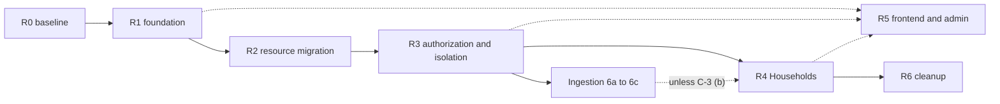

# Workspace Tenancy: implementation roadmap

| Field | Value |
|---|---|
| Purpose | The single place to track the move from owner-based data (`owner_id`) with a legacy household overlay to workspace tenancy (`workspace_id`), task by task, with evidence |
| Decisions live in | [ADR-001](ADR-001-workspace-tenancy-and-bank-ingestion.md). This roadmap does not restate rationale. When it names a decision (TEN, Q6, D-14, U10...) the ADR's section 24 is authoritative |
| New ADR needed? | **No.** ADR-001 already records the model, roles, ownership authority, request context, isolation without RLS, migration and phases. The conflicts in section 3 are amendments to ADR-001's decision register, not a new ADR |
| Code inspected | fern-funds `master` at `ca282f76`, and `c6447fc5` for the U49 correction, 2026-11-16 |
| Production inspected | Read-only, 2026-11-16 |
| Status of ADR-001 | **Proposed** |

## 1. How to use this document

**Statuses.** Every task carries exactly one:

| Status | Meaning |
|---|---|
| NOT_STARTED | No code merged |
| IN_PROGRESS | A branch or PR exists |
| BLOCKED | Cannot start: a named decision or task is missing |
| IMPLEMENTED | Merged to `master` |
| VERIFIED | Merged, its acceptance criteria hold, and its tests passed in CI. For data changes, also checked on production |

**Updating after every PR:**
1. Change the status of each task the PR touched.
2. Add the PR and commit to that task's **Evidence** column.
3. Append a line to the change log (section 9). Never delete an earlier line or overwrite earlier evidence; a regression is a new line.
4. Recompute the progress table (section 4).

**Rules carried over from ADR-001 section 25.0:**
- One PR in CI at a time.
- Every PR that touches tenant data adds cross-tenant tests in the same PR. There is no database backstop (NO-RLS).
- Per-user data fixes are hand-run SQL scripts, never Flyway migrations.
- Frontend filtering is never tenant isolation. The backend decides what a request may see.

## 2. Target model

The full model is in ADR-001 sections 7 to 9, 13 to 15 and 17; this is a summary.

| Topic | Decision | ADR |
|---|---|---|
| Tenant | A workspace is the tenant. Types are PERSONAL and HOUSEHOLD | TEN, D-1 |
| PERSONAL | Every user has exactly one, created at registration, with that user as its only member | D-2 |
| HOUSEHOLD | A separate, shared workspace. A user belongs to at most one | D-3 |
| Resource ownership | Every financial row has exactly one `workspace_id NOT NULL`. `created_by` is audit only and never authorizes | D-6, Q4, Q6 |
| Ownership authority | The ACTIVE membership with role OWNER. There is no owner column on `workspace`. Exactly one ACTIVE OWNER per workspace, enforced by the database | D-5 |
| Roles | OWNER and MEMBER. VIEWER: see conflict C-2 | D-4, U10 |
| Permissions | Come from membership and role, never from authorship | Q6 |
| Resource-level grants | ADR-001 confirms COLLABORATOR grants. The Product Owner now says none for now: see conflict C-1 | COLLABORATOR, D-20 |
| Request context | Every request runs in an explicit, validated workspace. Tokens and MCP grants carry a workspace scope. `User.activeContext` becomes a UI preference only | D-14 |
| Isolation | In Spring Boot only. No RLS. The database keeps foreign keys, unique keys and `NOT NULL` | NO-RLS, D-15 |
| Subscriptions | Stay on the user. A Household's entitlements come from its OWNER's plan. PRO is needed to create and administer a Household; members need no plan | Q8, D-13 |
| Akahu credentials | Belong to the user (each person's own Akahu app), erased locally on account deletion, never revoked remotely. Future managed providers define their own lifecycle and are not coupled to workspace ownership | ADR 28.8, D-8 |
| Architecture | Spring modular monolith, Spring Modulith strict, no microservices | D-24 to D-28 |

## 3. Decision conflicts that need approval

These came up when the roadmap brief was compared with ADR-001 and the code. None is silently resolved here. Each has a recommendation and names what it blocks.

| ID | Conflict | Recommendation | Blocks |
|---|---|---|---|
| **C-1** | The brief says "no resource-level grants or per-account sharing permissions for now". ADR-001 records COLLABORATOR (READ_ONLY or READ_WRITE grants on PERSONAL resources inside a Household) as a **confirmed** product decision, with ADR Phase 7b and open questions CU1 to CU6 | Amend ADR-001: COLLABORATOR is **deferred**, not cancelled. Phase 7b leaves the plan. The legacy household's `READ` share of accounts and loans is not carried over. The schema reserves nothing for it | Scope of R4. The ADR register must be amended before R4 starts |
| **C-2** | The brief lists OWNER, MEMBER and VIEWER as supported roles. ADR-001 leaves VIEWER undecided (U10), recommending option (a): in the schema, but not shipped in the UI | Accept VIEWER as a supported role: read-only on every resource of the workspace, refused on every write, never OWNER. Decide whether it ships in the R5 UI or stays API only | R1 (role enum), R3 (permission matrix), R5 (UI) |
| **C-3** | The brief's phases do not mention bank ingestion. ADR-001 makes Households (Phase 7a) depend on the provider-neutral ingestion model (6a to 6c), so a joint account connected by two partners is not duplicated. The Product Owner has said not to start 6b or 6c | Choose one: **(a)** keep the ADR order (R4 waits for the ingestion track); or **(b)** ship Households first, where a bank account fed from one member's own Akahu connection lands in that member's PERSONAL workspace only, and joint-account linking comes later. Recommended: **(b)**, with D-3 and U4 unchanged and an explicit product limitation. It needs the amendment written into ADR-001 | R4 |
| **C-4** | The brief says "migrate existing household sharing behaviour; preserve existing household data and access semantics where intended". ADR-001 Q3 and U11 say no Household is migrated and new Households start from scratch. Production holds one legacy `household` with one REVOKED membership and no shares (U47) | Keep Q3: nothing is migrated. The legacy feature stays closed behind PRO until R6 removes it. "Preserve semantics" applies only to the rules worth keeping: one Household per user, PRO to create, the 6-person cap, and invitation codes | R4, R6 |
| **C-5** | ADR-001 is Proposed. Its Phase 1 (acceptance) gates Phase 3 onwards | Accept ADR-001 with C-1 to C-4 recorded, or explicitly authorize R1 under the Proposed status (R1 is additive and invisible) | R1 start |
| **C-6** | Many of the ADR's pending items (24.3) gate later phases | Not a conflict; listed per phase in section 6 so they are decided before the phase that needs them | Various |

## 4. Progress

| Phase | Equivalent ADR-001 phase | Tasks | VERIFIED | IMPLEMENTED | IN_PROGRESS | BLOCKED | NOT_STARTED |
|---|---|---|---|---|---|---|---|
| R0 Preparation and baseline | 0a, 0b, 0c, 2 + inventory | 15 | 8 | 0 | 0 | 1 | 6 |
| R1 Workspace foundation | 3 | 15 | 0 | 0 | 12 | 1 | 2 |
| R2 Financial resource migration | 4 | 11 | 1 | 0 | 0 | 0 | 10 |
| R3 Authorization and isolation | 5 (+ context of 3) | 14 | 0 | 0 | 0 | 0 | 14 |
| R4 Households | 7a | 13 | 0 | 0 | 0 | 2 | 11 |
| R5 Frontend and admin | spread over 3, 5, 7a | 10 | 0 | 0 | 0 | 0 | 10 |
| R6 Cleanup and hardening | 8 | 10 | 0 | 0 | 0 | 0 | 10 |
| Ingestion track (dependency) | 6a, 6b, 6c | 3 | 0 | 0 | 0 | 2 | 1 |
| **Total** | | **91** | **9** | **0** | **12** | **6** | **64** |

**Overall: about 10% of tasks verified (9 of 91): the prerequisite work (deletion integrity, billing safety, legacy closure, module structure), the R0-8 table inventory, and R2-1, the classification decisions it settled. No workspace code exists yet.**

Before 2026-11-17: about 8% of tasks verified, all of it prerequisite work (deletion integrity, billing safety, legacy closure, module structure). No workspace code exists yet.

## 5. Current state (verified 2026-11-16 against the code)

This is what the code does today, not what ADR-001 intends.

| Area | Current implementation | Evidence |
|---|---|---|
| Tenancy key | `owner_id` (= the authenticated user) on **65 entities and 69 tables** (R0-8), financial and identity alike. **45 repositories** have about 100 owner-keyed methods. There are about 89 `requireOwned`/`currentOwnerId()` call sites and 33 classes that use `JdbcTemplate` or native SQL | `grep "private Long ownerId"`; repository and call-site counts |
| Workspace | **Nothing.** No `workspace` table, entity or reference anywhere in code or migrations | `grep -ri workspace` returns nothing |
| Owner stamping | Trigger stamps `owner_id` from the `app.owner_id` session variable when an insert leaves it null (V34, V35). `OwnerSessionDataSource` and `OwnerSessionTransactionManager` still publish `app.owner_id` and `app.active_context` | ADR F2, F3 |
| Active context | `security.ActiveContext` returns MINE or HOUSEHOLD from the persisted `User.activeContext`, for every request **including API tokens, MCP and scheduled jobs**. 19 production classes depend on it: `DefaultAuthorizationService`, the transaction, category, loan, budget, cashflow and net-worth services, and the session plumbing | `grep ActiveContext` |
| Authorization | `websecurity.DefaultAuthorizationService`: `requireOwned` plus `canAccess*` per resource type. In HOUSEHOLD context it widens only to resources explicitly shared (fixed in PR #716) | ADR H5 |
| Legacy household | `ledger/household`: `household(owner_id)`, `household_membership` (status, join code), `household_resource_share` (ACCOUNT or LOAN, READ only). One household per user; only the owner shares; PRO minimum and 5 invited or active memberships (V175 to V177) | ADR H1 to H8; PRs #795 to #797 |
| Legacy household in production | 8 users, 1 `household`, 1 membership (REVOKED), 0 shares | Read-only query, 2026-11-16 |
| Subscriptions | `subscription.owner_id` unique per user. `FeatureAccessService` resolves caps per plan (`free_cap`, `plus_cap`, `pro_cap`). The household feature is gated on the owner's plan | V93, V176 |
| Akahu | `user_akahu_connection(user_id, app_token, encrypted_user_token)`, one per user; `akahu_account.owner_id`. Accounts are upserted by `(owner_id, 'AKAHU', akahu id)`. Erased locally on deletion; no remote call | ADR A1, A2, 28.8 |
| Tokens and MCP | `api_token.owner_id` and `oauth_grant.owner_id`. No workspace scope | Entities |
| Frontend | Never sends owner ids. 41 files reference household or the active context. No `X-Fofi-Workspace` header exists | `frontend/src` search |
| Admin console | Plans page edits `free_cap`/`plus_cap`/`pro_cap`. The admin backend reads identity and counts only (`AdminTierBoundaryTest`) | `admin/src/app/plans/page.tsx` |
| Modules | Spring Modulith strict (`ModularityTest`). Ledger is one module (D-40) | Epic #775 |
| Deletion | Fence, ordered `OwnedDataEraser` steps, outbox for Stripe cleanup. Household owner deletion erases the household rows | Phases 0a and 0b |
| Tests relevant to tenancy | `OwnerScopingBoundaryTest`, `UnscopedFindAllBoundaryTest`, `AuthorizationBoundaryTest`, `AuthorizationParityTest`, `HouseholdUnsharedResourceAccessTest`, `HouseholdServiceIntegrationTest`, `HouseholdFilteredAggregatesTest`, `HouseholdRequiresProTest`. No `@Disabled` test exists. Full suite: 4,500 tests, 0 failures | `mvn verify`, 2026-11-16 |

## 6. Phases

Order: R0 → R1 → R2 → R3 → R4 → R6. R5 runs alongside, attached to the phase whose backend it uses. The ingestion track gates R4 unless C-3 (b) is approved.

---

### R0: Preparation and baseline

- **Objective:** a known, tested starting point, and the inventories every later phase works from.
- **Scope:** prerequisite safety work (already done), plus the inventories, baseline tests and migration safety net still missing. No behaviour change.
- **Dependencies:** none.
- **Modules and tables:** all of them (read-only inventory).
- **Security:** characterization tests pin today's isolation so later phases cannot weaken it unnoticed.
- **Migration and rollback:** none in this phase. The rollback strategy for later phases is written here.

| # | Task | Status | Evidence |
|---|---|---|---|
| R0-1 | - [x] Deletion integrity (ADR 0a): every user deletable, no leftovers | VERIFIED | fern-funds #791, #792, #794 → `716f0efe`; V174 on production |
| R0-2 | - [x] Billing safety on deletion (ADR 0b): fence, outbox, Stripe neutralization (AS-8 gate OFF) | VERIFIED | #798 → `ca282f76`; V178 and V179 on production (ADR 28.7) |
| R0-3 | - [x] Akahu credentials erased locally only, no remote revocation | VERIFIED | fern-funds #799 → `c6447fc5`, CI green, deployed 2026-11-16 10:09 UTC; `AkahuCredentialErasureTest`; ADR 28.8 |
| R0-4 | - [x] Legacy household closed to non-PRO; H5 by-id leak fixed | VERIFIED | #716; #795 → `0e021687`; V175 |
| R0-5 | - [x] Household cap of 6 people total via `pro_cap` | VERIFIED | #796, #797; V176, V177 |
| R0-6 | - [x] Module structure, Spring Modulith strict | VERIFIED | Epic #775 (#776 to #789), `ModularityTest` |
| R0-7 | - [x] Ownership boundary tests in CI (`OwnerScopingBoundaryTest`, `UnscopedFindAllBoundaryTest`, `AuthorizationBoundaryTest`, `AuthorizationParityTest`) | VERIFIED | Present and green on `master` |
| R0-8 | - [x] **Table inventory**: every table classified WORKSPACE, USER or REFERENCE (plus LEGACY, RETIRED and AMBIGUOUS dispositions), with module, ownership, FKs, sensitivity, code references and risks | VERIFIED (2026-11-17) | [R0-8 inventory](WORKSPACE-TENANCY-R0-8-TABLE-INVENTORY.md): 98 tables from V1 to V179 applied to PostgreSQL 16. Submitted at `e17a4ed` (47 WORKSPACE, 24 USER, 15 REFERENCE, 12 AMBIGUOUS). Product Owner review 2026-11-17: Q-1 to Q-9 decided (inventory 6.1, ADR 28.9), four clarifications answered (inventory 9). Now **54 WORKSPACE (47 need their own `workspace_id`), 29 USER, 15 REFERENCE, 0 AMBIGUOUS**. Earlier status: IMPLEMENTED (awaiting Product Owner review; VERIFIED once Q-1 to Q-9 are answered) |
| R0-9 | - [ ] **Access-path inventory**: every repository method, native query, `JdbcTemplate` call, FQL query table and MCP tool that filters by owner, mapped to its future workspace filter | NOT_STARTED | |
| R0-10 | - [ ] **Active-context inventory**: the 19 `ActiveContext` consumers and what HOUSEHOLD widening each one does | NOT_STARTED | |
| R0-11 | - [ ] **Resolve ADR decisions C-1 to C-5** (section 3) and record them in ADR-001 section 24 | NOT_STARTED | |
| R0-12 | - [ ] **Isolation characterization test generated from the route list**: every `/api/**` route and MCP tool called by user B against user A's ids returns 404 or 403. It becomes the cross-workspace suite in R3 | NOT_STARTED | |
| R0-13 | - [ ] **Production size check (AS-5)**, read-only: row counts per tenant table, to size the R2 backfills. Added by the R0-8 review: null `owner_id` rows in `import_history` and `csv_import_file_snapshot` (Q-8); `event_transactions` rows whose event and transaction have different owners (inventory 9.2); row counts of the four retired ledger tables (Q-6) | NOT_STARTED | |
| R0-14 | - [ ] **Rollback strategy written**: additive migrations only until R6; each phase's rollback is a revert plus a down script tested on a production copy; full backup before every data migration (backups to PC are already daily) | NOT_STARTED | |
| R0-15 | - [ ] **Retired ledger cleanup (Q-6)**: a written data-retention assessment against the R0-13 counts, then one dedicated change that drops `journal_entry`, `ledger_node`, `ledger_node_mapping` and `posting` with their triggers, and removes `RetiredLedgerEraser`, its erasure step and the test entries (inventory 9.4). Not part of R2; the tables are not migrated | BLOCKED | Needs the R0-13 counts and the retention assessment. Not authorized to touch production or drop anything yet (ADR 28.9) |

- **Acceptance criteria:** R0-8 to R0-10 are committed and reviewed. R0-12 is green on `master`. C-1 to C-5 are decided. R0-15 is done before R2 starts, or explicitly deferred: the retired tables are excluded from R2 either way.
- **Required tests:** R0-12.
- **Definition of Done:** every R0 task VERIFIED. ADR-001 is Accepted, or R1 is explicitly authorized (C-5).

---

### R1: Workspace foundation

- **Objective:** workspaces and memberships exist, every user has exactly one PERSONAL workspace, and every request and job can carry a validated workspace. No visible behaviour change.
- **Scope:** ADR Phase 3. Lifecycle use cases for Households exist at service level but are not reachable.
- **Dependencies:** R0 (R0-11 for the roles).
- **Modules and tables:**
  - New tables `workspace` (id, type, name, base_currency, created_at, status) and `workspace_membership` (workspace_id, user_id, role, status, timestamps), plus `workspace_audit_event` (ADR 17).
  - New code in the `user` module, or a new `workspace` module (decision in R1-1). `subscription` provides the PRO check behind an SPI.
- **Security:**
  - The membership check is the only gate.
  - A workspace id from the client is never trusted without a membership lookup.
  - Unknown or non-member workspace: 404, so existence does not leak.
- **Migration and rollback:** additive. Backfill one PERSONAL workspace and one OWNER membership per existing user. Rollback drops the new tables and columns.

| # | Task | Status | Evidence |
|---|---|---|---|
| R1-1 | - [ ] Decide the module home: inside `user` or a new `workspace` module with `allowedDependencies`. Recommended: new `workspace` module, depended on by `user` for creation at registration | IN_PROGRESS | fern-funds #801 (`740e7e18`, open, not merged): new `workspace` Spring Modulith module, `allowedDependencies = {security, user}`; `user` publishes events and knows nothing of workspaces; `ModularityTest` green |
| R1-2 | - [ ] Flyway: `workspace` with `type IN ('PERSONAL','HOUSEHOLD')` and `base_currency` | IN_PROGRESS | fern-funds #801 (`740e7e18`, open, not merged): V180 `workspace` with type CHECK, `base_currency`, `UNIQUE (id, type)`, immutable type trigger |
| R1-3 | - [ ] Flyway: `workspace_membership` with `role IN ('OWNER','MEMBER','VIEWER')` (VIEWER per C-2), `status IN ('INVITED','ACTIVE','LEFT','REMOVED')`, and unique `(workspace_id, user_id)` | IN_PROGRESS | fern-funds #801 (`740e7e18`, open, not merged): V180 `workspace_membership`, roles OWNER, MEMBER, VIEWER; statuses per ADR 9.2 (INVITED, ACTIVE, DECLINED, REVOKED, LEFT); `UNIQUE (workspace_id, user_id)`; composite FK to `(id, type)`; `user_id` RESTRICT |
| R1-4 | - [ ] Constraint: exactly one ACTIVE OWNER per workspace (partial unique index plus a deferred check, or a service-level lock plus an integrity test; ADR D-5) | IN_PROGRESS | fern-funds #801 (`740e7e18`, open, not merged): partial unique index (at most one) plus deferred constraint trigger (exactly one at commit); `WorkspaceSchemaConstraintsTest` |
| R1-5 | - [ ] Constraint: at most one PERSONAL workspace per user and at most one ACTIVE HOUSEHOLD membership per user (partial unique indexes, D-2 and D-3) | IN_PROGRESS | fern-funds #801 (`740e7e18`, open, not merged): partial unique indexes for one PERSONAL per user, one member per PERSONAL, at most one HOUSEHOLD membership per user in INVITED or ACTIVE (U29, V183; DECLINED, REVOKED and LEFT free the slot; invitation expiry of 14 days comes with the invitation lifecycle); `WorkspaceSchemaConstraintsTest` |
| R1-6 | - [ ] JPA entities `Workspace`, `WorkspaceMembership`, and repositories with workspace-scoped finders only | IN_PROGRESS | fern-funds #801 (`740e7e18`, open, not merged): `Workspace`, `WorkspaceMembership`, repositories with membership- or person-scoped finders only; `WorkspaceRepositoryTest` |
| R1-7 | - [ ] PERSONAL workspace created in the same transaction as registration (local, OAuth, admin-created). Invariant test: no user without exactly one | IN_PROGRESS | fern-funds #801 (`740e7e18`, open, not merged): `UserCreated` from local sign-up, first OAuth sign-in and bootstrap admin, handled in the same transaction; `UserCreationPersonalWorkspaceTest`, `UserCreationPathsTest` |
| R1-8 | - [ ] Backfill migration: one PERSONAL workspace and OWNER membership per existing user; `base_currency` copied from `users` (D-39). Generic SQL, no ids | IN_PROGRESS | fern-funds #801 (`740e7e18`, open, not merged): V181 generic, idempotent backfill; V182 adds `budget_totals_per_period` and `merchant_auto_categorize_enabled` (same type, nullability and defaults as `users`) and sets all three Q-7 settings from the owner; provisioned on creation and kept in sync through `UserMoneySettingsChanged` in the settings transaction; `PersonalWorkspaceBackfillTest`, `UserCreationPersonalWorkspaceTest`. Production count after deploy still to do |
| R1-9 | - [ ] `CurrentWorkspace` resolver: workspace id from the `X-Fofi-Workspace` header, validated against an ACTIVE membership, cached per request. Not yet used for authorization | IN_PROGRESS | fern-funds #802 (`ad69bc45`, open, not merged): `CurrentWorkspace` in the `workspace` module; MVC interceptor on `/api/**` after authentication; header must be one positive id (400) with an ACTIVE membership (404 otherwise, same for unknown, foreign, INVITED, DECLINED, REVOKED, LEFT); no header means the PERSONAL workspace, looked up on first use; kept as a request attribute and removed on completion; `/api/auth/**` and `/api/me/workspaces` not intercepted; `WorkspaceRequestResolutionTest`, `WorkspaceSelectionUnitTest` |
| R1-10 | - [ ] `GET /api/me/workspaces`: the caller's workspaces with type, role and name | IN_PROGRESS | fern-funds #802 (`ad69bc45`, open, not merged): ACTIVE memberships only, `{id, type, name, role}`, PERSONAL first; `WorkspaceRequestResolutionTest` |
| R1-11 | - [ ] `workspace_id` on `api_token` and `oauth_grant`, backfilled to the PERSONAL workspace; new tokens require one (D-14) | NOT_STARTED | |
| R1-12 | - [ ] Scheduled jobs run per explicit workspace (`WorkspaceTask`), not from a stored user context | NOT_STARTED | |
| R1-13 | - [ ] Lifecycle services (create Household, invite, accept, leave, remove, transfer, dissolve) with the workspace-row lock of D-37, not exposed by any controller | BLOCKED | Needs C-1, C-2 and the R4 decisions on transfer and dissolution |
| R1-14 | - [ ] Account deletion erases the user's workspaces and memberships: a `WorkspaceDataEraser` step; an OWNER deletion dissolves their Household (Q1) | IN_PROGRESS | fern-funds #801 (`740e7e18`, open, not merged), partial: `WorkspaceEraser` at the last `ErasureStep.WORKSPACES` (owned workspaces with their memberships, then other memberships); `WorkspaceEraserTest`, `AccountDeletionSchemaTest`, `AccountDeletionCoverageTest` |
| R1-15 | - [ ] Tests: lifecycle invariants, the backfill (each existing user gets exactly one PERSONAL workspace), registration paths, header validation, token scoping, deletion | IN_PROGRESS | fern-funds #801 (`740e7e18`, open, not merged), partial: lifecycle invariants (constraints), backfill, registration paths and deletion covered; header validation covered by fern-funds #802 (`ad69bc45`, open); token scoping waits for R1-11 |

- **Acceptance criteria:**
  - Every user, existing and new, has exactly one PERSONAL workspace with themselves as the ACTIVE OWNER.
  - The constraints reject a second OWNER, a second PERSONAL workspace and a second Household membership.
  - A request with a workspace the caller is not a member of is refused.
  - No existing endpoint changes behaviour.
- **Required tests:** R1-15; the full suite unchanged; `ModularityTest` with the new module.
- **Definition of Done:** R1-1 to R1-12, R1-14 and R1-15 VERIFIED; the R1-8 backfill confirmed on production by a read-only count.

---

### R2: Financial resource migration

- **Objective:** every workspace-owned row carries `workspace_id NOT NULL`, with database integrity, while `owner_id` keeps working.
- **Scope:** ADR Phase 4. Schema and backfill only; reads and writes switch in R3.
- **Dependencies:** R1; the R0-8 inventory (VERIFIED); AS-5 and the Q-8 counts (R0-13); TD-8; ADR 28.9 open items OI-1 (blob ownership) and OI-2 (coach context lifecycle) before the storage, receipt and coach PRs.
- **Modules and tables:** every table classified WORKSPACE in R0-8 (54, of which 47 get their own `workspace_id`, 3 inherit through a single parent under Q-9, and 4 retired ledger tables are not migrated under Q-6). By module: ledger (account, transaction, category, sub_category, merchant, loan, recurring, attachments, associations, import history), budget, goal, asset, investment, balance, event (including `event_transactions` with its own integrity column), forecast labels, dashboard, saved_query, receipt (including the learned rules of Q-2), grocery list (Q-4), csvimport profiles (Q-1). **USER-scoped and staying on `owner_id`:** subscription, beta_access, stripe_customer, api_token, oauth_grant, feedback, notification preferences, ai_credit_use, user_akahu_connection, coach conversations (Q-3, with a workspace context column), Chef recipes and messages (Q-4). Settings moving from `users` to `workspace` (Q-7) are R1 work.
- **Modules and tables as written before the R0-8 review:** every table classified WORKSPACE in R0-8. Expected: ledger (account, transaction, category, sub_category, merchant, loan, recurring, attachments, associations, import history), budget, goal, asset, investment, balance, event, forecast labels, dashboard, saved_query, receipt, grocery, csvimport profiles. **USER-scoped and staying on `owner_id`:** subscription, beta_access, stripe_customer, api_token, oauth_grant, feedback, notification preferences, ai_credit_use, user_akahu_connection.
- **Security:** no read path changes yet. The application sets `workspace_id` on every insert; no trigger is added.
- **Migration and rollback:**
  - Batched Flyway backfill from `owner_id` to the owner's PERSONAL workspace.
  - `NOT NULL` is added only after a validation query returns zero nulls.
  - Rollback drops the columns and constraints; `owner_id` is still intact.

| # | Task | Status | Evidence |
|---|---|---|---|
| R2-1 | - [x] Confirm the WORKSPACE and USER classification from R0-8, per table, with the Product Owner for the borderline ones (coach conversations U28, dashboards and saved queries U27, grocery, receipts) | VERIFIED (2026-11-17, decisions only; no R2 code) | Product Owner decisions Q-1 to Q-9, ADR 28.9; [R0-8 inventory](WORKSPACE-TENANCY-R0-8-TABLE-INVENTORY.md) 6.1 |
| R2-2 | - [ ] Add nullable `workspace_id` and `created_by` columns, one module per PR, leaves first | NOT_STARTED | |
| R2-3 | - [ ] Every insert path sets `workspace_id` from `CurrentWorkspace` (PERSONAL until R3) | NOT_STARTED | |
| R2-4 | - [ ] Batched backfill `workspace_id` = owner's PERSONAL workspace, per module | NOT_STARTED | |
| R2-5 | - [ ] Validation query and test: zero nulls; every row's workspace belongs to its `owner_id`; counts match | NOT_STARTED | |
| R2-6 | - [ ] `NOT NULL` after R2-5 passes on production | NOT_STARTED | |
| R2-7 | - [ ] Composite foreign keys `(parent_id, workspace_id)` so a child cannot point to another workspace's parent (ADR 15.3) Includes `event_transactions`: own `workspace_id` and a composite FK to both `events` and `transaction` over that column (inventory 9.2), after a read-only count of cross-owner links | NOT_STARTED | |
| R2-8 | - [ ] Rescope unique keys from `(owner_id, ...)` to `(workspace_id, ...)` (for example account `source/source_ref`, transaction `fit_id`) without dropping the old ones yet | NOT_STARTED | |
| R2-9 | - [ ] Indexes on `workspace_id` matching today's owner indexes | NOT_STARTED | |
| R2-10 | - [ ] Deletion and erasers also delete by `workspace_id`; coverage test extended | NOT_STARTED | |
| R2-11 | - [ ] Data-integrity test in CI against a seeded database (the R2-5 script), plus a schema test that every WORKSPACE table without its own `workspace_id` has exactly one tenant reference: its `NOT NULL`, primary-key, `ON DELETE CASCADE` parent FK (Q-9, inventory 9.3) | NOT_STARTED | |

- **Acceptance criteria:**
  - Zero null `workspace_id` on production in every WORKSPACE table.
  - Every composite foreign key and unique key is valid.
  - No behaviour change.
- **Required tests:** R2-5 and R2-11; the deletion coverage and schema tests; the full suite.
- **Definition of Done:** every R2 task VERIFIED, with production counts recorded here.

---

### R3: Workspace authorization and isolation

- **Objective:** every read and write is decided by workspace and role. `owner_id` and `User.activeContext` stop being authorization inputs.
- **Scope:** ADR Phase 5, plus the enforcement half of D-14. Consolidated reads (Q5) are included.
- **Dependencies:** R2; ADR U5, U24 and U35; C-2. (U27, U28 and U31 were decided on 2026-11-17, ADR 28.9.)
- **Modules and tables:** every module with WORKSPACE tables, `websecurity`, `security`, `mcp`, `queryexplorer`, frontend API client.
- **Security:**
  - The decisive phase.
  - Every controller method declares its scope (D-36): `@WorkspaceScoped`, `@UserScoped` or `@AdminScoped`.
  - Bulk operations verify every id.
  - Native SQL and FQL take the workspace.
  - ArchUnit bans owner finders in production code.
  - IDOR across workspaces answers 404.
- **Migration and rollback:** one module per PR, with a revert per PR. `owner_id` is still populated until R6.

| # | Task | Status | Evidence |
|---|---|---|---|
| R3-1 | - [ ] Permission matrix per role (OWNER, MEMBER, VIEWER) and per action, from Q6 and U5, committed as a table here and enforced in one place | NOT_STARTED | |
| R3-2 | - [ ] `WorkspaceAuthorization` service: `requireMember`, `requireRole`, `requireResourceInWorkspace`; replaces `requireOwned` and `canAccess*` | NOT_STARTED | |
| R3-3 | - [ ] Scope annotations on every controller method, plus a test that fails on an undeclared method | NOT_STARTED | |
| R3-4 | - [ ] Frontend sends `X-Fofi-Workspace` on every call (AS-10); a missing header on a workspace-scoped route is 400 | NOT_STARTED | |
| R3-5 | - [ ] Migrate modules to workspace filters, one PR each, leaves first: support, insights, documents, planning, wealth, ledger last | NOT_STARTED | |
| R3-6 | - [ ] FQL query tables and every `JdbcTemplate` or native query take the workspace | NOT_STARTED | |
| R3-7 | - [ ] MCP tools run in the token's workspace; unscoped tokens fail closed | NOT_STARTED | |
| R3-8 | - [ ] Replace the MINE/HOUSEHOLD widening: `ActiveContext` no longer authorizes; `User.activeContext` is kept only as a UI default workspace | NOT_STARTED | |
| R3-9 | - [ ] Stop publishing `app.active_context`, and stop relying on `app.owner_id` for anything but the legacy stamping trigger | NOT_STARTED | |
| R3-10 | - [ ] Consolidated reads: PERSONAL, HOUSEHOLD (100%) and CONSOLIDATED over the caller's ACTIVE workspaces, read-only (Q5, D-7) | NOT_STARTED | |
| R3-11 | - [ ] ArchUnit: no `findByOwnerId` or owner predicate in production code for WORKSPACE tables | NOT_STARTED | |
| R3-12 | - [ ] Cross-workspace suite (grown from R0-12): every route and MCP tool, two users and two workspaces, by-id and bulk; negative tests for VIEWER writes | NOT_STARTED | |
| R3-13 | - [ ] Role tests: OWNER, MEMBER and VIEWER against the R3-1 matrix | NOT_STARTED | |
| R3-14 | - [ ] Legacy household endpoints answer 404 once R3-8 lands, so the old widening cannot be reached | NOT_STARTED | |

- **Acceptance criteria:** ADR-001 criteria 1, 2, 3, 12 (without COLLABORATOR per C-1), 13 and 16 hold for every module except ingestion.
- **Required tests:** R3-3, R3-11, R3-12 and R3-13; consolidated read tests.
- **Definition of Done:** every R3 task VERIFIED. No production code authorizes by `owner_id` or `ActiveContext`.

---

### R4: Households

- **Objective:** a PRO user creates a Household, invites people, and members share its resources by role.
- **Scope:** ADR Phase 7a, without COLLABORATOR (C-1) and without migration of the legacy household (C-4).
- **Dependencies:** R3. The ingestion track or C-3 (b). ADR U3, U6, U9, U10, U16, U22, U23, U25 and U29 (U26 is decided: 6 people); TD-9.
- **Modules and tables:** the workspace module, `subscription`, the ledger (taxonomy seed per U25), insights, email, frontend Household screens.
- **Security:**
  - Only the OWNER manages membership and dissolves the Household.
  - The PRO check and the cap are enforced server side under the workspace-row lock.
  - Invitation tokens are single-use, expire, and are bound to the invitee's email.
- **Migration and rollback:** the feature-flag rollout (TD-9) stops new Households; existing ones keep working (ADR 18.4).

| # | Task | Status | Evidence |
|---|---|---|---|
| R4-1 | - [ ] Endpoints over the R1-13 lifecycle services: create, rename, invite, accept, decline, leave, remove, transfer, dissolve | BLOCKED | Needs C-1, C-3 and the U items above |
| R4-2 | - [ ] PRO required to create and administer (Q8); a refused create is 402. Same feature-config gate as today | NOT_STARTED | |
| R4-3 | - [ ] Cap of 6 people including the OWNER: `pro_cap` = 5 counts INVITED plus ACTIVE (reuse the logic of PRs #796 and #797) | NOT_STARTED | |
| R4-4 | - [ ] Invitations: expiry and refusal of an invitee already in a Household (U29); resend | NOT_STARTED | |
| R4-5 | - [ ] Leave and remove: access ends immediately; resources stay (Q4); the member's bank feeds into the Household stop (U9) | NOT_STARTED | |
| R4-6 | - [ ] Transfer ownership only to a MEMBER with active PRO (U2, U16) | NOT_STARTED | |
| R4-7 | - [ ] Dissolution and OWNER deletion erase the Household and all its data at once (Q1, U1, D-21) | NOT_STARTED | |
| R4-8 | - [ ] OWNER loses PRO: Household behaviour per U6 | BLOCKED | U6 |
| R4-9 | - [ ] Household base currency (U23) and starting taxonomy (U25) | NOT_STARTED | |
| R4-10 | - [ ] Member notifications per U3 (owner warned before deletion, members emailed afterwards) | NOT_STARTED | |
| R4-11 | - [ ] Feature flag (TD-9) through the existing feature configuration | NOT_STARTED | |
| R4-12 | - [ ] Tests: ADR 26 ownership lifecycle (transfer, concurrent transfer, dissolution with members, leave, remove, deletion of OWNER and of MEMBER), races of 9.6, cap race | NOT_STARTED | |
| R4-13 | - [ ] Cross-workspace suite rerun with two-member Households and a VIEWER | NOT_STARTED | |

- **Acceptance criteria:** ADR-001 criteria 4, 9 and 11 hold with Households. The legacy household path is unreachable.
- **Required tests:** R4-12 and R4-13.
- **Definition of Done:** every R4 task VERIFIED. Behind the flag in production, with one Household exercised end to end on a production copy.

---

### R5: Frontend and admin experience

- **Objective:** people can see and switch workspaces and manage a Household; administrators can see workspace state without seeing financial data.
- **Scope:** UI only, each item attached to the phase that provides its backend. Mobile first. Custom Select and DatePicker only. Figma kept in sync. What's New entries for features only. No dashes in copy.
- **Dependencies:** R1 (workspace list), R3 (header everywhere), R4 (Household screens).
- **Modules:** `frontend/`, `admin/`, the `admin` backend module (tier 1, D-38).
- **Security:** the UI never decides access. It reflects the backend's 403 and 404 answers.
- **Migration and rollback:** the UI follows the feature flag.

| # | Task | Status | Evidence |
|---|---|---|---|
| R5-1 | - [ ] API client sends `X-Fofi-Workspace` on every call, from a persisted current workspace (supports R3-4) | NOT_STARTED | |
| R5-2 | - [ ] Workspace switcher replacing today's MINE/HOUSEHOLD toggle (41 files reference household or the active context) | NOT_STARTED | |
| R5-3 | - [ ] PERSONAL, HOUSEHOLD and CONSOLIDATED figures where the backend offers them | NOT_STARTED | |
| R5-4 | - [ ] Household management: create, rename, members, roles, transfer, leave, dissolve, following the Transactions page layout rule | NOT_STARTED | |
| R5-5 | - [ ] Invitations: send, accept, decline, expired and already-in-a-Household states | NOT_STARTED | |
| R5-6 | - [ ] Role-aware UI: VIEWER sees no write controls; refused writes show a clear message | NOT_STARTED | |
| R5-7 | - [ ] Error and empty states: no Household, not PRO, cap reached, removed while viewing | NOT_STARTED | |
| R5-8 | - [ ] Account deletion copy for Household OWNERs (U3) | NOT_STARTED | |
| R5-9 | - [ ] Admin console: workspace and membership counts per user and Household state, with no financial data (tier 1, U33) | NOT_STARTED | |
| R5-10 | - [ ] Frontend tests (Vitest) for the switcher, header and Household screens; Figma updated | NOT_STARTED | |

- **Acceptance criteria:** every workspace action is reachable on mobile; there is no client-side filtering of another workspace's data; admin screens show no financial records.
- **Required tests:** R5-10; `AdminTierBoundaryTest` still green.
- **Definition of Done:** every R5 task VERIFIED and the Figma design system updated.

---

### R6: Cleanup and hardening

- **Objective:** one ownership model left.
- **Scope:** ADR Phase 8, after one stable release with R4 live.
- **Dependencies:** R4 and R5. COLLABORATOR is not required while C-1 defers it.
- **Modules and tables:** the legacy `household*` tables and code; `ActiveContext`; `owner_id` on WORKSPACE tables, with its stamping trigger and the `app.owner_id` plumbing; the old owner unique keys; `User.activeContext` as an authorization field.
- **Security:** a final isolation audit before the irreversible drop.
- **Migration and rollback:** **irreversible.** A full backup is taken immediately before, and the drop is rehearsed on a production copy.

| # | Task | Status | Evidence |
|---|---|---|---|
| R6-1 | - [ ] Decide the legacy production `household` row (U47) and remove the legacy household tables and code | NOT_STARTED | |
| R6-2 | - [ ] Remove `ActiveContext`, `SecurityContextActiveContext` and the `app.active_context` publication | NOT_STARTED | |
| R6-3 | - [ ] Drop the owner stamping trigger (V34, V35) and the `app.owner_id` session plumbing | NOT_STARTED | |
| R6-4 | - [ ] Drop `owner_id` and the old owner unique keys from WORKSPACE tables; USER tables keep theirs | NOT_STARTED | |
| R6-5 | - [ ] Remove transitional compatibility code (PERSONAL default when the header is missing, dual filters) | NOT_STARTED | |
| R6-6 | - [ ] Index and query-plan review on production-sized data | NOT_STARTED | |
| R6-7 | - [ ] Complete security review: cross-workspace suite, IDOR, MCP, FQL, exports, attachments | NOT_STARTED | |
| R6-8 | - [ ] Update `AGENTS.md`, `docs/ai/security.md` and `docs/ai/architecture.md` to the workspace model | NOT_STARTED | |
| R6-9 | - [ ] Operational runbook: workspace support cases, Household dissolution, restores (U30) | NOT_STARTED | |
| R6-10 | - [ ] Migration rehearsal and restore test on a production copy before the drop | NOT_STARTED | |

- **Acceptance criteria:** ADR-001 section 27 holds in full. No reference to `owner_id` remains for WORKSPACE data, and none to `ActiveContext` or the legacy household.
- **Required tests:** the full suite plus the cross-workspace suite; the rehearsal of R6-10.
- **Definition of Done:** every R6 task VERIFIED; ADR-001 marked implemented.

---

### Ingestion track (dependency of R4; ADR Phases 6a to 6c)

The Product Owner has not authorized 6b or 6c. Listed only to make the dependency visible.

| # | Task | Status | Evidence |
|---|---|---|---|
| ING-1 | - [ ] 6a: provider-neutral ingestion tables, leases and account locks (after R3 ledger) | NOT_STARTED | |
| ING-2 | - [ ] 6b: durable exclusion, reconciliation, review items | BLOCKED | Not authorized |
| ING-3 | - [ ] 6c: joint-account linking, SOURCE and STANDBY, failover | BLOCKED | Not authorized; affects R4 per C-3 |

## 7. Decisions still requiring approval

| Needed before | Items |
|---|---|
| R1 | C-1, C-2, C-5; R1-1 (module home) |
| R2 | ADR 28.9 open items OI-1 (blob ownership) and OI-2 (coach context lifecycle); the R0-13 counts, including the Q-8 nulls. (R2-1, U27 and U28 decided 2026-11-17) |
| R3 | U5, U24, U35; R3-1 permission matrix. (U31 decided 2026-11-17: Q-6) |
| R4 | C-3, C-4; U3 (decided in part), U6, U9, U10 (via C-2), U16, U22, U23, U25, U29; TD-9 |
| R6 | U47 |
| R0-15 (retired ledger cleanup) | The read-only R0-13 counts and a written retention assessment (Q-6 condition) |

## 8. First recommended task

**R0-11: decide C-1 to C-5.** R0-8, the table inventory, was VERIFIED on 2026-11-17. The read-only R0-13 counts are next for the data questions it raised (Q-6, Q-8, `event_transactions`).

As written before 2026-11-17: **R0-8: the table inventory**, followed by R0-11 (decide C-1 to C-5). Every later phase depends on knowing, per table, whether it becomes workspace-owned or stays user-owned, and R2 cannot be planned without it. It changes no behaviour.

The first **code** task is **R1-2 to R1-5 and R1-8 as one PR**:
- the `workspace` and `workspace_membership` tables with their constraints;
- the backfill that gives each existing user exactly one PERSONAL workspace and OWNER membership;
- an invariant test.

It is additive and invisible to users, and it can be rolled back by dropping two tables.

## 9. Change log

| Date | Change | Evidence |
|---|---|---|
| 2026-11-16 | Roadmap created from ADR-001 (Proposed) and an inspection of fern-funds `master` at `ca282f76`. R0-1, R0-2 and R0-4 to R0-7 marked VERIFIED, R0-3 IN_PROGRESS, from merged and deployed evidence. Conflicts C-1 to C-5 raised | This commit |
| 2026-11-16 | R0-3 VERIFIED: U49 correction merged and deployed | fern-funds #799, `c6447fc5` |
| 2026-11-16 | R0-8 IMPLEMENTED: table inventory committed for Product Owner review (questions Q-1 to Q-9). Roadmap count corrected: 69 tables carry `owner_id` (65 have entities) | R0-8 inventory, this commit |
| 2026-11-17 | R0-8 VERIFIED after Product Owner review of `e17a4ed`: Q-1 to Q-9 decided and recorded (inventory 6.1, ADR 28.9); clarifications answered (inventory 9). Classification is now 54 WORKSPACE (47 with their own `workspace_id`), 29 USER, 15 REFERENCE. R2-1 VERIFIED as decisions only. R0-13 extended with the Q-8, `event_transactions` and retired-ledger counts. R0-15 added (retired ledger cleanup, BLOCKED on R0-13 and a retention assessment). R2 and R3 dependencies updated; U27, U28 and U31 decided. No code, schema, migration or production change | ADR 28.9, R0-8 inventory, this commit |
| 2026-11-17 | R1-1 to R1-8 IN_PROGRESS, R1-14 and R1-15 IN_PROGRESS in part: workspace foundation in fern-funds #801 (`803b50c6`), not merged. `mvn verify` green (4,510 tests). Production not touched | fern-funds #801 |
| 2026-11-17 | Product Owner corrections on fern-funds #801, pushed as `07a55af5`: Q-7 settings on the workspace (V182) and U29, where a pending invitation holds the one Household slot (V183). `mvn verify` green (4,530 tests). Statuses unchanged: IN_PROGRESS until merge | fern-funds #801 |
| 2026-11-17 | Product Owner final correction on fern-funds #801, pushed as `740e7e18`: a missing PERSONAL workspace now fails and rolls back the whole settings change instead of logging, so the Q-7 copies cannot differ. `mvn verify` green (4,531 tests). Statuses unchanged: IN_PROGRESS until merge | fern-funds #801 |
| 2026-11-17 | R1-9 and R1-10 IN_PROGRESS on fern-funds #802 (`ad69bc45`), not merged; R1-15 evidence adds header validation. #801 merged as `096209c7`. |
